<!-- _class: cover -->
<!-- _paginate: "" -->
<!-- _footer: Presentacion preparada para TECSUP -->

# Costos en plantas minero metalúrgicas

###### Una mirada ejecutiva al negocio minero

Ing. Alí Meres 
Ingeniero de Minas UNI - CIP 
Business Analytics Technical Lead @ Astay Systems
Contacto adicional：[LinkedIn](https://www.linkedin.com/in/ali-ivan-meres-vargas/)- ameresv\@gmail.com

## Propósito del curso
<!-- _class: fixedTitle -->

Relacionar las decisiones de planta con el costo, la recuperación de metal y la rentabilidad de la operación.

- Construir indicadores con unidades y perímetros comparables.
- Explicar las variaciones de consumo, precio y desempeño.
- Sustentar decisiones con datos de procesamiento y estados financieros.

<!-- Conecte el objetivo con la práctica: el menor costo unitario no asegura el mayor margen si cambia la recuperación o la ley. -->

## Organización de cada sesión
<!-- _class: fixedTitle -->

| Tiempo | Actividad |
|---|---|
| Hasta 90 minutos | Teoría, conceptos y ejemplos |
| 30 minutos | Receso |
| 15 minutos | Ejemplo guiado en Excel |
| 35 minutos | Trabajo del equipo |
| 10 minutos | Discusión de resultados |

## Agenda a desarrollar
<!-- _class: agenda_col2 -->

- Proceso, EEFF , OPEX y CAPEX
- Centros de costos y costo unitario
- Chancado y molienda
- Flotación, polimetálicos y lixiviación
- Presupuesto y variaciones PVE
- Mantenimiento y árbol de valor
- Liquidación de concentrados y NSR
- Rentabilidad, equilibrio e indicadores

<!-- TODO: Adecuar al esquema de Agenda -->

## Sesión 01: Del proceso al negocio

<!-- _class: trans -->
<!-- _paginate: false -->
<!-- _footer: '' -->

## Sesión 01: Hoja de Ruta de la sesión
<!-- _class: fixedTitle -->

| Tiempo | Desarrollo |
|---|---|
| 00–30 min | Cadena de valor y decisiones OPEX/CAPEX |
| 30–60 min | Resultado, balance y liquidez |
| 60–90 min | Caja, inversiones y preparación del caso |

> Al finalizar: 30 minutos de receso y 60 minutos de caso.

<!-- TODO: Adecuar formato necesario -->

## ¿Qué decisiones veremos?
<!-- _class: fixedTitle -->

- Relacionar las etapas de la cadena con sus recursos y resultados.
- Diferenciar **OPEX**, **CAPEX**, depreciación y caja.
- Interpretar el estado de resultados y el balance.
- Reconocer qué información falta para evaluar una inversión.

<!-- TODO: Adecuar al esquema de Agenda -->

## Análisis de la cadena de valor en la minería

<!-- _class: cols-2 -->

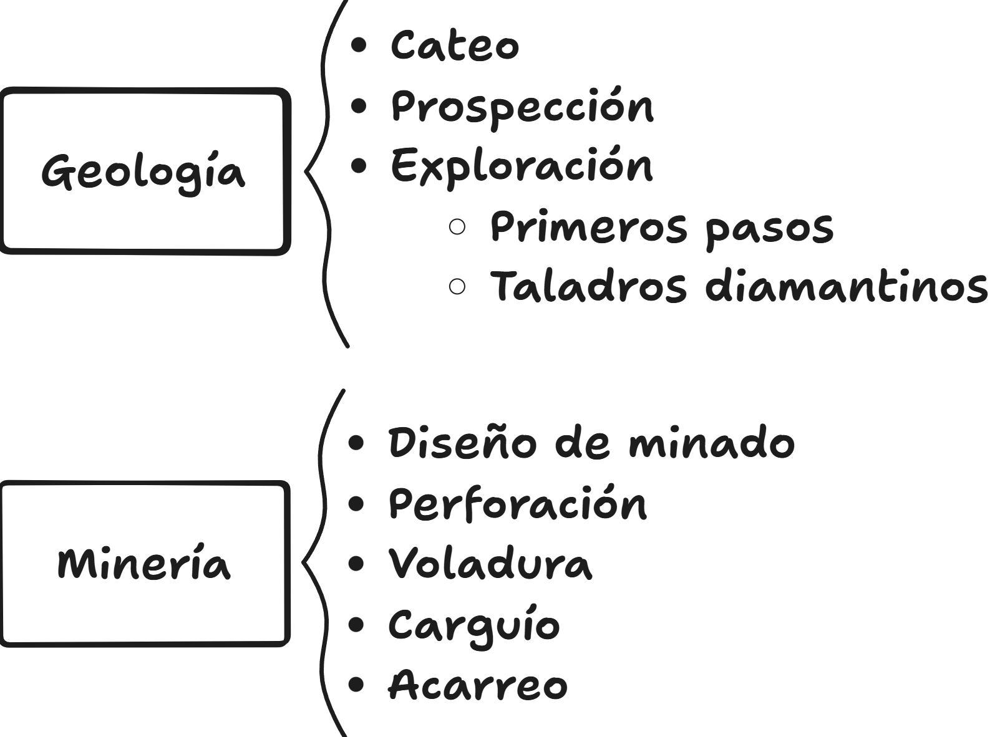

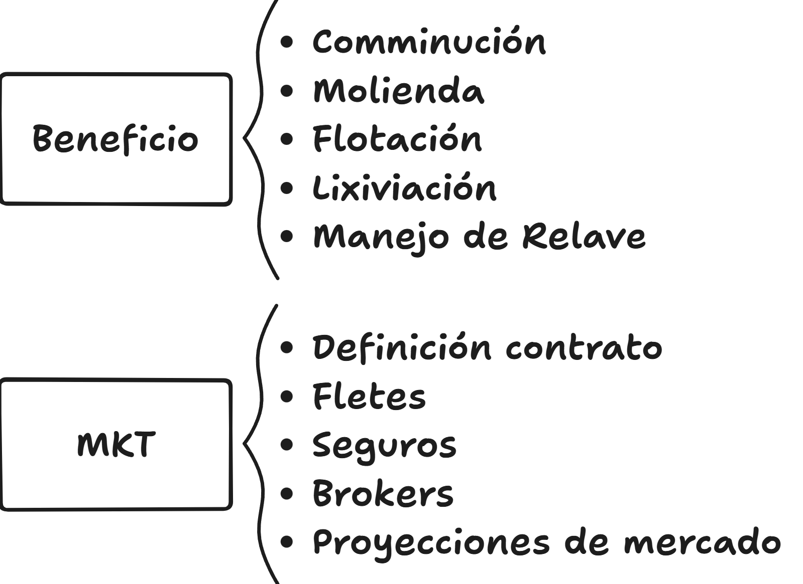

## Cadena de valor de una planta de cobre
<!-- _class: fixedTitle -->

| Etapa | Resultado físico | Recursos principales |
|---|---|---|
| Mina y transporte | Mineral entregado | Equipos, combustible, personal |
| Chancado y molienda | Mineral con tamaño apto | Energía, bolas, revestimientos |
| Flotación o lixiviación | Concentrado o solución rica | Reactivos, agua, equipos |
| Producto y venta | Metal vendible o pagable | Filtrado, transporte, cargos |

<!-- Diferencie mineral, concentrado y metal. La ruta LESDE termina en cátodos; la ruta de sulfuros suele vender concentrados. -->

## La cadena conecta toneladas y dinero
<!-- _class: fixedTitle -->

| Etapa | Dato para control | Pregunta económica |
|---|---|---|
| Molienda | t tratadas y kWh/t | ¿Cuánto cuesta preparar el mineral? |
| Flotación | ley y recuperación | ¿Cuánto metal pasa al concentrado? |
| Venta | metal pagable y cargos | ¿Cuánto valor se reconoce? |

> Un cambio en una etapa puede afectar a las siguientes.

<!-- Siga el recorrido de una tonelada desde la tolva hasta el producto. En molienda pregunte qué mediciones registrarían por turno: toneladas, consumo eléctrico y tamaño de producto. En flotación añada ley y recuperación; en venta, cantidad pagable y cargos. Una caída del costo de molienda puede coexistir con pérdida de recuperación. Relacione este vínculo con la pregunta cualitativa de la hoja 01 Negocio: asignar un recurso y una cuenta a cada etapa. No trate como dato real un cambio no medido. -->

## OPEX vs CAPEX
<!-- _class: fixedTitle -->

| **Criterio** | **CAPEX** | **OPEX** |
|:---:|:---:|:---:|
| **Objetivo** | Crecer, modernizar o cumplir regulaciones. | Mantener operaciones diarias. |
| **Ejemplo típico** | Compra de una flota de camiones CAEX. | Combustible para camiones CAEX. |
| **Tratamiento contable** | Capitalizado (activo) y depreciado. | Gasto del período. |
| **Horizonte temporal** | Beneficios a largo plazo (>1 año). | Beneficios inmediatos (mes a mes). |
| **Flexibilidad** | Decisiones estratégicas (poco frecuentes). | Ajustes operativos (mensual/trimestral). |
| **Impacto en liquidez** | Gran desembolso inicial. | Desembolsos recurrentes y menores. |

> CAPEX construye el futuro; OPEX sostiene el presente:  Ya que, sin CAPEX adecuado, la mina pierde competitividad a largo plazo. Sin control de OPEX, los márgenes se erosionan

## OPEX y CAPEX en planta
<!-- _class: fixedTitle -->

| Pregunta | OPEX operativo | CAPEX de inversión |
|---|---|---|
| ¿Para qué? | Operar y conservar | Adquirir o mejorar un activo |
| Ejemplo | Energía, reactivos, rutina | Molino nuevo o componente mayor elegible |
| Registro | Consumo, inventario o gasto | Activo, si cumple criterios |
| Caja | Desembolso según pago | Desembolso según cronograma |

> La clasificación final depende de los hechos y de la política contable aplicable.

## Mantenimiento y reemplazo mayor
<!-- _class: fixedTitle -->

- Una inspección o reparación cotidiana suele reconocerse en el período o incorporarse al costo de producción.
- El reemplazo de un componente puede capitalizarse si cumple los criterios de reconocimiento.
- El componente sustituido debe darse de baja cuando corresponda.

> La frecuencia de una intervención, por sí sola, no decide el tratamiento contable.

###### Fuente: [NIC 16](https://www.ifrs.org/issued-standards/list-of-standards/ias-16-property-plant-and-equipment/).

## Revestimiento, reparación y activo
<!-- _class: fixedTitle -->

| Decisión de planta | Análisis que corresponde |
|---|---|
| Lubricación y reparación rutinaria | Costo de operación según su función |
| Reposición de componente importante | Evaluar reconocimiento y baja de la pieza reemplazada |
| Molino nuevo | Evaluar costo del activo y vida útil |

###### Fuentes: [IFRS Foundation, NIC 16](https://www.ifrs.org/issued-standards/list-of-standards/ias-16-property-plant-and-equipment/).

<!-- Plantee tres órdenes de trabajo: lubricar, cambiar un componente principal y adquirir un molino. Para la primera explique el tratamiento habitual de operación. Para las otras dos, evalúe beneficios futuros, medición confiable y, cuando corresponda, la baja de la parte sustituida. Un componente grande no se capitaliza automáticamente por su nombre ni por un umbral aislado. Pida justificar con hechos y vincule la discusión con la pregunta 2 del caso 01. -->

## Estimacion de cut-off en mineria
<!-- _class: fixedTitle -->

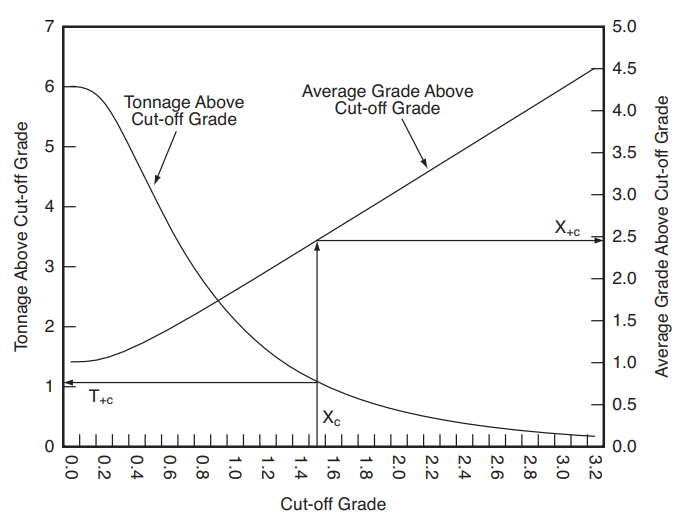

## Estimacion de cut-off en mineria
<!-- _class: fixedTitle -->

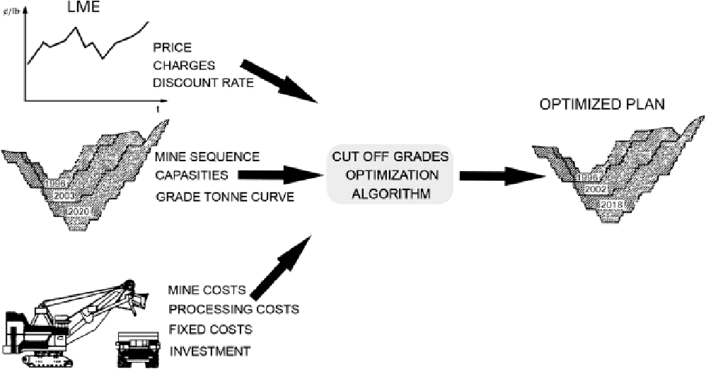

## Estimacion de cut-off en mineria
<!-- _class: pin-3 -->

> La obtención de un CoG robusto es, *sin lugar a dudas*, uno de los grandes objetivos del equipo de planificación. Para esto, **el enfoque multidisciplanario** ya descrito es clave en este punto. Los enfoques basados en una CoG en punto de equilibrio son muy propensos al riesgo propio del precio de metales.

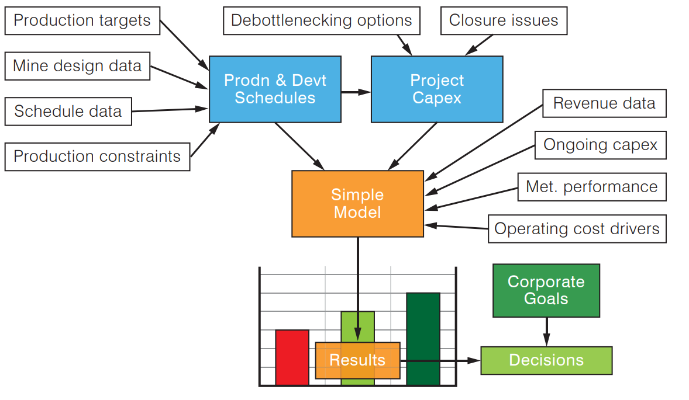

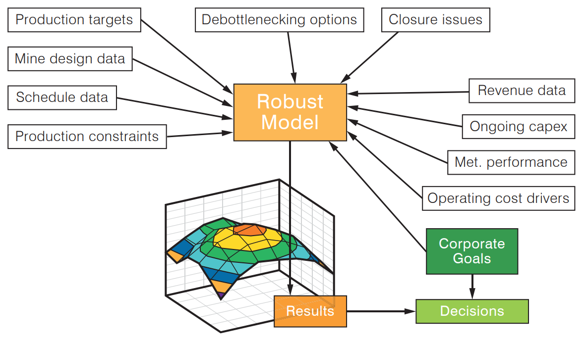

 

## Estados Financieros
<!-- _class: cols-3 -->

Los datos que proporcionan los sistemas contables son organizados y reportados a la gerenia en forma de Estados Financieros.

 

### Balance General 

¿Qué tengo, qué debo y qué obligaciones de cierre me esperan?

Uso: evalúa liquidez y capacidad de financiar proyectos. **Es lo primero que revisan bancos y prestamistas**.

 

### Estado de Resultados 

¿Gano dinero con cada tonelada que produzco?

Limitación: incluye partidas que no son caja, como **depreciación o deterioros de activos**, que pueden distorsionar la lectura de la operación.

 

### Flujo de Caja 

¿Cuánta caja genero y para qué me alcanza?

Uso: el flujo de caja libre es la base de la valorización (VAN, TIR, DCF). En un ciclo bajo de precios, **determina si la operación sobrevive**.

 

## Estado de resultados
<!-- _class: fixedTitle -->

**Ingresos** menos **costo de ventas** = utilidad bruta

**Utilidad bruta / ingresos** = margen bruto

Después se reconocen otros gastos e ingresos, resultados financieros e impuesto para llegar al resultado neto.

<!-- Pida que identifiquen qué magnitudes son del período y cuáles no representan necesariamente cobros o pagos. -->

## Estado de resultados
<!-- _class: fixedTitle -->

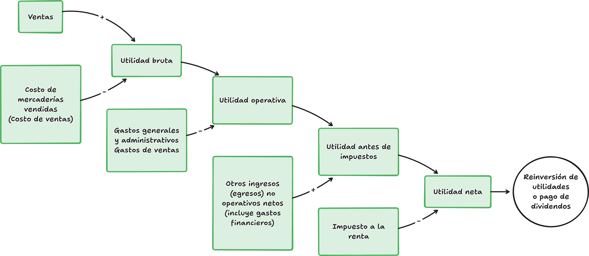

## Estado de resultados
<!-- _class: fixedTitle -->

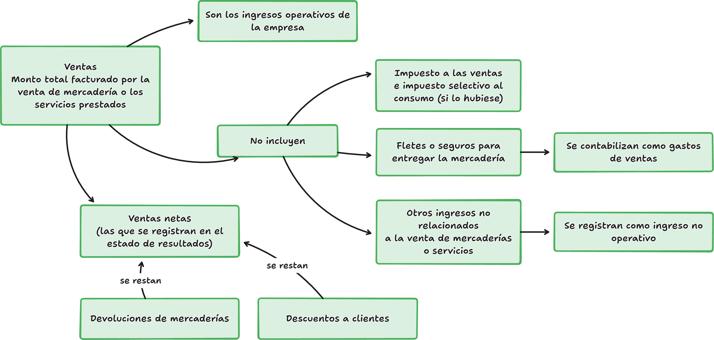

## Estado de resultados
<!-- _class: fixedTitle -->

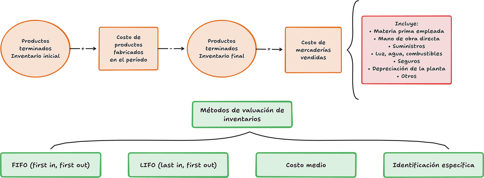

## Ejemplo guiado: utilidad bruta 2024
<!-- _class: fixedTitle -->

| Grupo consolidado | US\$ millones |
|---|---:|
| Ingresos | 2.021,2 |
| Costos operativos en costo de ventas | 1.040,8 |
| Depreciación en costo de ventas | 426,6 |
| **Utilidad bruta** | **553,8** |

> 553,8 / 2.021,2 = **27,40 % de margen bruto**.

###### Fuente: [Hudbay, estados consolidados 2024–2025](https://www.sec.gov/Archives/edgar/data/1322422/000106299326001113/exhibit99-1.htm). No corresponde exclusivamente a Perú.

## Ubicación del ejemplo en Excel
<!-- _class: fixedTitle -->

**Hoja «01 Negocio» · 2024 consolidado**

- C8: ingresos; C9 y C10: componentes de costo de ventas.
- C47: suma de costos; C48: utilidad bruta; C49: margen.
- La columna D queda para que el equipo analice 2025.

No mezclar este cálculo consolidado con las cifras del segmento Perú.

###### Fuentes: [Hudbay, estados consolidados y segmento Perú 2024–2025](https://www.sec.gov/Archives/edgar/data/1322422/000106299326001113/exhibit99-1.htm).

<!-- Abra la hoja 01 Negocio y localice las etiquetas de entrada antes de leer una fórmula. Muestre cómo C47 suma C9 y C10, cómo C48 resta el costo de ventas de C8 y cómo C49 divide por ingresos. El resultado se expresa en millones y el margen en porcentaje. Las cifras de Perú figuran aparte, en filas 42 a 44; no las reemplace en el cálculo consolidado. Después del receso utilice este recorrido como ejemplo guiado, dejando el resto de celdas amarillas para los equipos. -->

## Balance: una fotografía a una fecha
<!-- _class: fixedTitle -->

**Activo = pasivo + patrimonio**

- Activos corrientes: efectivo, cuentas por cobrar e inventarios, entre otros.
- Pasivos corrientes: obligaciones exigibles de corto plazo.
- Propiedad, planta y equipo: activos netos de depreciación y deterioros acumulados, según corresponda.

<!-- El balance muestra saldos al cierre; el estado de resultados y el flujo de efectivo cubren un período. -->

## Balance de Resultados
<!-- _class: fixedTitle -->

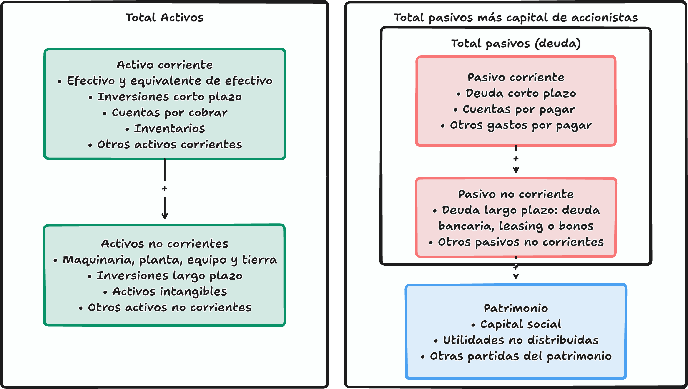

## Balance 2024: qué datos se concilian
<!-- _class: fixedTitle -->

| Grupo consolidado, US\$ millones | Saldo 2024 |
|---|---:|
| Activo total | 5.487,6 |
| Pasivo total | 2.840,2 |
| Patrimonio de propietarios | 2.553,2 |
| Participación no controladora | 94,2 |

**Control:** activo − pasivo − patrimonio total.

###### Fuentes: [Hudbay, estados consolidados y segmento Perú 2024–2025](https://www.sec.gov/Archives/edgar/data/1322422/000106299326001113/exhibit99-1.htm).

<!-- Describa un balance como saldo en una fecha: los activos son recursos y los pasivos, obligaciones reconocidas. Para el control de la fila 56 del Excel, sume al patrimonio de propietarios la participación no controladora antes de compararlo con activo menos pasivo. Pregunte qué significaría una diferencia distinta de cero: error de alcance, dato omitido o redondeo. Los estudiantes harán la operación y compararán ambos años durante el taller. -->

## Capital de trabajo y liquidez
<!-- _class: fixedTitle -->

**Capital de trabajo corriente** = activo corriente − pasivo corriente

**Razón corriente** = activo corriente / pasivo corriente

Ambas medidas requieren revisar la composición y el vencimiento de cada partida. Un inventario no tiene la misma liquidez que el efectivo.

## Liquidez: misma fecha y mismo perímetro
<!-- _class: fixedTitle -->

En el balance consolidado 2024:

- Activo corriente: **US\$1.048,5 millones**.
- Pasivo corriente: **US\$537,2 millones**.
- Capital de trabajo: activo corriente menos pasivo corriente.
- Razón corriente: activo corriente dividido entre pasivo corriente.

El detalle de las partidas explica la calidad de la liquidez.

###### Fuentes: [Hudbay, estados consolidados y segmento Perú 2024–2025](https://www.sec.gov/Archives/edgar/data/1322422/000106299326001113/exhibit99-1.htm).

<!-- Los dos indicadores usan saldos, no flujos anuales. Invite a identificar efectivo, cuentas por cobrar, inventarios y vencimientos de deuda en el detalle de la hoja. Explique por qué una razón mayor que uno no garantiza que todos los cobros ocurran antes de los pagos. En el caso los participantes calcularán las filas de capital de trabajo y razón corriente en 2024 y 2025; no anticipe la comparación ni use datos de una operación individual como si fueran consolidados. -->

## Resultado y flujo de efectivo
<!-- _class: fixedTitle -->

| Medida | Pregunta que responde |
|---|---|
| Utilidad | ¿Qué resultado se reconoció durante el período? |
| Caja operativa | ¿Cuánto efectivo generaron las operaciones? |
| Compras pagadas de PPE | ¿Cuánto se pagó por activos del período? |
| Caja operativa menos PPE pagado | ¿Qué subtotal parcial queda? |

###### Este subtotal no equivale automáticamente al flujo de caja libre definido por la empresa.

## Goodwill
<!-- _class: fixedTitle -->

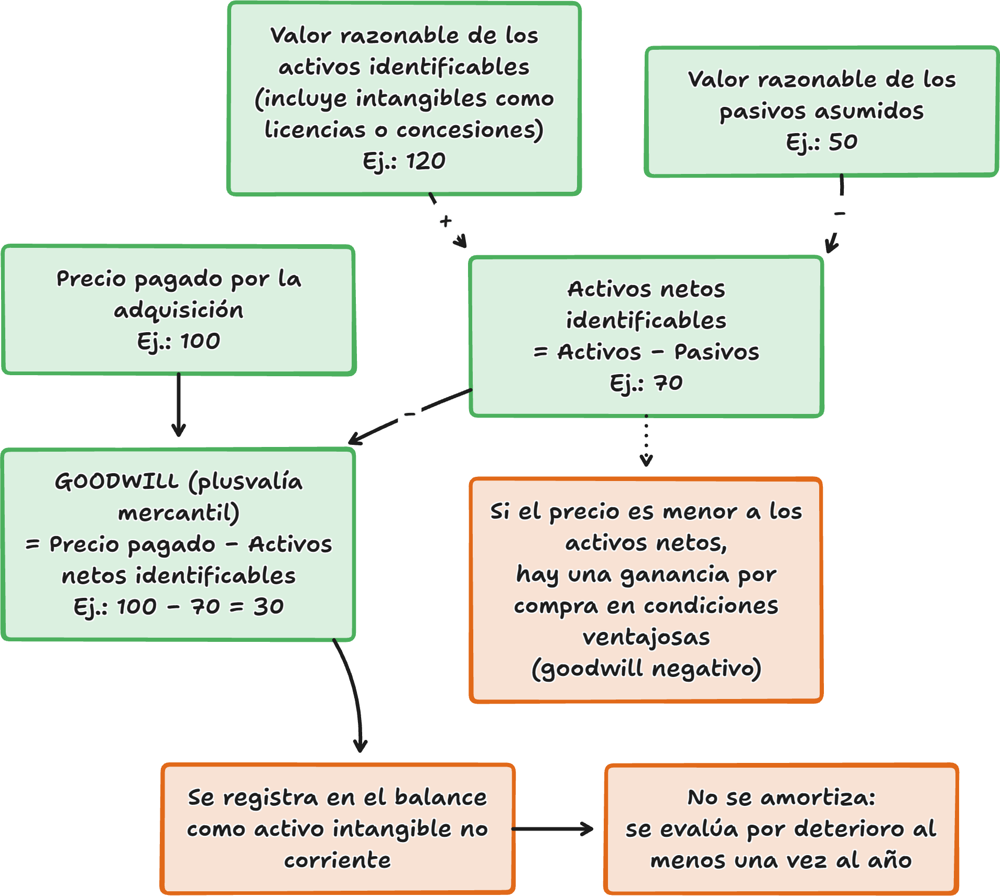

## CAPEX de sostenimiento y crecimiento
<!-- _class: fixedTitle -->

- **Sostenimiento:** inversiones destinadas a mantener la operación o su capacidad según la definición del reportante.
- **Crecimiento:** inversiones que buscan ampliar capacidad o desarrollar nuevas oportunidades.
- Distinguir **adiciones reportadas**, compromisos y **pagos efectivos**.

###### Fuente: [Hudbay, discusión de resultados e inversiones 2025](https://www.sec.gov/Archives/edgar/data/1322422/000106299326001113/exhibit99-2.htm).

## Inversiones: adiciones y pagos
<!-- _class: fixedTitle -->

| Referencia 2024 | US\$ millones |
|---|---:|
| Sostenimiento del segmento Perú | 124,4 |
| Crecimiento del segmento Perú | 0,8 |
| Compras pagadas de PPE consolidadas | 347,1 |

Las dos primeras filas son adiciones del segmento. La tercera es un pago consolidado.

###### Fuentes: [Hudbay, MD&A 2025, costos e inversiones de Perú](https://www.sec.gov/Archives/edgar/data/1322422/000106299326001113/exhibit99-2.htm) · [Hudbay, estados consolidados y segmento Perú 2024–2025](https://www.sec.gov/Archives/edgar/data/1322422/000106299326001113/exhibit99-1.htm).

<!-- Señale los perímetros en el Excel: las filas 39 y 40 son adiciones del segmento Perú, mientras la fila 38 presenta compras pagadas de PPE del grupo consolidado. La suma del CAPEX del segmento es una operación de práctica; no se debe restar del flujo de caja consolidado para presentarla como flujo libre de Perú. Discuta diferencias temporales entre comprometer, reconocer la adición y pagar. Para evaluar una inversión, además, hacen falta flujos futuros y una tasa apropiada. -->

## ¿Qué falta para evaluar una inversión?
<!-- _class: fixedTitle -->

Además del CAPEX, se necesitan flujos incrementales por período: producción, precios, costos, impuestos y capital de trabajo.

La tasa de descuento debe ser consistente con la moneda, el riesgo y el tipo de flujo. El costo de capital requiere información sobre deuda, patrimonio, tasas y estructura de financiamiento.

<!-- No se puede obtener el costo de capital a partir de un balance resumido. Los flujos incrementales excluyen costos hundidos. -->

## Caso 01: estados financieros y planta
<!-- _class: fixedTitle -->

**Archivo:** cuaderno, caso 01 · **Excel:** «01 Negocio».

1. Con el docente, reconstruyan el margen bruto consolidado de 2024.
2. Completen los indicadores de 2025, controles del balance y sección Perú.
3. Vinculen tres decisiones de planta con OPEX, CAPEX o depreciación.

> ¿Una mejora del margen permite concluir que mejoró la liquidez?

<!-- Cuidar el perímetro: consolidado y segmento Perú aparecen separados. Los equipos registran las respuestas en las celdas amarillas. -->

---
<!-- _class: last-slide -->
<!-- _footer: "" -->

###### Muchas gracias

- <i class="fa-brands fa-google"></i>
  - ameresv@gmail.com
- <i class="fa-brands fa-telegram"></i> 
  - +51956384450  
- <i class="fa-brands fa-linkedin"></i> 
  - Ali Meres

## Sesión 02: Centros de costos y costo unitario
<!-- _class: trans -->
<!-- _paginate: false -->
<!-- _footer: '' -->

## Sesión 02: ruta de teoría
<!-- _class: fixedTitle -->

| Tiempo | Desarrollo |
|---|---|
| 00–30 min | Centros, objeto de costo y clasificaciones |
| 30–60 min | Reparto de costos y costo de ventas |
| 60–90 min | Costo unitario, conciliación y preparación del caso |

###### Al finalizar: 30 minutos de receso y 60 minutos de caso.

## Del recurso al objeto de costo
<!-- _class: fixedTitle -->

### Costo

Se define como el dinero o valor sacrificado para adquirir bienes o servicios, con el objetivo de obtener un beneficio.

**Objeto de costo** es aquello que queremos medir: una etapa, un producto, una orden o una tonelada procesada. 

### Gasto

Se le define como un costo que ha producido un beneficio y que ha expirado. Costo expirado = Gasto. **Los costos no expirados** que pueden dar beneficios futuros se clasifican como **activos**. Ej.: bolas de acero en almacén.

<!-- Un mismo recurso puede analizarse por naturaleza, por centro responsable o por comportamiento con el volumen. -->

## Costo vs gasto
<!-- _class: fixedTitle -->

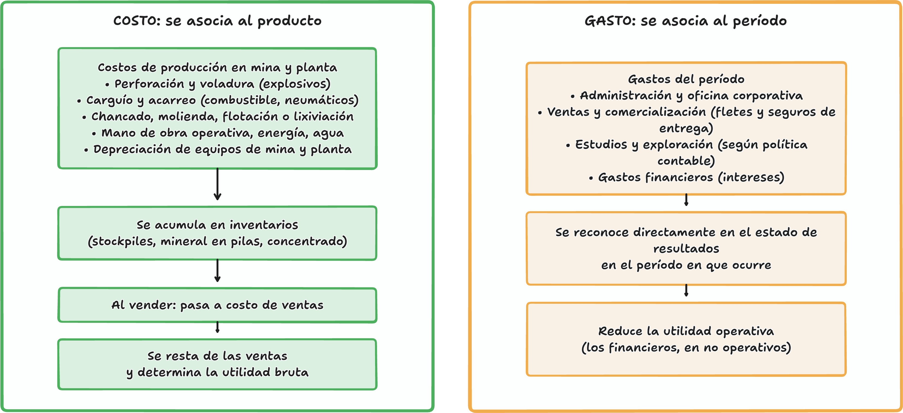

<!-- Un mismo recurso puede analizarse por naturaleza, por centro responsable o por comportamiento con el volumen. -->

## Un mismo recurso, varias preguntas
<!-- _class: fixedTitle -->

| Objeto de costo | Pregunta |
|---|---|
| Molino SAG | ¿Cuánto consumió ese equipo? |
| Circuito de molienda | ¿Cuánto costó la etapa completa? |
| Planta | ¿Cuánto costó procesar una tonelada? |
| Producto | ¿Cuánto costo se atribuye al concentrado? |

La respuesta cambia con la frontera elegida.

<!-- Plantee que el supervisor pide el costo del molino y finanzas pide el costo de planta. La misma factura de energía puede seguir rutas de asignación diferentes según el objeto. Primero se identifica el perímetro, luego el periodo y por último el conductor para distribuir los servicios compartidos. Este criterio prepara la clasificación de centros del caso 02. No presente el costo de molienda publicado como si fuera exclusivamente electricidad o como si desagregara chancado y flotación. -->

## Centros de costos de planta
<!-- _class: fixedTitle -->

| Centro | Actividades y recursos |
|---|---|
| Chancado | Energía, desgaste, operadores |
| Molienda | Energía, bolas, revestimientos |
| Flotación | Reactivos, aire, equipos y personal |
| Servicios y soporte | Agua, laboratorio, mantenimiento común |

La apertura real depende del sistema de la operación y de su capacidad de medición.

## Directo o indirecto
<!-- _class: fixedTitle -->

- **Directo:** se puede identificar económicamente con el objeto de costo elegido.
- **Indirecto:** beneficia a varios objetos y requiere un criterio de reparto.

La electricidad medida de un molino es directa respecto al molino. La supervisión compartida requiere asignación si se costean los circuitos por separado.

<!-- Directo no es sinónimo de variable. La clasificación cambia si el objeto pasa de un molino a toda la planta. -->

## Dos clasificaciones independientes
<!-- _class: fixedTitle -->

| Recurso | Respecto al molino | Frente al tonelaje |
|---|---|---|
| Energía medida del equipo | Directa, si se identifica | Analizar consumo y contrato |
| Supervisión compartida | Indirecta al molino | Analizar comportamiento por plazo |
| Bolas identificadas al circuito | Directas al circuito | Analizar consumo específico |

Identificación y comportamiento responden preguntas distintas.

<!-- La palabra directo responde a si un recurso puede trazarse al objeto de costo. Fijo o variable responde a cómo cambia el costo ante un conductor en un rango y periodo. Por ejemplo, la energía medida puede ser directa al molino, pero incluir demanda contratada y consumo que responden de modo distinto al volumen. Pida que justifiquen cada clasificación y señalen qué datos faltan. No concluya la proporción fija o variable con el reporte resumido del caso. -->

## Fijo, variable o mixto
<!-- _class: fixedTitle -->

| Comportamiento | En un rango y plazo definidos |
|---|---|
| Fijo | El total permanece aproximadamente estable |
| Variable | El total cambia con el conductor elegido |
| Mixto | Contiene componentes fijos y variables |

> El costo fijo por tonelada suele aumentar cuando baja el tonelaje, aun si el gasto total no cambia.

## Distribución de costos indirectos
<!-- _class: fixedTitle -->

**Costo asignado al centro** = costo común × participación en el conductor

Ejemplos de conductores: kWh medidos, horas de mantenimiento registradas, metros cúbicos de agua o personal atendido.

Una asignación útil tiene una relación razonable con el uso del servicio y suma el total a distribuir.

## Reparto: escoger un conductor observable
<!-- _class: fixedTitle -->

Para un servicio compartido:

**Participación del centro** = uso del centro / uso total medido

**Costo asignado** = costo del servicio × participación

El control de cierre compara la suma asignada con el costo total a distribuir.

<!-- Use el servicio de mantenimiento común: si existen horas registradas por centro, pueden servir como conductor, siempre que describan razonablemente el uso del servicio. Pregunte qué ocurre con trabajo no registrado o servicios externos asignables directamente. Verifique que no se asigne dos veces el mismo costo y que las participaciones sumen cien por ciento. El Excel no publica un reparto interno de G&A: esta es una metodología de discusión, no una reconstrucción real de la empresa. -->

## Costeo por procesos y por actividades
<!-- _class: fixedTitle -->

- El **costeo por procesos** acumula costos por etapa durante un período y los relaciona con la producción de esa etapa.
- El **costeo basado en actividades** atribuye recursos a actividades y usa conductores para distribuirlos.
- La elección depende del objetivo, los datos y el costo de mantener el modelo.

## Costeo por procesos y por actividades
<!-- _class: fixedTitle -->

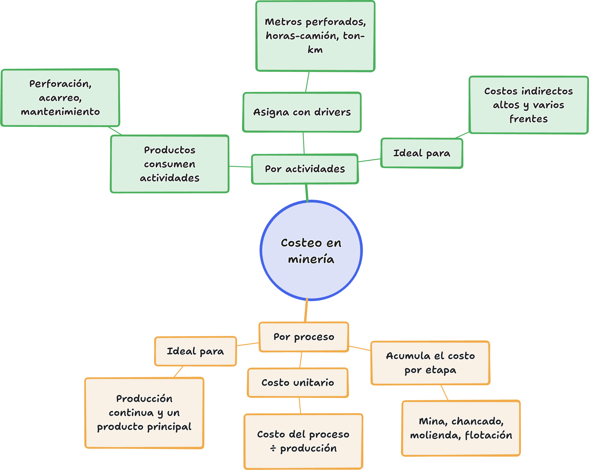

## De producción a costo de ventas
<!-- _class: fixedTitle -->

El costo de producción no necesariamente coincide con el costo de ventas del mismo período: pueden cambiar existencias o existir ajustes contables.

La asignación de costos indirectos fijos de producción considera la capacidad normal; los desperdicios anormales reciben tratamiento separado.

###### Fuente: [NIC 2, Inventarios](https://www.ifrs.org/issued-standards/list-of-standards/ias-2-inventories/).

## Producción, existencias y venta
<!-- _class: fixedTitle -->

| Movimiento | Efecto a investigar |
|---|---|
| Se produce y queda concentrado en almacén | Parte del costo puede permanecer en inventarios |
| Se vende concentrado producido antes | Sale costo previamente acumulado |
| Se reconocen otras partidas | Revisar la conciliación contable publicada |

El signo del ajuste depende de la presentación de la fuente.

###### Fuentes: [IFRS Foundation, NIC 2](https://www.ifrs.org/issued-standards/list-of-standards/ias-2-inventories/).

<!-- Explique la diferencia entre costo incurrido para producir y costo del producto vendido. Si al cierre aumenta el inventario de concentrado, el movimiento puede modificar el costo de ventas respecto del costo incurrido, sujeto a la política contable y los demás ajustes. En la hoja 02 se muestra un ajuste de inventario con su signo tal como aparece en la conciliación de la fuente. No cambie el signo por intuición: verifique el puente publicado y los registros. -->

## El denominador cambia la lectura
<!-- _class: fixedTitle -->

| Indicador | Qué mide |
|---|---|
| US\$/t extraída | Costo respecto al material extraído |
| US\$/t tratada | Costo respecto al mineral procesado |
| US\$/t concentrado seco | Costo respecto al producto físico |
| US\$/lb Cu producido | Costo respecto al metal obtenido |

Antes de comparar, verifique período, humedad, etapa, moneda y costos incluidos.

## Ejemplo guiado: costo por tonelada
<!-- _class: fixedTitle -->

En la operación Perú de 2024, el costo combinado ajustado de mina, molienda y administración fue **US\$412,2 millones** y el mineral molido fue **31,934 millones de toneladas**.

**412,2 / 31,934 = US\$12,91/t molida**

###### Fuente: [Hudbay, MD&A 2025](https://www.sec.gov/Archives/edgar/data/1322422/000106299326001113/exhibit99-2.htm). Tonelaje redondeado.

## Ejemplo de molienda en la operación Perú
<!-- _class: fixedTitle -->

**2024 · datos de la hoja «02 Costeo»**

- Molienda: **US\$197,1 millones**.
- Mineral molido: **31,934 millones de t**.
- 197,1 / 31,934 = **US\$6,17/t molida**.

La etiqueta «molienda» usa el alcance del reporte, no una lista de insumos individuales.

###### Fuentes: [Hudbay, MD&A 2025, costos e inversiones de Perú](https://www.sec.gov/Archives/edgar/data/1322422/000106299326001113/exhibit99-2.htm).

<!-- El numerador procede de C8 y el denominador de C11. Como ambos están en millones, la división entrega dólares por tonelada sin multiplicar por un millón. La fórmula demostrada está en C24. Pregunte qué partidas esperan encontrar en molienda y aclare que el informe resumido no permite conocer el costo de bolas ni repartir el valor entre equipos. Los equipos compararán después con la columna de 2025 y calcularán los demás centros. -->

## Conciliación con costo de ventas
<!-- _class: fixedTitle -->

Parta del costo combinado ajustado y agregue las partidas definidas en la conciliación: flete, reposición de ajustes, inventarios, regalías, suspensión y depreciación, según corresponda.

**Control = costo conciliado − costo de ventas reportado**

El detalle y el signo de cada partida dependen de la definición de la fuente.

## Estructura del puente contable
<!-- _class: fixedTitle -->

Costo combinado ajustado

**+** flete y reposición del ajuste administrativo
**+** otros ajustes, inventarios, regalías y suspensión
**+** depreciación y amortización
**=** costo de ventas conciliado, sujeto a redondeo

###### Fuentes: [Hudbay, MD&A 2025, costos e inversiones de Perú](https://www.sec.gov/Archives/edgar/data/1322422/000106299326001113/exhibit99-2.htm).

<!-- Dirija la mirada a las filas 12 a 19 de la hoja 02. Muestre que el subtotal ajustado ya contiene un ajuste negativo de otras partidas administrativas y que la conciliación repone ese ajuste antes de llegar al costo de ventas. Los demás conceptos se toman con el signo de la tabla pública. La fila 29 es el control frente al importe reportado. Deje a los estudiantes hacer el cálculo y explicar por qué no se suman nuevamente centros ya incluidos. -->

## Tres preguntas antes de comparar
<!-- _class: fixedTitle -->

1. ¿Los dos montos incluyen las mismas etapas y conceptos?
2. ¿Los tonelajes representan la misma base física?
3. ¿La diferencia viene del gasto, del volumen o de ambos?

El costo por tonelada describe una relación; por sí solo no identifica la causa del cambio.

## Puente de preguntas para el caso 02
<!-- _class: fixedTitle -->

- **Perímetro:** ¿mina, molienda y administración usan la misma definición?
- **Tiempo:** ¿el costo y las toneladas corresponden al mismo año?
- **Denominador:** ¿se usan toneladas molidas en ambos períodos?
- **Conciliación:** ¿qué conceptos faltan para llegar a costo de ventas?

Un cociente sin estas referencias puede inducir una decisión equivocada.

###### Fuentes: [Hudbay, MD&A 2025, costos e inversiones de Perú](https://www.sec.gov/Archives/edgar/data/1322422/000106299326001113/exhibit99-2.htm).

<!-- Antes del receso, haga una revisión oral con la tabla de datos sin pedir aún que completen la práctica. Solicite que señalen en voz alta el numerador y el denominador de molienda. Pregunte si la menor facturación total demostraría mejor desempeño y anote las respuestas como hipótesis. Después del receso los equipos calcularán ambos años y separarán el efecto de volumen del cambio de gasto. La conclusión exige evidencia adicional sobre composición y comportamiento de costos. -->

## Caso 02: centro de costos y ventas
<!-- _class: fixedTitle -->

**Archivo:** cuaderno, caso 02 · **Excel:** «02 Costeo».

- Calculen US\$/t para mina, molienda y administración ajustada.
- Comparen ambos años y concilien el costo de ventas reportado.
- Propongan un conductor para repartir un servicio compartido.

> ¿Un menor gasto total implica necesariamente un menor US\$/t?

## Estrategia en costos
<!-- _class: fixedTitle -->

En la industria minera, la gestión de los costos es **la estrategia competitiva** que mayor garantía puede ofrecer para lograr **resultados positivos** en un sector que depende directamente de los precios de los metales que se cotizan internacionalmente.

De allí que los costos en la actividad minera deben de ser calificados como *estratégicos*, pues las decisiones que se tomen en torno a ellos tendrán impacto sobre la **viabilidad de la operación**.

---
<!-- _class: last-slide -->
<!-- _footer: "" -->

###### Muchas gracias

- <i class="fa-brands fa-google"></i>
  - ameresv@gmail.com
- <i class="fa-brands fa-telegram"></i> 
  - +51956384450  
- <i class="fa-brands fa-linkedin"></i> 
  - Ali Meres

# Costos en plantas minero metalúrgicas

###### Una mirada ejecutiva al negocio minero

<!-- _class: cover -->
<!-- _paginate: "" -->
<!-- _footer: Presentacion preparada para TECSUP -->

Ing. Alí Meres 
Ingeniero de Minas UNI - CIP 
Business Analytics Technical Lead @ Astay Systems
Contacto adicional：[LinkedIn](https://www.linkedin.com/in/ali-ivan-meres-vargas/)- ameresv\@gmail.com

## Agenda a desarrollar
<!-- _class: agenda_col2 -->

- Proceso, EEFF , OPEX y CAPEX
- Centros de costos y costo unitario
- Chancado y molienda
- Flotación, polimetálicos y lixiviación
- Presupuesto y variaciones PVE
- Mantenimiento y árbol de valor
- Liquidación de concentrados y NSR
- Rentabilidad, equilibrio e indicadores

## Sesión 03: Chancado y Molienda

<!-- _class: trans -->
<!-- _paginate: false -->
<!-- _footer: '' -->

## Sesión 03: ruta de teoría
<!-- _class: fixedTitle -->

| Tiempo | Desarrollo |
|---|---|
| 00–25 min | Circuito de conminución y recursos |
| 25–60 min | Energía, intensidad y valoración |
| 60–90 min | Medios de molienda y decisiones de proceso |

###### Al finalizar: 30 minutos de receso y 60 minutos de caso.

## Objetivo económico de la conminución
<!-- _class: fixedTitle -->

Reducir el tamaño del mineral para permitir la liberación de las especies de interés y alimentar la etapa posterior.

La decisión debe considerar **energía, medios de molienda, desgaste y desempeño metalúrgico**, además de toneladas por hora.

## Retos principales 
<!-- _class: fixedTitle -->

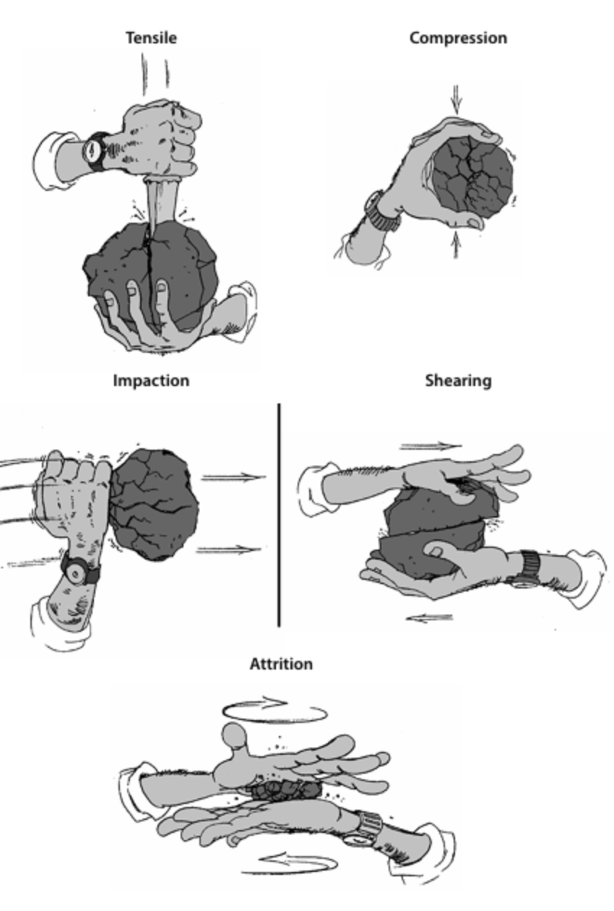

## Retos y principales *cost drivers*
<!-- _class: fixedTitle -->

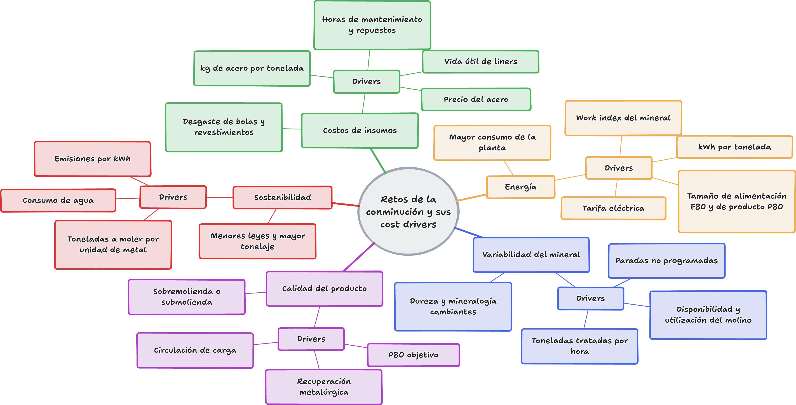

## Una decisión de circuito repercute en flotación
<!-- _class: fixedTitle -->

La etapa de conminución condiciona el tamaño de alimentación a flotación.

- Producto más grueso: revisar liberación y recuperación.
- Producto más fino: revisar energía, medios y capacidad.
- Evaluación: comparar metal recuperado y costo total incremental.

La respuesta depende del mineral y se verifica con datos y ensayos.

<!-- Explique que chancado, molienda y clasificación no tienen como fin producir finos por sí mismos, sino preparar una alimentación adecuada para la etapa posterior. Un cambio de granulometría puede afectar liberación y recuperación, pero no hay un efecto universal para todos los minerales. Para decidir se necesitan curvas de recuperación por tamaño, energía, consumo de medios y tasas reales. Este es el puente con la sesión 04: la mejor operación se evalúa en conjunto, no por kWh/t aislado. -->

## Alternativas de circuito
<!-- _class: fixedTitle -->

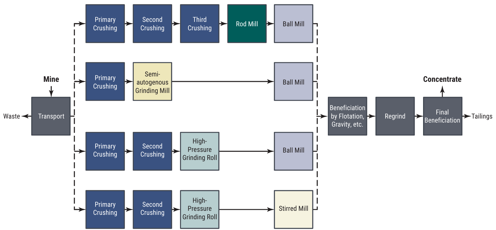

## Alternativas de circuito 
<!-- _class: fixedTitle -->

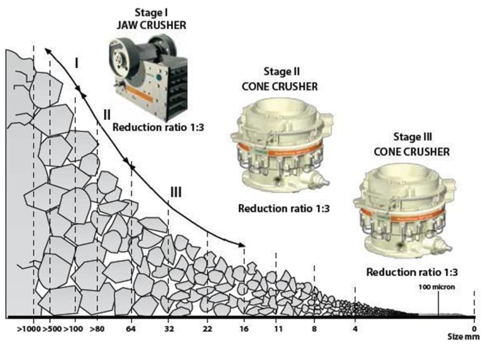

## Alternativas de circuito 
<!-- _class: fixedTitle -->

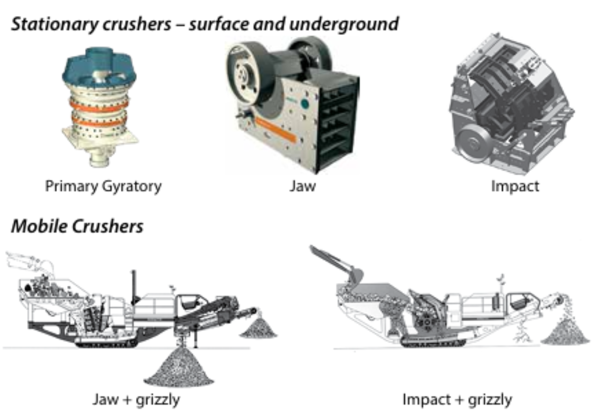

## Alternativas de circuito 
<!-- _class: fixedTitle -->

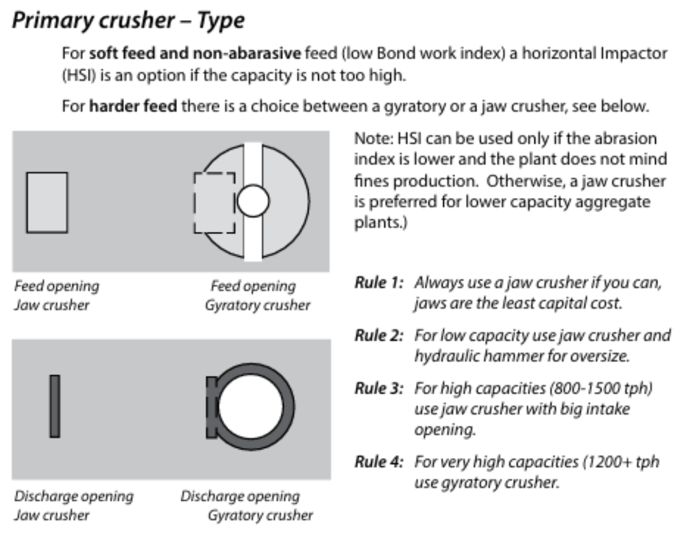

## Recursos de chancado y molienda
<!-- _class: fixedTitle -->

| Recurso | Unidad de control |
|---|---|
| Energía eléctrica | kWh y kWh/t |
| Bolas y otros medios | kg y kg/t |
| Revestimientos | Consumo, vida útil y costo |
| Mantenimiento | Horas, repuestos y costo |
| Personal y servicios | Horas y costo por centro |

## Mapa de medición del circuito
<!-- _class: fixedTitle -->

| Medición | Unidad | Frontera |
|---|---|---|
| Tonelaje alimentado | t | Mineral tratado en el periodo |
| Electricidad | kWh | Planta completa o equipo medido |
| Medios de molienda | kg | Consumo o reposición definida |
| Granulometría | % pasante o tamaño | Alimentación y producto |

Documentar la frontera antes de dividir.

<!-- Pida definir de dónde sale cada dato: balanza para tonelaje, medidor eléctrico, inventarios o registro de adiciones para medios y muestreo para granulometría. La reposición de bolas no siempre coincide exactamente con el desgaste del mismo periodo si varía el inventario en el molino o almacén. En la hoja 03 la fuente entrega intensidad eléctrica y participación del circuito; no entrega un desglose monetario de consumibles de esa concentradora. -->

## Intensidad energética
<!-- _class: fixedTitle -->

**kWh/t** = energía consumida / toneladas tratadas

**Energía estimada** = toneladas tratadas × intensidad

Registre la frontera de medición: molino, molienda y clasificación o concentradora completa. No son indicadores intercambiables.

## Ejemplo guiado: energía de la planta
<!-- _class: fixedTitle -->

Datos reportados para una concentradora de cobre en 2021:

- Mineral tratado: **29.617.007 t**.
- Intensidad total: **19,71 kWh/t**.
- Energía estimada: **583,75 millones de kWh**.

###### Fuente: [Southern Copper, informe técnico Cuajone 2021](https://www.sec.gov/Archives/edgar/data/1001838/000155837022002995/scco-20211231ex961a821f6.pdf). Cálculo con intensidad redondeada.

## Ejemplo guiado: dos fronteras de energía
<!-- _class: fixedTitle -->

**2021 · concentradora de cobre**

- Energía total estimada: 29.617.007 × 19,71 = **583,75 millones kWh**.
- Molienda y clasificación: 583,75 millones × 54,95 % = **320,77 millones kWh**.
- Intensidad de ese circuito: **10,830645 kWh/t**.

Conserve decimales para el cálculo; redondee solo al presentar.

###### Fuentes: [Southern Copper, Cuajone 2021, sección 14.4.12](https://www.sec.gov/Archives/edgar/data/1001838/000155837022002995/scco-20211231ex961a821f6.pdf).

<!-- Reproduzca las tres fórmulas ya demostradas en C16, C17 y C18 de la hoja 03. Explique que el 54,95 por ciento corresponde a la participación sobre la electricidad total, no al porcentaje de toneladas tratadas. También puede obtener la intensidad del circuito multiplicando 19,71 por 0,5495. La diferencia entre la energía de planta y la de ese circuito corresponde a otras cargas según la frontera del informe, sin identificarlas individualmente. -->

## Energía de molienda y clasificación
<!-- _class: fixedTitle -->

Si se conoce la participación de un circuito:

**Energía del circuito** = energía total × participación

**Intensidad del circuito** = energía del circuito / toneladas tratadas

La potencia instantánea y la energía de un período no son la misma magnitud: kW mide potencia; kWh mide energía.

## Valorización de electricidad
<!-- _class: fixedTitle -->

**Costo referencial** = kWh × tarifa de referencia

Para el costo real, revisar contrato, moneda, demanda de potencia, cargos aplicables, medición y período.

Una tarifa de otra operación puede servir para una simulación, pero no representa la factura de la planta analizada.

## Facturación y costo referencial
<!-- _class: fixedTitle -->

La hoja 03 usa **US\$0,065/kWh** de un proyecto distinto para valorar una energía estimada.

Antes de llamar real al costo, solicitar:

- Contrato y moneda de la concentradora.
- kWh y demanda facturados para el mismo periodo.
- Cargos, descuentos y criterios de asignación.

###### Fuentes: [Buenaventura, informe San Gabriel 2024](https://www.sec.gov/Archives/edgar/data/1013131/000141057825001056/tmb-20241231xex96d2.pdf).

<!-- Distinga el dato físico de Cuajone del parámetro económico del estudio San Gabriel. La multiplicación entrega una valoración didáctica, no una factura ni el gasto contratado por la concentradora de cobre. Pregunte cómo incidirían los cargos por potencia, las horas de consumo y la medición por circuito; las condiciones concretas dependen del contrato. Reserve para el taller el cálculo de la valoración en ambas columnas. -->

## Alternativas de molienda
<!-- _class: fixedTitle -->

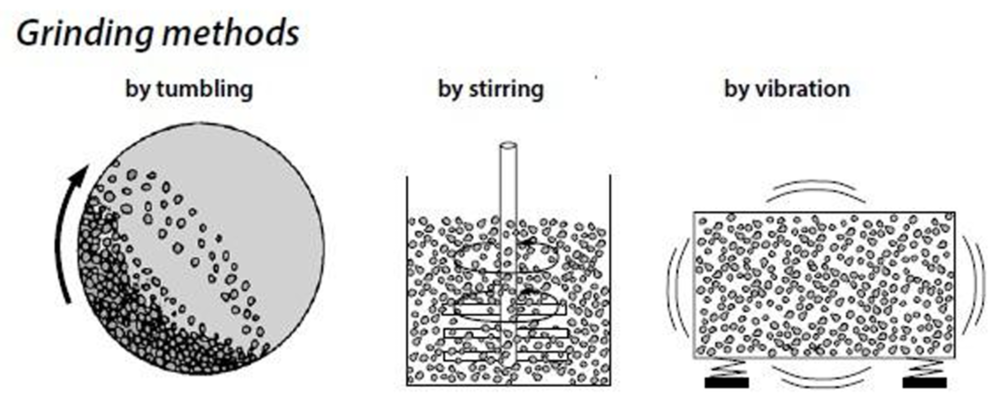

## Alternativas en la molienda
<!-- _class: fixedTitle -->

| Criterio | Molino de barras | Molino AG | Molino SAG |
|---|---|---|---|
| Operación | Húmedo (overflow) o mayormente seco (descarga periférica) | Húmedo o seco | Húmedo o seco |
| Etapa | Molienda gruesa; primario en plantas de menos de 200 t/h | Primaria, gruesa (hasta 400 mm) | Primaria, gruesa (hasta 400 mm) |
| Medio de molienda | Barras | La propia alimentación | Alimentación más 4–18% de bolas |
| Capacidad | Alta (descarga periférica) | Alta | Mayor que el AG |
| Sensibilidad a la alimentación | — | Sensible | Menos sensible que el AG |
| Rasgo clave | Granulometría estrecha, sin descarga por parrilla | Tiempo de retención corto | Tiempo de retención corto |

## Alternativas en la molienda
<!-- _class: fixedTitle -->

| Criterio | Bolas (overflow) | Bolas (parrilla) | Guijarros | Rodamientos de rodillos |
|---|---|---|---|---|
| Operación | Solo húmedo | Seco o húmedo | Húmedo o seco | Húmedo o seco |
| Descarga | Overflow | Parrilla | Siempre parrilla | Overflow o parrilla |
| Etapa | Secundaria | Secundaria | Secundaria | — |
| Molienda | Más fina | Más gruesa | — | — |
| Medio de molienda | Bolas (35–40%) | Bolas (admite 5–10% más) | Guijarros, sílex, porcelana o Al₂O₃ | — |
| Sobremolienda | Mayor riesgo | Menor riesgo | — | — |
| Rasgo clave | Robusto y simple | Descarga más compleja | Sin contaminación metálica | Simple, económico, menor capacidad |

## Alternativas de molienda
<!-- _class: fixedTitle -->

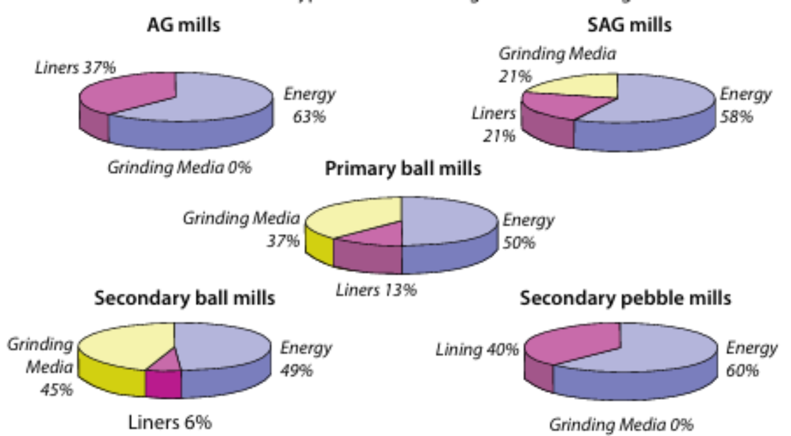

## Alternativas de molienda
<!-- _class: fixedTitle -->

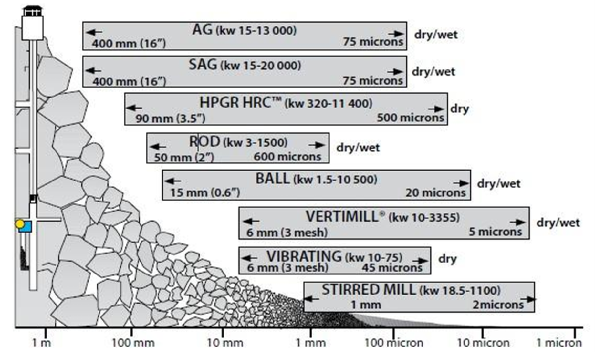

## Medios de molienda
<!-- _class: fixedTitle -->

**Consumo específico** = kg de medios / t de mineral

**Costo específico** = kg/t × precio por kg

Para comparar campañas, revise mineral, tamaño de alimentación y producto, reposición, inventarios y medición de desgaste.

## Conversión de g/t a kg/año
<!-- _class: fixedTitle -->

**kg/año** = t/año × g/t / 1.000

La hoja 03 incluye consumos de diseño de medios SAG y bolas tomados de un proyecto de oro/plata distinto de la concentradora de cobre.

###### Fuente: [Buenaventura, informe técnico San Gabriel 2024](https://www.sec.gov/Archives/edgar/data/1013131/000141057825001056/tmb-20241231xex96d2.pdf).

## Medios: conversiones antes de multiplicar
<!-- _class: fixedTitle -->

En un proyecto separado de oro/plata:

- Medios SAG: **339 g/t = 0,339 kg/t**.
- Bolas de molino: **1.087 g/t = 1,087 kg/t**.
- Diseño: **1.095.000 t/año**.

Cada consumo anual se obtiene multiplicando **kg/t × t/año**.

###### Fuentes: [Buenaventura, informe San Gabriel 2024](https://www.sec.gov/Archives/edgar/data/1013131/000141057825001056/tmb-20241231xex96d2.pdf).

<!-- Escriba la conversión 1.000 g igual a 1 kg y revise que las toneladas de mineral se cancelen al multiplicar. Los parámetros corresponden a un proyecto separado de oro y plata; no describen el desgaste de la planta de cobre. Pida a los participantes identificar qué multiplicaciones deberán completar después en las filas 23 a 25 de la hoja 03, sin revelar aún los resultados anuales. Para convertir a costo faltan precios y condiciones reales. -->

## Variables que explican el consumo
<!-- _class: fixedTitle -->

- Dureza y mezcla del mineral.
- Tamaño de alimentación y granulometría del producto.
- Carga de medios, recirculación y condiciones del circuito.
- Disponibilidad, medición eléctrica y cambios operativos.

No atribuya una variación a una causa sin verificar datos comparables.

## Diagnóstico: qué dato solicitar
<!-- _class: fixedTitle -->

| Cambio observado | Datos para investigar |
|---|---|
| Más kWh/t | Dureza, granulometría, carga y medición |
| Más kg de medios/t | Mineral, reposición y registros de inventario |
| Menos t/h | Alimentación, disponibilidad y restricciones |
| Cambio en recuperación | Tamaño, mineralogía y operación posterior |

Las variables sugieren hipótesis; se requiere verificarlas.

<!-- Proponga un aumento de intensidad como situación de investigación, sin atribuirlo a un hecho real. Compare mineralogía y dureza, tamaño de alimentación y producto, potencia de equipos, carga circulante y calidad de la medición. Para los medios solicite adiciones, existencias inicial y final y condiciones del molino. Distinga correlación y causa: un cambio de mezcla puede coincidir con una variación de tarifa sin ser consecuencia de ella. En el caso se escogerán dos mediciones prioritarias. -->

## Costo y desempeño metalúrgico
<!-- _class: fixedTitle -->

Una molienda más fina puede modificar el consumo de energía y la recuperación posterior. El efecto depende de la mineralogía y las condiciones operativas.

La comparación debe considerar el **margen incremental**, no solo el consumo eléctrico por tonelada.

<!-- Pregunte qué ensayos, datos de granulometría y mediciones de recuperación se necesitan para evaluar una alternativa. -->

## Una decisión de molienda se evalúa en cadena
<!-- _class: fixedTitle -->

**Propuesta:** modificar la granulometría objetivo.

**Costo incremental:** energía, medios, revestimientos y mantenimiento.

**Beneficio o pérdida:** cambio estimado de metal recuperado y valor neto.

**Evidencia:** pruebas metalúrgicas, medición de energía y capacidad efectiva.

<!-- Conduzca la discusión como una decisión que requiere pruebas. Un producto más fino puede aumentar consumo y en ciertos minerales mejorar liberación; en otros, sobre-molienda u otros factores pueden perjudicar resultados. Las pruebas y datos disponibles deben definir el efecto. El costo debe compararse con el valor incremental del metal recuperado, considerando restricciones del circuito. No use porcentajes genéricos ni ahorros no reportados. Relacione con la sesión 04, en la cual se calcula metal recuperado. -->

## Caso 03: energía y medios de molienda
<!-- _class: fixedTitle -->

**Archivo:** cuaderno, caso 03 · **Excel:** «03 Energía».

1. Estimen el consumo total y el de molienda para dos años.
2. Valoricen con la tarifa referencial y calculen medios de diseño.
3. Propongan dos mediciones para explicar las diferencias.

> ¿Qué información falta para conocer el costo real de las bolas de la concentradora?

## Estrategias de costos - Conminución
<!-- _class: fixedTitle -->

| Estrategia | Palanca de ahorro | Impacto reportado | Cost driver |
|---|---|---|---|
| HPGR en lugar de molino SAG | Menor energía en molienda primaria | Hasta 30% de energía (dato del proveedor) | kWh por tonelada |
| Preconcentración y ore sorting | Rechazo temprano de estéril; menos mineral a moler | No cuantificado | Toneladas a moler por unidad de metal |
| Control avanzado de procesos (APC) | Menor sobremolienda y energía desperdiciada | No cuantificado | P80 objetivo, kWh por tonelada |

---
<!-- _class: last-slide -->
<!-- _footer: "" -->

###### Muchas gracias

- <i class="fa-brands fa-google"></i>
  - ameresv@gmail.com
- <i class="fa-brands fa-telegram"></i> 
  - +51956384450  
- <i class="fa-brands fa-linkedin"></i> 
  - Ali Meres

# Costos en plantas minero metalúrgicas

###### Una mirada ejecutiva al negocio minero

<!-- _class: cover -->
<!-- _paginate: "" -->
<!-- _footer: Presentacion preparada para TECSUP -->

Ing. Alí Meres 
Ingeniero de Minas UNI - CIP 
Business Analytics Technical Lead @ Astay Systems
Contacto adicional：[LinkedIn](https://www.linkedin.com/in/ali-ivan-meres-vargas/)- ameresv\@gmail.com

## Agenda a desarrollar
<!-- _class: agenda_col2 -->

- Proceso, EEFF , OPEX y CAPEX
- Centros de costos y costo unitario
- Chancado y molienda
- Flotación, polimetálicos y lixiviación
- Presupuesto y variaciones PVE
- Mantenimiento y árbol de valor
- Liquidación de concentrados y NSR
- Rentabilidad, equilibrio e indicadores

## Sesión 04: Flotación, polimetálicos y LESDE
<!-- _class: trans -->
<!-- _paginate: false -->
<!-- _footer: '' -->

## Sesión 04: ruta de teoría
<!-- _class: fixedTitle -->

| Tiempo | Desarrollo |
|---|---|
| 00–40 min | Flotación y balance de cobre |
| 40–60 min | Zinc, plata y circuitos polimetálicos |
| 60–90 min | LESDE, bases de costo y preparación del caso |

###### Al finalizar: 30 minutos de receso y 60 minutos de caso.

## Dos rutas de procesamiento de cobre
<!-- _class: fixedTitle -->

| Ruta | Producto de la planta | Variables de interés |
|---|---|---|
| Concentración por   flotación | Concentrado de cobre | Ley, recuperación, reactivos |
| Lixiviación, extracción por solventes   y electrodeposición | Cátodo de cobre | Cinética, ácido, recuperación, energía |

La ruta elegida depende de las características del mineral y del diseño de la operación.

## Ejemplo de circuito de concentrados Cu–Mo
<!-- _class: fixedTitle -->

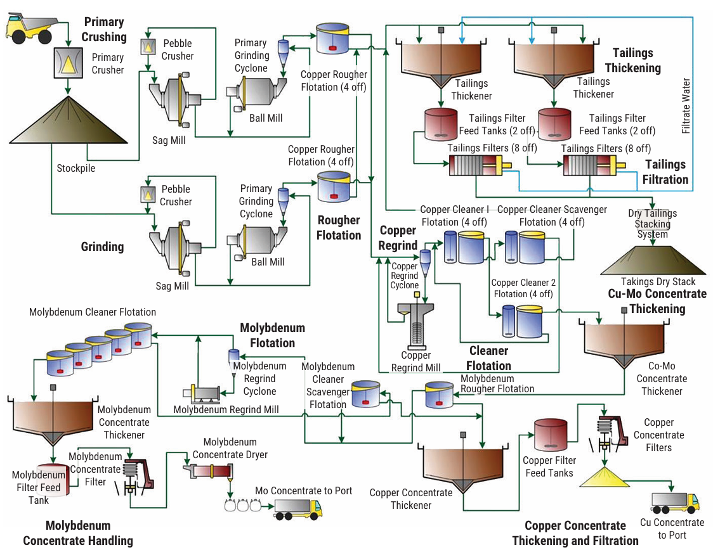

## Balance de metal
<!-- _class: fixedTitle -->

**Metal en alimentación** = toneladas de mineral × ley de cabeza

**Metal recuperado** = metal de alimentación × recuperación

**Metal estimado en concentrado** = toneladas secas de concentrado × ley del concentrado

Use las leyes y recuperaciones como proporciones al multiplicar.

## Primero: convertir ley y recuperación
<!-- _class: fixedTitle -->

| Dato publicado | Conversión para multiplicar |
|---|---:|
| Ley de cabeza 0,39 % Cu | 0,0039 t Cu / t mineral |
| Recuperación 84,2 % | 0,842 |
| Ley de concentrado 21,98 % Cu | 0,2198 t Cu / t concentrado |

El porcentaje se divide entre 100 una sola vez.

###### Fuentes: [Hudbay, operación Perú, resultados 2023–2024](https://www.sec.gov/Archives/edgar/data/1322422/000106299325002997/exhibit99-2.htm).

<!-- Escriba las unidades bajo cada número. La ley de 0,39 por ciento equivale a 0,0039 toneladas de Cu por tonelada de mineral, y la recuperación de 84,2 por ciento equivale a una proporción de 0,842. En Excel las celdas almacenan esas fracciones aunque se visualicen como porcentaje; no divida entre cien nuevamente. Esta verificación evita errores de dos órdenes de magnitud en las filas 23 a 25 de la hoja 04. -->

## Ejemplo guiado: cobre de alimentación
<!-- _class: fixedTitle -->

Para 2023: **30.720.929 t** de mineral molido y **0,39 % Cu** de ley publicada.

30.720.929 × 0,0039 = **119.812 t de Cu en alimentación**, aproximadamente.

Con recuperación de 84,2 %, el Cu recuperado estimado es **100.881 t**.

###### Fuente: [Hudbay, resultados de Perú 2023–2024](https://www.sec.gov/Archives/edgar/data/1322422/000106299325002997/exhibit99-2.htm). Las leyes publicadas están redondeadas.

## Dos rutas para estimar el metal
<!-- _class: fixedTitle -->

**2023 · concentradora de cobre**

- Desde cabeza: 30.720.929 t × 0,0039 × 0,842 ≈ **100.881 t Cu**.
- Desde concentrado: 457.137 t × 0,2198 ≈ **100.479 t Cu**.
- Cu producido reportado: **100.487 t**.

La ley de cabeza se publica redondeada.

###### Fuentes: [Hudbay, operación Perú, resultados 2023–2024](https://www.sec.gov/Archives/edgar/data/1322422/000106299325002997/exhibit99-2.htm).

<!-- Reproduzca las tres filas ya resueltas en C23, C24 y C25. La estimación desde concentrado se aproxima al cobre reportado, mientras la estimación desde la ley de cabeza puede diferir por redondeo, mediciones y base de reporte. No agregue una causa específica si la fuente no la identifica. Señale que no deben forzar el balance cambiando un dato de entrada. Para investigar se requieren ensayes completos, tonelajes reconciliados y precisión de las leyes. -->

## Metal contenido, recuperado y pagable
<!-- _class: fixedTitle -->

| Magnitud | Qué representa |
|---|---|
| Contenido en cabeza | Metal presente en el mineral alimentado |
| Recuperado | Metal que llega al concentrado o producto |
| Pagable | Porción reconocida según el contrato |
| Vendido | Cantidad comercializada durante un período |

La relación vendido/producido de un año puede incluir efectos de inventarios y no define por sí sola la pagabilidad.

## Venta y producción: por qué cambian
<!-- _class: fixedTitle -->

El cobre producido y el cobre pagable vendido pueden referirse a movimientos distintos.

- Producción: metal contenido en el concentrado producido.
- Venta: metal pagable de los despachos del periodo.
- Diferencias posibles: inventario, tiempos y condiciones de venta.

**Vendido / producido** no es una cláusula de pagabilidad.

###### Fuentes: [Hudbay, operación Perú, resultados 2023–2024](https://www.sec.gov/Archives/edgar/data/1322422/000106299325002997/exhibit99-2.htm).

<!-- En la fuente de 2024 se describe acumulación de concentrado sin vender al cierre. Use esa información para ilustrar que la producción física y las ventas del periodo no tienen que coincidir. No interprete el cociente de la fila 28 del Excel como pagabilidad contractual. Pregunte qué otros datos se necesitarían: inventarios inicial y final, mermas, despachos y reglas de liquidación. La sesión 07 distingue con mayor detalle metal entregado y metal pagable. -->

## Recuperación y ley de concentrado
<!-- _class: fixedTitle -->

**Recuperación de metal** = metal en producto / metal en alimentación

**Ley de concentrado** = metal en concentrado / masa seca de concentrado

La relación entre recuperación y calidad requiere evaluar condiciones de operación y especificaciones del producto.

## Lectura comparada de ley y recuperación
<!-- _class: fixedTitle -->

| Concentradora de Cu | 2023 | 2024 |
|---|---:|---:|
| Ley de cabeza | 0,39 % | 0,36 % |
| Recuperación | 84,2 % | 85,0 % |
| Cu producido | 100.487 t | 99.001 t |

La cantidad tratada también cambió; revise las tres variables juntas.

###### Fuentes: [Hudbay, operación Perú, resultados 2023–2024](https://www.sec.gov/Archives/edgar/data/1322422/000106299325002997/exhibit99-2.htm).

<!-- Compare los sentidos de cambio sin usar una sola variable como explicación completa: la ley de cabeza reportada baja, la recuperación sube y las toneladas procesadas aumentan. La compañía explica que el menor grado influyó en el descenso de cobre producido, parcialmente compensado por mayor tratamiento. En el ejercicio, las leyes publicadas están redondeadas; la estimación aritmética no sustituye el metal reportado. Use la hoja 04 para ubicar datos, reservando los cálculos de 2024 a los equipos. -->

## Principales consumos de flotación
<!-- _class: fixedTitle -->

- Colectores, espumantes, modificadores y reguladores de pH.
- Energía de agitación, aire, bombeo y remolienda.
- Agua de proceso, mantenimiento y servicios de laboratorio.

**Dosificación específica** = masa de reactivo / toneladas tratadas.

<!-- La dosificación y el costo por tonelada deben relacionarse con ley, recuperación, calidad de concentrado y calidad del agua. -->

## Mineral polimetálico: cobre, zinc y plata
<!-- _class: fixedTitle -->

Cada metal tiene su propia ley, recuperación, destino y condición comercial. Un concentrado puede contener más de un metal y un circuito puede producir varios concentrados.

No se calcula recuperación de zinc si falta la ley de zinc en la alimentación o una medición equivalente del metal alimentado.

## Ejemplo separado: operación polimetálica
<!-- _class: fixedTitle -->

Una operación de Huancavelica reportó para 2024:

- **686.500 t** tratadas aproximadamente.
- **12.554 t de Zn** y **2,0 millones de oz de Ag** producidas.
- También reportó producción de Pb y Cu.

Los indicadores kg Zn/t y oz Ag/t tienen unidades distintas.

###### Fuentes: [Endeavour, operación polimetálica de Huancavelica 2024](https://www.sec.gov/Archives/edgar/data/1277866/000110465925031726/tm2510167d9_suppl.htm).

<!-- Esta referencia corresponde a otra operación, no a la concentradora de cobre de las diapositivas anteriores. Convierta toneladas de zinc a kilogramos antes de dividir por toneladas tratadas; la plata se mantiene en onzas por tonelada. Reserve los resultados numéricos para las filas 29 y 30 del taller. No presente esos cocientes como recuperación: para calcularla faltan las leyes o contenidos de alimentación y la definición de recuperación correspondiente. -->

## Lixiviación en pilas
<!-- _class: fixedTitle -->

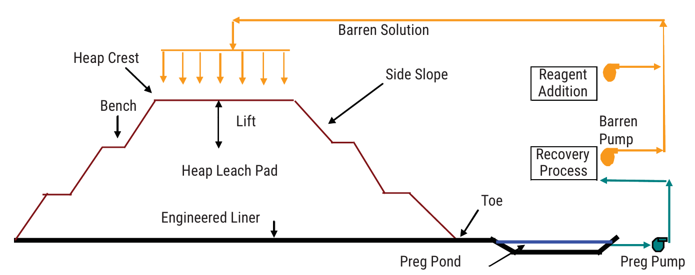

###### Esquema de la presentación de referencia facilitada por el docente; la solución rica continúa hacia su tratamiento.

## Ruta LESDE y unidades
<!-- _class: fixedTitle -->

1. **Lixiviación:** la solución disuelve el cobre recuperable.
2. **Extracción por solventes:** transfiere y concentra cobre en solución.
3. **Electrodeposición:** produce cátodos mediante energía eléctrica.

Los costos pueden expresarse por t de mineral colocado o por lb de cátodo. Conviértalos a una base común antes de sumarlos.

## Bases de costo en lixiviación y SX/EW
<!-- _class: fixedTitle -->

En un estudio técnico separado:

| Etapa | Base de diseño | Costo unitario |
|---|---:|---:|
| Lixiviación | 33.000 t mineral/día | US\$2,22/t |
| SX/EW | 54 millones lb Cu/año | US\$0,39/lb |

El periodo y el denominador difieren.

###### Fuentes: [Freeport, Cerro Verde, informe técnico 2024](https://www.sec.gov/Archives/edgar/data/831259/000083125925000006/a2024trscerroverde-finalxp.pdf).

<!-- Explique que una cifra se aplica a toneladas de mineral colocadas por día y la otra a libras de cobre producidas por año. Multiplicar cada par da montos para periodos diferentes; sumarlos sin convertir no tiene sentido. Para una conversión integral se necesitarían días de operación, metal recuperado y un límite claro que evite duplicar costos. El Excel plantea cálculos separados, no la reconstrucción del costo total de una operación real. -->

## Consumos en LESDE
<!-- _class: fixedTitle -->

| Etapa | Recursos a vigilar |
|---|---|
| Lixiviación | Ácido, soluciones, bombeo, preparación de pilas |
| Extracción por solventes | Extractante, diluyente y energía |
| Electrodeposición | Energía, insumos y mantenimiento |

La recuperación, el tiempo y la mineralogía son relevantes para interpretar los costos.

## Reactivos y energía: preguntas de gestión
<!-- _class: fixedTitle -->

| Recurso | Relación a revisar |
|---|---|
| Ácido | kg por t tratada y recuperación |
| Extractante y diluyente | Consumo, pérdidas y volumen de solución |
| Electricidad EW | kWh por lb de cátodo |
| Agua y bombeo | Balance de soluciones y costo por etapa |

El menor consumo debe evaluarse junto con recuperación y producción.

<!-- Use el ácido como ejemplo de un insumo cuyo consumo depende de mineralogía y condiciones de proceso. Una reducción en kg por tonelada no equivale automáticamente a una mejora si también cae la recuperación o cambia el tiempo de lixiviación. En SX y EW destaque la necesidad de medir pérdidas, flujo de soluciones y energía del mismo periodo. La hoja 04 usa costos unitarios de un estudio; no proporciona consumos específicos ni facturas reales de estos insumos. -->

## Comparabilidad entre operaciones
<!-- _class: fixedTitle -->

En el caso de esta sesión se usan **tres referencias separadas**: concentradora de cobre, operación polimetálica y estudio de LESDE.

Cada referencia responde una pregunta distinta. No se deben presentar sus parámetros como si provinieran de la misma planta.

## Caso 04: balances y rutas de proceso
<!-- _class: fixedTitle -->

**Archivo:** cuaderno, caso 04 · **Excel:** «04 Flotación».

- Completen el balance de Cu y comparen sus estimaciones con el metal reportado.
- Calculen los indicadores de Zn y Ag con los datos disponibles.
- Expliquen cómo comparar los costos diarios y anuales de LESDE.

> ¿Qué mediciones adicionales permiten cerrar el balance de metal?

---
<!-- _class: last-slide -->
<!-- _footer: "" -->

###### Muchas gracias

- <i class="fa-brands fa-google"></i>
  - ameresv@gmail.com
- <i class="fa-brands fa-telegram"></i> 
  - +51956384450  
- <i class="fa-brands fa-linkedin"></i> 
  - Ali Meres

# Costos en plantas minero metalúrgicas

###### Una mirada ejecutiva al negocio minero

<!-- _class: cover -->
<!-- _paginate: "" -->
<!-- _footer: Presentacion preparada para TECSUP -->

Ing. Alí Meres 
Ingeniero de Minas UNI - CIP 
Business Analytics Technical Lead @ Astay Systems
Contacto adicional：[LinkedIn](https://www.linkedin.com/in/ali-ivan-meres-vargas/)- ameresv\@gmail.com

## Agenda a desarrollar
<!-- _class: agenda_col2 -->

- Proceso, EEFF , OPEX y CAPEX
- Centros de costos y costo unitario
- Chancado y molienda
- Flotación, polimetálicos y lixiviación
- Presupuesto y variaciones PVE
- Mantenimiento y árbol de valor
- Liquidación de concentrados y NSR
- Rentabilidad, equilibrio e indicadores

## Sesión 05: Presupuesto y variaciones
<!-- _class: fixedTitle -->

<!-- _class: trans -->
<!-- _paginate: false -->
<!-- _footer: '' -->

## Sesión 05: ruta de teoría
<!-- _class: fixedTitle -->

| Tiempo | Desarrollo |
|---|---|
| 00–25 min | Presupuesto estático y flexible |
| 25–65 min | Puente de volumen, eficiencia y precio |
| 65–90 min | Ejemplo resuelto y aplicación a insumos |

Al finalizar: 30 minutos de receso y 60 minutos de caso.

## Presupuesto como referencia de gestión
<!-- _class: fixedTitle -->

El presupuesto explicita volumen, consumo específico y precio para un período y una frontera definidos.

Para explicar una diferencia, compare el costo real con una base coherente y documente cambios en mezcla de mineral, alcance y política de registro.

## Construcción de una línea de presupuesto
<!-- _class: fixedTitle -->

**Recurso:** energía, medios o reactivos de un centro.

**Volumen:** toneladas previstas para el periodo.

**Consumo específico:** cantidad del recurso por tonelada.

**Precio:** tarifa o costo por unidad del recurso.

**Resultado:** volumen × consumo específico × precio.

<!-- Pida construir verbalmente una línea de energía desde el plan de tonelaje, una intensidad de referencia y la tarifa. Después cambie el recurso a bolas y compruebe que cambian las unidades. Un estándar presupuestario necesita responsable, versión, periodo y justificación técnica; una cifra histórica no es automáticamente el presupuesto. El caso 05 usa un año anterior como base de comparación, no como presupuesto aprobado, y combina tarifas externas para practicar la mecánica. -->

## Costo de un recurso
<!-- _class: fixedTitle -->

**Costo** = toneladas × consumo específico × precio

Por ejemplo, en electricidad: **t × kWh/t × (S/ por kWh) = S/**.

En bolas: **t × kg/t × US\$/kg = US\$**. Cada producto conserva su propia unidad.

## Presupuesto estático y flexible
<!-- _class: fixedTitle -->

| Base | Pregunta |
|---|---|
| Presupuesto estático | ¿Qué se aprobó para el volumen previsto? |
| Presupuesto flexible | ¿Qué costaría el volumen real con el estándar definido? |
| Real | ¿Qué costo se obtuvo con consumo y precio reales? |

La comparación flexible evita atribuir todo el cambio al desempeño cuando también varía el tonelaje.

## Presupuesto flexible: qué se mantiene
<!-- _class: fixedTitle -->

| Comparación | Toneladas | Consumo/t | Precio |
|---|---|---|---|
| Base estática | Base | Base | Base |
| Base flexible | Comparadas | Base | Base |
| Comparado | Comparadas | Comparado | Comparado |

El ajuste de volumen permite revisar el resto de la desviación.

<!-- El presupuesto flexible recalcula el volumen observado usando el estándar y el precio de base. La diferencia frente a la base estática corresponde al efecto volumen en este método. La comparación con el costo observado aún combina consumo específico y precio; de ahí la necesidad de un puente. Pregunte qué ocurre si cambia la mezcla de mineral y el estándar no se actualiza: parte de la diferencia puede reflejar una base no comparable, además de desempeño operativo. -->

## Variables del puente PVE
<!-- _class: fixedTitle -->

| Símbolo | Base 0 | Comparación 1 |
|---|---|---|
| **T** | Toneladas base | Toneladas comparadas |
| **e** | Consumo específico base | Consumo específico comparado |
| **p** | Precio unitario base | Precio unitario comparado |

Costo base = T₀ × e₀ × p₀. Costo comparado = T₁ × e₁ × p₁.

## Las unidades deben cerrar
<!-- _class: fixedTitle -->

Para electricidad:

**T** = toneladas · **e** = kWh/t · **p** = S/ por kWh.

**T × e** entrega kWh y **T × e × p** entrega soles.

Para bolas, cambie **e** a kg/t y **p** a moneda/kg; mantenga la moneda homogénea.

<!-- Haga que los participantes cancelen unidades en voz alta. Si el consumo se ingresa en gramos por tonelada y el precio por kilogramo, debe convertirse una de las unidades antes de multiplicar. Si se comparan monedas diferentes, se requiere una tasa y criterio de conversión declarados. La hoja 05B solicita seis entradas: dos tonelajes, dos consumos específicos y dos precios. No rellene esos datos con valores supuestos de la operación. -->

## Efecto volumen
<!-- _class: fixedTitle -->

**Volumen** = (T₁ − T₀) × e₀ × p₀

Mide el cambio de costo al sustituir el tonelaje, manteniendo consumo específico y precio de la base.

En este orden de cálculo, los otros dos factores aún no cambian.

## Puente guiado: efecto volumen
<!-- _class: fixedTitle -->

**Circuito total · comparación histórica**

(30.850.490 − 29.617.007) t

× 19,71 kWh/t × S/0,29 por kWh

= **+S/7,05 millones**, aproximadamente.

El cálculo conserva intensidad y tarifa de la base.

###### Fuentes: [Southern Copper, Cuajone 2021, sección 14.4.12](https://www.sec.gov/Archives/edgar/data/1001838/000155837022002995/scco-20211231ex961a821f6.pdf) · [Southern Copper, Cuajone 2024, sección 14.4.12](https://www.sec.gov/Archives/edgar/data/1001838/000155837025002017/scco-20241231xex96d1.pdf) · [PCR / SMV, tarifas medias Luz del Sur 2021 y 2024](https://www.smv.gob.pe/ConsultasP8/temp/PCR%20DIC25.pdf).

<!-- Señale las celdas C7, C8, C17 y C11 y la fórmula ya resuelta en C23 de la hoja 05. El aumento de toneladas se valora al consumo específico y precio de base: es una construcción secuencial, no la factura adicional identificada de una operación. La señal positiva incrementa el costo bajo las condiciones del ejemplo. No mezcle la tarifa en soles de este ejercicio con la tarifa en dólares del caso 03. -->

## Efecto eficiencia
<!-- _class: fixedTitle -->

**Eficiencia** = T₁ × (e₁ − e₀) × p₀

Mantiene el volumen comparado y el precio base. Refleja el efecto del cambio en consumo por tonelada.

Para un insumo de costo positivo, una disminución de consumo específico genera un efecto favorable, si las demás condiciones se mantienen.

## Puente guiado: efecto eficiencia
<!-- _class: fixedTitle -->

30.850.490 t × (20,23 − 19,71) kWh/t

× S/0,29 por kWh

= **+S/4,65 millones**, aproximadamente.

El volumen ya es el comparado; el precio permanece en la base.

###### Fuentes: [Southern Copper, Cuajone 2024, sección 14.4.12](https://www.sec.gov/Archives/edgar/data/1001838/000155837025002017/scco-20241231xex96d1.pdf) · [Southern Copper, Cuajone 2021, sección 14.4.12](https://www.sec.gov/Archives/edgar/data/1001838/000155837022002995/scco-20211231ex961a821f6.pdf) · [PCR / SMV, tarifas medias Luz del Sur 2021 y 2024](https://www.smv.gob.pe/ConsultasP8/temp/PCR%20DIC25.pdf).

<!-- En la hoja 05 la fórmula del circuito total aparece en C24. Muestre que la diferencia de intensidades se multiplica por todas las toneladas del periodo comparado y por el precio de base. El resultado positivo implica mayor costo simulado asociado a intensidad, pero no demuestra ineficiencia de los operadores. Una variación de dureza, mezcla o frontera de medición puede explicar parte del cambio y debe investigarse con datos independientes. -->

## Efecto precio
<!-- _class: fixedTitle -->

**Precio** = T₁ × e₁ × (p₁ − p₀)

Usa el consumo comparado y mide el cambio asociado al precio unitario.

Revise moneda, calidad, condiciones de compra y si las tarifas incluyen los mismos cargos.

## Puente guiado: efecto precio
<!-- _class: fixedTitle -->

30.850.490 t × 20,23 kWh/t

× (S/0,32 − S/0,29 por kWh)

= **+S/18,72 millones**, aproximadamente.

La tarifa procede de una distribuidora y no del contrato de la mina.

###### Fuentes: [PCR / SMV, tarifas medias Luz del Sur 2021 y 2024](https://www.smv.gob.pe/ConsultasP8/temp/PCR%20DIC25.pdf) · [Southern Copper, Cuajone 2024, sección 14.4.12](https://www.sec.gov/Archives/edgar/data/1001838/000155837025002017/scco-20241231xex96d1.pdf).

<!-- La fórmula C25 aplica la diferencia entre tarifas al consumo del periodo comparado. El valor de las tarifas es una referencia externa de clientes libres de una distribuidora; ni la tarifa ni el costo resultante constituyen datos reales de la concentradora. Al sumar volumen, eficiencia y precio se obtiene la variación total del ejercicio, con diferencias menores por redondeo de lo mostrado en pantalla. Pida explicar por qué precio es el mayor efecto aritmético. -->

## Control del puente
<!-- _class: fixedTitle -->

**Variación total = volumen + eficiencia + precio**

Debe coincidir con:

**T₁ × e₁ × p₁ − T₀ × e₀ × p₀**

El reparto de efectos conjuntos puede cambiar con el orden de sustitución. Mantenga el mismo orden y evite redondear resultados intermedios.

## Ejemplo: energía total de la concentradora
<!-- _class: fixedTitle -->

| Variable | Base 2021 | Comparación 2024 |
|---|---:|---:|
| Mineral tratado, millones de t | 29,617 | 30,850 |
| Intensidad, kWh/t | 19,71 | 20,23 |
| Tarifa externa, S/ por kWh | 0,29 | 0,32 |

###### La tarifa proviene de una referencia externa. La base es 2021, no un presupuesto aprobado. Fuentes: [Cuajone 2021](https://www.sec.gov/Archives/edgar/data/1001838/000155837022002995/scco-20211231ex961a821f6.pdf), [Cuajone 2024](https://www.sec.gov/Archives/edgar/data/1001838/000155837025002017/scco-20241231xex96d1.pdf) y [tarifas de referencia](https://www.smv.gob.pe/ConsultasP8/temp/PCR%20DIC25.pdf).

## Ejemplo guiado: conciliación PVE
<!-- _class: fixedTitle -->

| Efecto en energía total | S/ millones |
|---|---:|
| Volumen | +7,05 |
| Eficiencia | +4,65 |
| Precio | +18,72 |
| **Variación total** | **+30,43** |

Costo simulado: de **S/169,29 M** a **S/199,71 M**. No representa el gasto real de la mina.

## Interpretación y responsables
<!-- _class: fixedTitle -->

- Un efecto identifica una contribución aritmética, no demuestra su causa.
- Contraste consumo específico con mineral, operación y medición.
- Contraste precio con contratos, facturas y ajustes de tarifa.
- Registre hipótesis, responsable, acción y fecha de seguimiento.

## Datos para bolas o reactivos
<!-- _class: fixedTitle -->

Para construir el puente se necesitan, en ambos períodos:

1. Toneladas tratadas bajo la misma frontera.
2. Consumo específico medido en kg/t u otra unidad homogénea.
3. Precio por unidad de consumo, en moneda comparable.

La hoja «05B Insumos» permanece vacía hasta recibir los seis datos reales.

## Traslado del método a la hoja 05B
<!-- _class: fixedTitle -->

| Entrada | Base | Comparado |
|---|---|---|
| Mineral tratado | dato real | dato real |
| Consumo específico | kg/t | kg/t |
| Precio | moneda/kg | moneda/kg |

Con las seis entradas, la hoja calcula el puente y un control de conciliación.

<!-- Abra 05B Insumos y ubique C7:D9. La hoja permanece sin resultados mientras falte alguna de las seis entradas numéricas. Una vez disponibles datos reales comparables, mostrará costo base, costo comparado y efectos en C12:C19. Indique que el nombre del insumo, fuente y periodo también deben documentarse. Esta plantilla no contiene un dato oculto de bolas o reactivos: completarla requiere información que la operación suministre. -->

## Caso 05: desviación del circuito
<!-- _class: fixedTitle -->

**Archivo:** cuaderno, caso 05 · **Excel:** «05 PVE» y «05B Insumos».

- Revisen el puente resuelto de energía total.
- Construyan el puente de molienda y verifiquen la conciliación.
- Identifiquen el efecto mayor y los datos que necesitan para repetirlo con un insumo real.

> ¿Por qué esta comparación no es una desviación contra el presupuesto de la mina?

---
<!-- _class: last-slide -->
<!-- _footer: "" -->

###### Muchas gracias

- <i class="fa-brands fa-google"></i>
  - ameresv@gmail.com
- <i class="fa-brands fa-telegram"></i> 
  - +51956384450  
- <i class="fa-brands fa-linkedin"></i> 
  - Ali Meres

# Costos en plantas minero metalúrgicas

###### Una mirada ejecutiva al negocio minero

<!-- _class: cover -->
<!-- _paginate: "" -->
<!-- _footer: Presentacion preparada para TECSUP -->

Ing. Alí Meres 
Ingeniero de Minas UNI - CIP 
Business Analytics Technical Lead @ Astay Systems
Contacto adicional：[LinkedIn](https://www.linkedin.com/in/ali-ivan-meres-vargas/)- ameresv\@gmail.com

## Agenda a desarrollar
<!-- _class: agenda_col2 -->

- Proceso, EEFF , OPEX y CAPEX
- Centros de costos y costo unitario
- Chancado y molienda
- Flotación, polimetálicos y lixiviación
- Presupuesto y variaciones PVE
- Mantenimiento y árbol de valor
- Liquidación de concentrados y NSR
- Rentabilidad, equilibrio e indicadores

## Sesión 06: Mantenimiento y árbol de valor

<!-- _class: trans -->
<!-- _paginate: false -->
<!-- _footer: '' -->

## Sesión 06: ruta de teoría
<!-- _class: fixedTitle -->

| Tiempo | Desarrollo |
|---|---|
| 00–30 min | Mantenimiento, tiempo y disponibilidad |
| 30–60 min | Ritmo de tratamiento y costo de paradas |
| 60–90 min | Árbol de valor y preparación del caso |

###### Al finalizar: 30 minutos de receso y 60 minutos de caso.

## Mantenimiento como decisión económica
<!-- _class: fixedTitle -->

El mantenimiento consume recursos y también influye en la disponibilidad y la estabilidad de producción.

Para evaluar una intervención se comparan costos y consecuencias esperadas: duración de parada, riesgo de falla, repuestos y posible impacto en el proceso.

## Relación conceptual entre mantenimiento y pérdidas
<!-- _class: fixedTitle -->

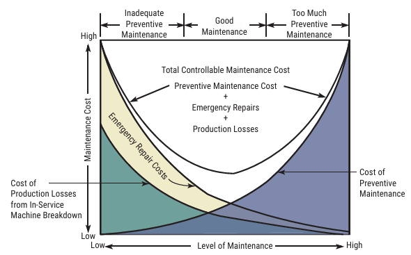

###### Esquema de la presentación de referencia facilitada por el docente; las curvas son conceptuales, no mediciones de una planta.

## Modelo de tiempos
<!-- _class: fixedTitle -->

| Tiempo | Pregunta |
|---|---|
| Calendario | ¿Cuál es el horizonte total? |
| Disponible | ¿Cuánto tiempo estuvo apto el equipo? |
| Operado | ¿Cuánto tiempo efectivamente procesó? |
| No disponible | ¿Cuánto tiempo quedó fuera según la definición? |

Cada operación debe documentar cómo clasifica paradas programadas, fallas y restricciones externas.

## Una parada necesita clasificación
<!-- _class: fixedTitle -->

| Registro | Ejemplos de información |
|---|---|
| Inicio y fin | Fecha, hora y equipo |
| Tipo | Planificada, falla u otra restricción |
| Causa | Código y descripción comprobable |
| Consecuencia | Equipo afectado y restricción del circuito |

La disponibilidad resume horas; el detalle explica la causa.

<!-- Pida que imaginen una detención y enumeren qué se debe registrar para entenderla, sin asignar un evento o duración real. El registro debe distinguir paradas programadas, fallas y restricciones como falta de alimentación, usando el diccionario de la empresa. Una hora fuera de servicio no siempre es atribuible a mantenimiento. La hoja 06 contiene una tasa global de disponibilidad; no contiene el historial necesario para repartir esa diferencia entre causas. -->

## Disponibilidad y utilización
<!-- _class: fixedTitle -->

En un modelo basado en calendario:

**Disponibilidad** = tiempo disponible / tiempo calendario

**Utilización sobre disponible** = tiempo operado / tiempo disponible

Las definiciones de la fuente pueden diferir. Antes de comparar, compruebe numerador, denominador y paradas incluidas.

## Disponibilidad y uso no son iguales
<!-- _class: fixedTitle -->

**Disponible:** equipo apto para operar según la definición del indicador.

**Operado:** tiempo en que realmente procesa.

Un equipo puede estar disponible y sin operar por falta de mineral u otra restricción. Las fórmulas deben respetar el denominador de cada empresa.

<!-- Use un ejemplo verbal sin cifras: un molino disponible espera alimentación. Su disponibilidad puede seguir siendo alta mientras su utilización sea menor. Si el área define disponibilidad mecánica, física u operacional de forma distinta, hay que usar sus propias reglas y horas base. No compare porcentajes de dos fuentes hasta revisar exclusiones y base de tiempo. Esta distinción prepara el cálculo aproximado del tonelaje de la hoja 06. -->

## Ejemplo guiado: tiempo disponible
<!-- _class: fixedTitle -->

Para un año de 365 días y referencia nominal de **94 %**:

- Tiempo calendario = **8.760 h**.
- Tiempo disponible equivalente = **8.234,4 h**.
- Tiempo no disponible equivalente = **525,6 h**.

###### Ejercicio con datos de [Hudbay, informe anual 2023](https://s23.q4cdn.com/405985100/files/doc_downloads/2024/03/2023aif-final.pdf). La diferencia no identifica por sí sola las causas de parada.

## Ejemplo en la hoja 06 Mantenimiento
<!-- _class: fixedTitle -->

**2023 · base de 365 días y 94 % de referencia nominal**

- C17: 365 × 24 = **8.760 h**.
- C18: 8.760 × 0,94 = **8.234,4 h disponibles**.
- C19: diferencia = **525,6 h no disponibles**.

La diferencia no identifica automáticamente fallas.

###### Fuentes: [Hudbay, informe anual 2023, referencia nominal de planta](https://s23.q4cdn.com/405985100/files/doc_downloads/2024/03/2023aif-final.pdf).

<!-- Abra la hoja 06 y demuestre las tres primeras celdas calculadas. El 94 por ciento aparece junto a la capacidad nominal en el informe de 2023 y se usa como referencia de cálculo, no como una medición desagregada de todas las paradas de ese año. Aplicarlo al calendario es una simplificación. Las 525,6 horas no son mantenimiento correctivo ni pérdida de producción medida. Pida registros adicionales para separar fallas, trabajo planificado y otras causas. -->

## Ritmo y tonelaje
<!-- _class: fixedTitle -->

**Toneladas estimadas** = días calendario × disponibilidad × t por día disponible

**Ritmo equivalente** = toneladas reales / días disponibles equivalentes

Compare la estimación con la producción real y revise tasa, restricciones y redondeos antes de interpretar la diferencia.

## Capacidad estimada y producción real
<!-- _class: fixedTitle -->

Para la referencia 2023:

**Tonelaje estimado** = 365 días × 94 % × 90.000 t/día disponible

**Comparación** = toneladas realmente molidas − tonelaje estimado.

La tasa de 2023 es nominal y está redondeada; no reproduce cada día de operación.

###### Fuentes: [Hudbay, informe anual 2023, referencia nominal de planta](https://s23.q4cdn.com/405985100/files/doc_downloads/2024/03/2023aif-final.pdf).

<!-- La hoja 06 usa 90.000 toneladas por día como tasa nominal redondeada de referencia; las 30.720.929 toneladas son el tratamiento real reportado. Muestre la estructura de la operación, pero deje el resultado de C20 y la diferencia de C21 para los equipos. Pida identificar diferencias entre capacidad nominal y producción real, restricciones y redondeo. El dato no permite concluir cuánto mineral se perdió por fallas. -->

## Confiabilidad y reparación
<!-- _class: fixedTitle -->

Dos indicadores habituales requieren una definición de fallas y períodos consistente:

- **Tiempo medio entre fallas:** tiempo operativo considerado / número de fallas.
- **Tiempo medio de reparación:** tiempo de reparación considerado / número de reparaciones.

No sustituyen un análisis de criticidad ni explican por sí solos la pérdida económica.

## ¿Cuánto cuesta una parada?
<!-- _class: fixedTitle -->

Revise mano de obra, repuestos y servicios de la intervención. Luego estime, si corresponde, el margen de producción que realmente no podrá recuperarse.

No suponga que toda hora detenida es producción perdida: puede existir capacidad de recuperación, inventario intermedio o una restricción en otra etapa.

## Evitar doble conteo del impacto
<!-- _class: fixedTitle -->

**Costo de intervención:** repuestos, servicios y mano de obra incrementales.

**Pérdida operativa:** margen del producto que no puede recuperarse, cuando corresponda.

No sumar como costo perdido partidas que ya se incluyeron en el margen incremental.

<!-- Distinga el costo de ejecutar una intervención del valor económico que se deja de generar. Si una detención puede recuperarse con inventario, mayor ritmo posterior o capacidad ociosa, la pérdida de producción neta puede ser menor que horas por capacidad nominal. Al valorarla, use margen incremental y evite añadir de nuevo costos variables ya descontados. Ninguno de estos importes se puede calcular con certeza solo con las horas equivalentes de la hoja 06. -->

## Árbol de valor de la planta
<!-- _class: fixedTitle -->

| Impulsor | Conexión con el resultado |
|---|---|
| Tiempo y ritmo | Determinan toneladas tratadas |
| Ley y recuperación | Determinan metal recuperado |
| Pagabilidad y precio | Determinan valor comercial, sujeto a cargos |
| Costos e inversiones | Afectan margen y generación de caja |

## Árbol de valor: lectura física y comercial
<!-- _class: fixedTitle -->

1. Tiempo disponible y ritmo determinan toneladas tratadas.
2. Toneladas, ley y recuperación estiman metal recuperado.
3. Pagabilidad, precio y cargos determinan valor comercial parcial.
4. Costos e inversiones determinan el resultado evaluado.

<!-- Recorra el árbol de arriba hacia abajo y luego de abajo hacia arriba. Una disminución del costo por tonelada puede acompañarse de menos metal por tonelada por una ley menor. También puede mejorar la disponibilidad sin mejorar el valor si otra etapa restringe el circuito. Pida que los estudiantes dibujen sus relaciones causales y que etiqueten qué variables tienen medida, cuáles son hipótesis y cuáles requieren datos comerciales que no están en la hoja. -->

## Indicadores que deben leerse juntos
<!-- _class: fixedTitle -->

Un menor **US\$/t** no basta para afirmar que el margen mejoró. También pueden cambiar la ley, la recuperación, el producto pagable y el precio.

Compare costo por tonelada con **kg de Cu producido por tonelada** y con los ingresos y cargos disponibles para el mismo período.

## Datos comparables en el caso 06
<!-- _class: fixedTitle -->

| Variable | Referencia 2023 | Reportado 2024 |
|---|---:|---:|
| Toneladas molidas | 30.720.929 | 31.933.624 |
| Costo de molienda | US\$198,1 M | US\$197,1 M |
| Cu en concentrado | 100.487 t | 99.001 t |

Los equipos calcularán US\$/t y kg Cu/t para cada año.

###### Fuentes: [Hudbay, operación Perú, resultados 2023–2024](https://www.sec.gov/Archives/edgar/data/1322422/000106299325002997/exhibit99-2.htm).

<!-- Estas filas del Excel combinan costo y desempeño físico de la misma operación y periodos, con las precisiones indicadas en las fuentes. No basta comparar los millones de dólares ni el total de toneladas por separado. En el taller dividan costo por toneladas molidas y conviertan el Cu reportado a kilogramos antes de dividirlo entre toneladas. El resultado apoya una conversación sobre margen, pero no incorpora precios ni cargos, por lo que no lo determina. -->

## Priorizar causas verificables
<!-- _class: fixedTitle -->

1. Separar cambios de disponibilidad, ritmo y ley.
2. Identificar fallas, mantenimiento programado y restricciones externas.
3. Estimar el impacto económico con una misma base.
4. Definir responsable, acción y medición posterior.

## Caso 06: disponibilidad y valor
<!-- _class: fixedTitle -->

**Archivo:** cuaderno, caso 06 · **Excel:** «06 Mantenimiento».

- Estimen horas disponibles y tonelaje para ambos años.
- Comparen con la producción real y calculen costo por tonelada y Cu/t.
- Dibujen el árbol de valor y propongan cómo investigar las paradas.

> ¿Qué evidencia permitiría distinguir una falla de una parada programada?

---
<!-- _class: last-slide -->
<!-- _footer: "" -->

###### Muchas gracias

- <i class="fa-brands fa-google"></i>
  - ameresv@gmail.com
- <i class="fa-brands fa-telegram"></i> 
  - +51956384450  
- <i class="fa-brands fa-linkedin"></i> 
  - Ali Meres

# Costos en plantas minero metalúrgicas

###### Una mirada ejecutiva al negocio minero

<!-- _class: cover -->
<!-- _paginate: "" -->
<!-- _footer: Presentacion preparada para TECSUP -->

Ing. Alí Meres 
Ingeniero de Minas UNI - CIP 
Business Analytics Technical Lead @ Astay Systems
Contacto adicional：[LinkedIn](https://www.linkedin.com/in/ali-ivan-meres-vargas/)- ameresv\@gmail.com

## Agenda a desarrollar
<!-- _class: agenda_col2 -->

- Proceso, EEFF , OPEX y CAPEX
- Centros de costos y costo unitario
- Chancado y molienda
- Flotación, polimetálicos y lixiviación
- Presupuesto y variaciones PVE
- Mantenimiento y árbol de valor
- Liquidación de concentrados y NSR
- Rentabilidad, equilibrio e indicadores

## Sesión 07: Concentrados y NSR
<!-- _class: fixedTitle -->

<!-- _class: trans -->
<!-- _paginate: false -->
<!-- _footer: '' -->

## Sesión 07: ruta de teoría
<!-- _class: fixedTitle -->

| Tiempo | Desarrollo |
|---|---|
| 00–25 min | Masa, ley y contenido metálico |
| 25–55 min | Pagabilidad, tratamiento y refinación |
| 55–90 min | NSR parcial y preparación del caso |

###### Al finalizar: 30 minutos de receso y 60 minutos de caso.

## De mineral a ingreso comercial
<!-- _class: fixedTitle -->

El valor del concentrado depende de su masa seca, ley, contenido metálico, pagabilidad, precio y deducciones contractuales.

Una liquidación completa también puede incluir humedad, mermas, flete, penalidades, créditos de otros metales y condiciones de fijación de precio.

## Masa húmeda y masa seca
<!-- _class: fixedTitle -->

**Masa seca** = masa húmeda × (1 − fracción de humedad)

La ley comercial se debe aplicar sobre la base definida en el contrato. Los cargos por tonelada de concentrado deben utilizar la masa que especifique el acuerdo.

## De la balanza al contenido metálico
<!-- _class: fixedTitle -->

1. Registrar masa húmeda y porcentaje de humedad.
2. Calcular **masa seca = masa húmeda × (1 − humedad)**.
3. Multiplicar la masa seca por la ley sobre base seca.
4. Aplicar las reglas comerciales al metal entregado.

En el caso 07 se parte directamente de mineral seco.

<!-- Explique que el agua agrega masa física pero no contenido de cobre. La ley y el peso usados en el cálculo deben compartir base seca o la base pactada. En el taller se parte de una tonelada de mineral seco y no se dispone de humedad del concentrado, por lo cual no se añade un descuento de humedad ficticio. Si se recibiera un peso húmedo, haría falta la humedad medida antes de calcular masa seca. Pregunte en qué documento se registra cada dato. -->

## Contenido de metal
<!-- _class: fixedTitle -->

**Metal contenido** = masa seca de concentrado × ley del metal

Si la masa está en toneladas y la ley como proporción, el resultado es toneladas de metal.

**1 t métrica = 2.204,6226 lb** aproximadamente.

## Ejemplo: mineral, Cu y concentrado
<!-- _class: fixedTitle -->

**Una tonelada de mineral seco · parámetros de estudio**

- 1 × 0,0034 = **0,0034 t Cu en cabeza**.
- 0,0034 × 0,887 = **0,0030158 t Cu recuperado**.
- 0,0030158 / 0,252 = **0,011967 t de concentrado seco**.

Las tres cantidades miden objetos físicos diferentes.

###### Fuentes: [Freeport, Cerro Verde, informe técnico 2024](https://www.sec.gov/Archives/edgar/data/831259/000083125925000006/a2024trscerroverde-finalxp.pdf).

<!-- En la hoja 07 estas son las tres primeras filas resueltas, C18 a C20. Deténgase en las unidades: tonelada de mineral, tonelada de cobre y tonelada de concentrado no son equivalentes. Se divide el cobre recuperado por la ley del concentrado expresada como proporción, bajo el balance simple del ejercicio. La ley de 0,34 por ciento y la recuperación de 88,7 por ciento provienen de un estudio técnico histórico; no son un contrato ni valores actuales. -->

## Metal pagable
<!-- _class: fixedTitle -->

En un modelo porcentual sencillo:

**Metal pagable** = metal entregado × pagabilidad

Los contratos pueden usar deducciones mínimas, escalas u otras reglas. El porcentaje de este taller es un supuesto para aplicar los parámetros del estudio.

## Recuperación, merma y pagabilidad
<!-- _class: fixedTitle -->

| Etapa | Qué cambia |
|---|---|
| Recuperación metalúrgica | Cu que pasa del mineral al concentrado |
| Merma de transporte | Cantidad que llega al punto definido |
| Pagabilidad | Porción del metal entregado reconocida en el modelo |

La hoja aplica merma y pagabilidad en ese orden.

###### Fuentes: [Freeport, Cerro Verde, informe técnico 2024](https://www.sec.gov/Archives/edgar/data/831259/000083125925000006/a2024trscerroverde-finalxp.pdf).

<!-- Con una tonelada de mineral como base, pregunte dónde ocurre cada reducción: recuperación en planta, merma en transporte y pagabilidad al liquidar. En el modelo del caso, la merma se aplica proporcionalmente a masa y metal, y luego se usa una pagabilidad del 96 por ciento; las reglas reales dependen del contrato. No llame pagabilidad a la recuperación metalúrgica ni al cociente de ventas sobre producción. Los equipos completarán las filas posteriores al ejemplo guiado. -->

## Cargos de tratamiento y refinación
<!-- _class: fixedTitle -->

| Cargo | Base del modelo del taller |
|---|---|
| TC, tratamiento | US\$ por t seca de concentrado entregado |
| RC, refinación | US\$ por lb de Cu pagable |

Las bases y condiciones exactas dependen del contrato. Evite agregar un cargo total que ya incluya TC o RC.

## TC y RC: unidades de cobro
<!-- _class: fixedTitle -->

**TC:** US\$100 por tonelada seca de concentrado entregado.

**RC:** US\$0,10 por libra de Cu pagable en este taller.

La conversión de toneladas de Cu a libras se hace antes de aplicar el RC. Cada base debe coincidir con la hipótesis del modelo.

###### Fuentes: [Freeport, Cerro Verde, informe técnico 2024](https://www.sec.gov/Archives/edgar/data/831259/000083125925000006/a2024trscerroverde-finalxp.pdf).

<!-- Señale que TC y RC son parámetros del estudio empleados como supuestos didácticos, no una cotización contractual vigente. Conecte la masa seca entregada con TC y el cobre pagable en libras con RC. Según el taller, la merma afecta tanto masa como metal y la refinación se cobra sobre libras pagables; los contratos pueden usar otras reglas. Pregunte qué ocurriría si se multiplicara el TC por toneladas de mineral en vez de concentrado. -->

## NSR por tonelada de mineral
<!-- _class: fixedTitle -->

En el modelo parcial del taller:

**NSR** = (valor del Cu pagable − TC − RC) / t de mineral seco

El resultado **no incluye** flete, penalidades ni créditos por subproductos. Una liquidación completa requiere incluir lo aplicable una sola vez.

## Revisión del alcance del NSR
<!-- _class: fixedTitle -->

**Incluido:** valor de Cu pagable, TC y RC.

**No incluido:** flete, penalidades y créditos de subproductos.

**Base:** una tonelada seca de mineral.

Antes de agregar un cargo total, comprobar que no incluya ya TC o RC.

###### Fuentes: [Freeport, Cerro Verde, informe técnico 2024](https://www.sec.gov/Archives/edgar/data/831259/000083125925000006/a2024trscerroverde-finalxp.pdf).

<!-- Dibuje un puente conceptual desde valor del cobre pagable hasta el valor neto parcial y divídalo por mineral de alimentación. Si se agregara el cargo combinado de comercialización del mismo estudio sin revisar su composición, podría duplicarse tratamiento o refinación ya restados por separado. La hoja deja fuera flete, penalidades, humedad y subproductos. Por eso el indicador sirve para aprender el mecanismo y no representa la liquidación completa de un despacho real. -->

## Ejemplo guiado: una tonelada de mineral
<!-- _class: fixedTitle -->

Con **0,34 % Cu**, recuperación de **88,7 %** y concentrado de **25,2 % Cu**:

- Cu contenido: **0,0034 t**.
- Cu recuperado: **0,0030158 t**.
- Concentrado seco estimado: **0,011967 t**.

###### Parámetros históricos del [informe técnico Cerro Verde 2024](https://www.sec.gov/Archives/edgar/data/831259/000083125925000006/a2024trscerroverde-finalxp.pdf); cálculo por tonelada de mineral seco.

## Merma y pagabilidad en el taller
<!-- _class: fixedTitle -->

El modelo aplica la merma de transporte proporcionalmente a concentrado y Cu antes de calcular el metal pagable.

La pagabilidad se aplica al Cu entregado y el RC a las libras pagables. Estas reglas son **supuestos del ejercicio**, no una liquidación contractual universal.

## Sensibilidad al precio
<!-- _class: fixedTitle -->

El caso compara **US\$3,25/lb** y **US\$3,75/lb** con los demás parámetros del modelo constantes.

Preguntas para la comparación:

- ¿Qué componente del ingreso cambia?
- ¿Cambian el TC o el RC bajo estas hipótesis?
- ¿Qué efecto aparece en el NSR por tonelada de mineral?

## Sensibilidad: qué cambia y qué se congela
<!-- _class: fixedTitle -->

| Variable del modelo | Escenario A | Escenario B |
|---|---:|---:|
| Precio de cobre | US\$3,25/lb | US\$3,75/lb |
| Ley, recuperación y pagabilidad | Iguales | Iguales |
| TC y RC unitarios | Iguales | Iguales |

Los precios son parámetros históricos de estudio, no precios vigentes.

###### Fuentes: [Freeport, Cerro Verde, informe técnico 2024](https://www.sec.gov/Archives/edgar/data/831259/000083125925000006/a2024trscerroverde-finalxp.pdf).

<!-- Explique que el ejercicio congela todas las variables salvo el precio, para aislar su efecto. Por tanto, bajo las reglas del taller el cambio de NSR se explica por el metal pagable multiplicado por la diferencia de precio; los cargos TC y RC permanecen iguales. No anticipe el NSR de las columnas C y D que los equipos deben calcular. El mercado y los contratos reales pueden cambiar simultáneamente otros factores. -->

## Información para liquidar un envío
<!-- _class: fixedTitle -->

Reunir contrato, pesos y humedad, leyes y ensayes, período de cotización, reglas de pagabilidad, cargos, penalidades y créditos de otros metales.

Reconciliar **producto producido**, **producto despachado** y **producto liquidado** antes de explicar una diferencia.

## Lista de comprobación para la liquidación
<!-- _class: fixedTitle -->

- Pesos: húmedo, humedad medida y tonelada seca.
- Calidad: ensayes, penalidades y reglas de intercambio.
- Comercio: cotización, periodo de precio y pagables.
- Costos: TC, RC, flete y deducciones aplicables.
- Control: producción, existencias, despacho y liquidación.

<!-- Pida al grupo que describa qué documentos debería solicitar al área comercial antes de calcular el valor final de un embarque. Una balanza y un ensayo no bastan sin contrato, punto de entrega, periodo de fijación de precio y detalle de cargos. La comparación entre despacho y producción también requiere inventario inicial y final. Esta lista prepara la pregunta cualitativa del caso 07 y evita trasladar sin contexto los parámetros históricos del estudio a una operación real. -->

## Caso 07: NSR parcial
<!-- _class: fixedTitle -->

**Archivo:** cuaderno, caso 07 · **Excel:** «07 Concentrados».

1. Completen concentrado entregado y Cu pagable.
2. Calculen valor, TC, RC y NSR en los dos escenarios.
3. Expliquen qué falta para una liquidación comercial completa.

> ¿Qué parte de la diferencia proviene del precio en este modelo?

---
<!-- _class: last-slide -->
<!-- _footer: "" -->

###### Muchas gracias

- <i class="fa-brands fa-google"></i>
  - ameresv@gmail.com
- <i class="fa-brands fa-telegram"></i> 
  - +51956384450  
- <i class="fa-brands fa-linkedin"></i> 
  - Ali Meres

# Costos en plantas minero metalúrgicas

###### Una mirada ejecutiva al negocio minero

<!-- _class: cover -->
<!-- _paginate: "" -->
<!-- _footer: Presentacion preparada para TECSUP -->

Ing. Alí Meres 
Ingeniero de Minas UNI - CIP 
Business Analytics Technical Lead @ Astay Systems
Contacto adicional：[LinkedIn](https://www.linkedin.com/in/ali-ivan-meres-vargas/)- ameresv\@gmail.com

## Agenda a desarrollar
<!-- _class: agenda_col2 -->

- Proceso, EEFF , OPEX y CAPEX
- Centros de costos y costo unitario
- Chancado y molienda
- Flotación, polimetálicos y lixiviación
- Presupuesto y variaciones PVE
- Mantenimiento y árbol de valor
- Liquidación de concentrados y NSR
- Rentabilidad, equilibrio e indicadores

## Sesión 08: Rentabilidad y puntos de equilibrio
<!-- _class: trans -->
<!-- _paginate: false -->
<!-- _footer: '' -->

## Sesión 08: ruta de teoría
<!-- _class: fixedTitle -->

| Tiempo | Desarrollo |
|---|---|
| 00–30 min | Contribución, equilibrio y ley interna |
| 30–65 min | Cash cost, créditos y costos de sostenimiento |
| 65–90 min | EBITDA, caja y preparación del caso |

###### Al finalizar: 30 minutos de receso y 60 minutos de caso.

## Del costo a la contribución
<!-- _class: fixedTitle -->

**Margen de contribución unitario** = precio unitario neto − costo variable unitario

La contribución disponible ayuda a cubrir costos fijos. Las partidas incluidas en precio neto y costo variable deben definirse para el período y la decisión.

## Definir el margen para la decisión
<!-- _class: fixedTitle -->

**Ingreso neto unitario**

menos **costos variables relevantes por unidad**

= **contribución para cubrir costos fijos**

La selección de costos depende de la decisión y del horizonte evaluado.

<!-- Use el ejemplo de una libra adicional para explicar que no todos los costos cambian con la producción en el corto plazo. El margen relevante requiere incluir cada ingreso y costo incremental una sola vez. Un costo fijo puede variar en otro horizonte o si se supera la capacidad disponible; por eso la clasificación es una hipótesis de trabajo, no una propiedad permanente de la cuenta. El caso 08 explicita una asignación fija/variable solo para practicar. -->

## Punto de equilibrio en libras
<!-- _class: fixedTitle -->

Con precio y costo variable unitario constantes:

**Libras de equilibrio** = costo fijo / contribución por lb

La contribución debe ser positiva. El modelo del taller supone que ciertos costos de 2024 son fijos o variables y omite otras partidas.

## Modelo anual del taller: alcance
<!-- _class: fixedTitle -->

**Hipótesis didáctica:** G&A 2024 se trata como fijo.

Mina y molienda 2024 se tratan como variables respecto a las libras producidas de la base.

Se excluyen otros costos, inventarios y subproductos. El resultado es **equilibrio parcial**, no el de una mina real.

###### Fuentes: [Hudbay, MD&A 2025, costos e inversiones de Perú](https://www.sec.gov/Archives/edgar/data/1322422/000106299326001113/exhibit99-2.htm).

<!-- Ubique en la hoja 08 las filas 14 a 17. La administración de 95,5 millones se usa como fija y mina más molienda de 342,6 millones como variable, aunque la fuente no descompone de ese modo los costos. El costo variable unitario se obtiene dividiendo por las libras base; luego se resta del precio y se divide el costo fijo por la contribución. Son hipótesis para el cálculo: los participantes deben cuestionarlas y completar las filas 34 a 36. -->

## Evaluar una ley de corte interna
<!-- _class: fixedTitle -->

Una ley interna parcial puede obtenerse igualando **valor neto parcial por t** y **costos considerados por t**, manteniendo explícitas la recuperación, pagabilidad y deducciones.

El resultado depende del alcance: en el ejercicio se incluyen proceso, G&A, Cu, TC y RC; se omiten mina, flete, penalidades, subproductos y capital.

###### El modelo no sustituye la ley de corte de reservas ni una evaluación integral de mina.

## Ley interna: condición de equilibrio
<!-- _class: fixedTitle -->

En el modelo de la hoja 08:

**NSR parcial de Cu por tonelada** = **costo de proceso + G&A por tonelada**.

La ley que iguala ambos lados depende del precio, recuperación, pagabilidad y cargos considerados.

Mina, flete, penalidades, subproductos y capital quedan fuera.

###### Fuentes: [Freeport, Cerro Verde, informe técnico 2024](https://www.sec.gov/Archives/edgar/data/831259/000083125925000006/a2024trscerroverde-finalxp.pdf).

<!-- Conecte el modelo de ley interna con las reglas de NSR parcial de la sesión 07. La incógnita es la ley de cabeza que hace igual el valor neto parcial por tonelada al costo de proceso y administración utilizado en el ejercicio. La función lineal del taller incorpora recuperación, ley de concentrado, merma, pagabilidad, TC y RC bajo condiciones constantes. No la confunda con una ley de reserva ni con un cálculo que incluya todos los costos de mina y capital. -->

## Metal equivalente
<!-- _class: fixedTitle -->

El metal equivalente expresa el valor de varios metales en unidades de un metal de referencia bajo precios y supuestos definidos.

Para comparar valor comercial, considerar recuperaciones, pagabilidades y cargos de cada metal cuando corresponda. Un equivalente no cambia físicamente el metal producido.

## Cash cost por libra
<!-- _class: fixedTitle -->

En el indicador del taller:

**Cash cost neto** = cash cost antes de créditos − créditos por subproductos

**Cash cost neto/lb** = cash cost neto / lb de Cu producido

La fuente, la unidad de producción y los conceptos incluidos deben acompañar cualquier comparación.

## Cómo afectan los créditos por subproductos
<!-- _class: fixedTitle -->

**Cash cost neto** = costo antes de créditos − créditos.

**Por libra producida** = cash cost neto / libras de Cu producido.

El crédito puede variar por volumen, precio o reglas comerciales. Una caída del indicador no identifica por sí sola un ahorro físico de planta.

###### Fuentes: [Hudbay, MD&A 2025, costos e inversiones de Perú](https://www.sec.gov/Archives/edgar/data/1322422/000106299326001113/exhibit99-2.htm).

<!-- Explique que el crédito reduce el numerador del indicador neto, aunque las toneladas o los consumos físicos no hayan cambiado necesariamente. Pregunte qué pasaría si cambia el valor de los subproductos mientras el costo bruto permanece constante. Compare siempre la definición de crédito y denominador divulgados por la empresa. En la hoja 08, el cash cost de Perú y el indicador de sostenimiento son cifras de la compañía con perímetros que requieren conciliación. -->

## Ejemplo guiado: cash cost de Perú 2024
<!-- _class: fixedTitle -->

| Concepto | US\$ millones |
|---|---:|
| Cash cost antes de créditos | 554,0 |
| Créditos por subproductos | 295,8 |
| **Cash cost neto** | **258,2** |

258,2 / 218,26 millones de lb = **US\$1,18/lb**, aproximadamente.

###### Fuente: [Hudbay, operación Perú 2024–2025](https://www.sec.gov/Archives/edgar/data/1322422/000106299326001113/exhibit99-2.htm).

## Ejemplo guiado: recorrer el Excel
<!-- _class: fixedTitle -->

**Hoja «08 Rentabilidad» · 2024 Perú**

- C7 − C8 = C27: cash cost neto.
- C27 / C9 = C28: neto por libra producida.
- C7 / C9 = C29: bruto por libra producida.

La columna de 2025 y los modelos de equilibrio quedan para los equipos.

###### Fuentes: [Hudbay, MD&A 2025, costos e inversiones de Perú](https://www.sec.gov/Archives/edgar/data/1322422/000106299326001113/exhibit99-2.htm).

<!-- Muestre las tres celdas ya resueltas y confirme que tanto el costo como las libras se expresan en millones, de modo que la división devuelve dólares por libra. La referencia de 2024 da aproximadamente 1,18 dólares por libra neta. En el mismo archivo, las columnas de resultados de 2025 están en blanco para que los equipos calculen y analicen; no es necesario proyectar el solucionario en clase. El subtotal operativo consolidado tiene un perímetro distinto al cash cost Perú. -->

## C1, C2, C3 y AISC
<!-- _class: fixedTitle -->

- Las denominaciones C1, C2 y C3 requieren revisar la definición del proveedor y sus ajustes.
- El **sustaining cash cost** publicado por una empresa no debe asumirse idéntico a otro indicador sin conciliación.
- La guía del **World Gold Council** sobre AISC se desarrolló para la industria del oro y exige revisar alcance y conceptos.

###### Fuente: [World Gold Council, All-In Costs](https://www.gold.org/about-gold/gold-supply/responsible-gold/all-in-costs).

## Comparar indicadores exige una conciliación
<!-- _class: fixedTitle -->

| Indicador | Revisión necesaria |
|---|---|
| Cash cost | Costos, créditos y denominador |
| Sustaining cash cost | Adiciones incluidas y definición del reportante |
| C1 / C2 / C3 | Convención y conciliación del proveedor |
| AISC | Alcance de la guía y divulgación de la empresa |

Evite presentar etiquetas semejantes como equivalentes sin evidencia.

###### Fuentes: [World Gold Council, All-In Costs](https://www.gold.org/about-gold/gold-supply/responsible-gold/all-in-costs).

<!-- Las denominaciones de costos pueden variar entre compañías, consultoras y commodities. El World Gold Council publica una guía de AISC para oro; ello no autoriza a llamar AISC de cobre a cualquier sustaining cash cost divulgado. Pida buscar en las notas de la empresa los componentes, créditos, gastos corporativos y capital incluidos. Para el caso se compara la cifra publicada con el cash cost neto, sin afirmar que la diferencia corresponda a una sola partida. -->

## EBITDA, utilidad y caja
<!-- _class: fixedTitle -->

EBITDA parte de una definición de resultado y de los ajustes divulgados. Un subtotal de resultado operativo más depreciación incluida en costo de ventas puede dejar conceptos fuera.

La caja, además, cambia por impuestos pagados, inversión y capital de trabajo. Verifique siempre la conciliación de la empresa.

## Una partida extraordinaria cambia la lectura
<!-- _class: fixedTitle -->

En los datos consolidados 2025 se reporta una **reversión de deterioro de US\$322,3 millones**.

El resultado operativo más la depreciación de ventas es un **subtotal parcial**. Para obtener EBITDA se requiere la definición y conciliación aplicables.

Este dato es consolidado; no se atribuye a una sola planta.

###### Fuentes: [Hudbay, estados consolidados y segmento Perú 2024–2025](https://www.sec.gov/Archives/edgar/data/1322422/000106299326001113/exhibit99-1.htm).

<!-- Señale las filas 11 a 13 de la hoja 08 y mantenga separado el perímetro consolidado de las métricas de Perú. La reversión de deterioro es un componente que puede afectar el resultado operativo; su tratamiento en EBITDA o EBITDA ajustado depende de la definición y conciliación divulgadas. Sumar solo la depreciación contenida en costo de ventas no garantiza cubrir todas las partidas pertinentes. Tampoco convierte el subtotal en efectivo generado ni en flujo de caja libre. -->

## Sensibilidad y decisiones
<!-- _class: fixedTitle -->

Varíe una hipótesis a la vez y documente el alcance: precio, ley, recuperación, costo específico o tonelaje.

Después evalúe escenarios combinados y restricciones operativas. Para decidir, considere los flujos y costos **incrementales** relevantes.

## Indicadores que requieren reconciliación
<!-- _class: fixedTitle -->

| Lectura | Base que debe verificarse |
|---|---|
| US\$/t | Etapas y toneladas incluidas |
| US\$/lb | Metal producido, vendido o pagable |
| EBITDA | Entidad, período y ajustes |
| Flujo de caja | Cobros, pagos, inversión y capital de trabajo |

## Caso 08: rentabilidad y equilibrio
<!-- _class: fixedTitle -->

**Archivo:** cuaderno, caso 08 · **Excel:** «08 Rentabilidad».

- Reconcilien cash cost bruto, créditos y cash cost neto.
- Calculen el subtotal operativo y los dos modelos de equilibrio.
- Comparen los precios y enumeren costos y supuestos omitidos.

> ¿Qué conclusión se puede defender con estos datos y cuál requiere información adicional?

## Cierre del curso
<!-- _class: fixedTitle -->

Una recomendación de costos debe dejar claro:

1. Qué decisión se evalúa y cuál es la frontera del análisis.
2. Qué datos, unidades y supuestos se utilizan.
3. Cómo cambian metal, costos y valor bajo las alternativas.
4. Qué evidencia falta y cómo se verificará el resultado.

---
<!-- _class: last-slide -->
<!-- _footer: "" -->

###### Muchas gracias

- <i class="fa-brands fa-google"></i>
  - ameresv@gmail.com
- <i class="fa-brands fa-telegram"></i> 
  - +51956384450  
- <i class="fa-brands fa-linkedin"></i> 
  - Ali Meres

