<!-- _class: cover_d -->
<!-- _paginate: "" -->
<!-- _footer: Presentacion preparada para TECSUP -->

# Economía y costos en minería

###### Una introducción a la economía minera 

Ing. Ali Meres 
Ingeniero de Minas UNI - CIP 
Business Analytics Technical Lead @ Astay Systems - AAQ
Contacto adicional：[LinkedIn](https://www.linkedin.com/in/ali-ivan-meres-vargas/)- ameresv\@gmail.com

## Agenda a desarrollar

<!-- _class: cols2_ol_ci fglass toc_a -->
<!-- _footer: "" -->
<!-- _header: "" -->
<!-- _paginate: "" -->

- Introducción a los costos en minería
- Presupuestos de proyectos mineros
- Costos operativos en minería
- Evaluación económica de proyectos mineros
- Gestión financiera en la minería
- Optimización de costos en minería

## Introducción a los costos en minería
<!-- _class: trans -->
<!-- _footer: "" -->
<!-- _paginate: "" -->

## ¿Qué veremos en este módulo?

<!-- _class: col_ol_ci fglass toc_a -->
<!-- _footer: "" -->
<!-- _header: "" -->
<!-- _paginate: "" -->

- Conceptos básicos de costos en la industria minera
- Tipos de costos en minería: directos e indirectos
- Importancia de la gestión de costos en proyectos mineros
- Análisis de la cadena de valor en la minería
- Estimacion de cut-off en mineria

## Conceptos básicos

<!-- _class: fixedtitleA -->

- Impacto geológico:
  - Yacimientos **son fijos en volumen y en calidad**. Minerales son recursos no renovables.
  - Yacimientos más escasos y más profundos e innaccesibles
  - Ley del mineral: Un descenso del X% en la ley puede incrementar costos de procesamiento en un Y%.
- Ciclo de vida del proyecto:
  - La permisología toma cada vez más tiempo. **Avance de la minería ilegal**.
  - Fase de exploración: Costos altos por incertidumbre (ej.: USD 50-100 millones en exploración avanzada).
  - Cierre: Costos de remediación ambiental (ej.: USD 20-50 millones para una mina mediana).
- Escalabilidad limitada:
  - Dificultad para ajustar producción: Una mina no puede reducir fácilmente su escala sin afectar costos unitarios.

## Conceptos básicos

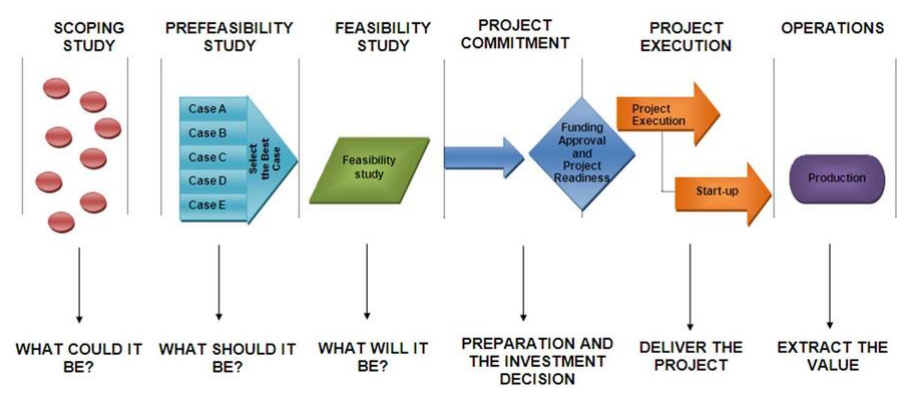

## Conceptos básicos

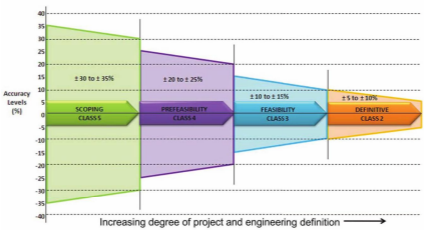

## Conceptos básicos

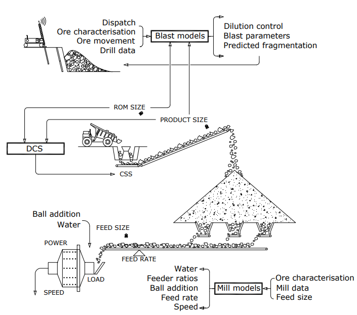

## Conceptos básicos

<!-- _class: cols-2 -->

##### Costo vs Gasto

- Costo: Recursos invertidos para producir un bien (mineral).
- Gasto: Recursos consumidos para sostener la operación, **no directamente vinculados a la producción.**

##### Costo hundido (o sunk cost en inglés)

- Se refiere a gastos ya incurridos que no pueden recuperarse y que, por lo tanto, **no deben influir en decisiones futuras de inversión o gestión**. 

| **Aspecto** | **Costo** | **Gasto** |
|:---:|:---:|:---:|
| Relación con la producción | Directamente vinculado a la extracción y procesamiento del mineral. | No está ligado a la producción (ej.: gastos legales, capacitación). |
| Capitalización | Puede capitalizarse si genera un activo (ej.: construcción de una planta). | Se registra como gasto del período (no se capitaliza). |
| Impacto en el estado de resultados | Parte del COGS (Costo de Ventas) en la cuenta de resultados. | Se registra como gasto operativo, administrativo o financiero. |

## Ejemplo práctico

| **Descripción** | **Costo** | **Gasto** 
|:---:|:---:|:---:|
| Exploración de un yacimiento que no encontró mineral económicamente viable |  |  |  |
| Combustible para camiones de acarreo durante la operación |  |  |  |
| Salarios del personal administrativo de la oficina central |  |  |  |
| Construcción de una planta de procesamiento abandonada por cambios tecnológicos |  |  |  |
| Compra de explosivos para voladura mensual |  |  |  |
| Estudio de impacto ambiental para un proyecto cancelado |  |  |  |
| Mantenimiento preventivo de equipos de perforación |  |  |  |
| Publicidad para contratar nuevos trabajadores |  |  |  |
| Adquisición de una flota de camiones usada en una mina clausurada |  |  |  |

## Ejercicio Resuelto

| **Descripción** | **Costo** | **Gasto** |
|:---:|:---:|:---:|
| Exploración de un yacimiento que no encontró mineral económicamente viable |  |  |
| Combustible para camiones de acarreo durante la operación | ✓ |  |
| Salarios del personal administrativo de la oficina central |  | ✓ |
| Construcción de una planta de procesamiento abandonada por cambios tecnológicos | ✓ |  |
| Compra de explosivos para voladura mensual | ✓ |  |
| Estudio de impacto ambiental para un proyecto cancelado |  | ✓ |
| Mantenimiento preventivo de equipos de perforación | ✓ |  |
| Publicidad para contratar nuevos trabajadores |  | ✓ |
| Adquisición de una flota de camiones usada en una mina clausurada | ✓ |  |

## Conceptos básicos

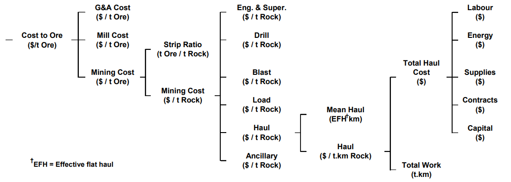

## Conceptos básicos

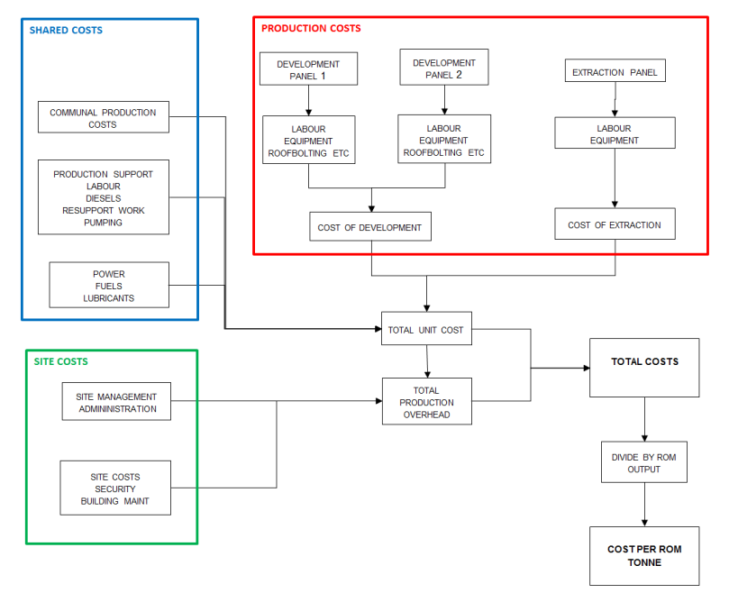

## OPEX vs CAPEX

<!-- _class: fixedtitleA -->

| **Criterio** | **CAPEX** | **OPEX** |
|:---:|:---:|:---:|
| **Objetivo** | Crecer, modernizar o cumplir regulaciones. | Mantener operaciones diarias. |
| **Ejemplo típico** | Compra de una flota de camiones CAEX. | Combustible para camiones CAEX. |
| **Tratamiento contable** | Capitalizado (activo) y depreciado. | Gasto del período. |
| **Horizonte temporal** | Beneficios a largo plazo (>1 año). | Beneficios inmediatos (mes a mes). |
| **Flexibilidad** | Decisiones estratégicas (poco frecuentes). | Ajustes operativos (mensual/trimestral). |
| **Impacto en liquidez** | Gran desembolso inicial. | Desembolsos recurrentes y menores. |

 

> CAPEX construye el futuro; OPEX sostiene el presente:
>  Ya que, sin CAPEX adecuado, la mina pierde competitividad a largo plazo. Sin control de OPEX, los márgenes se erosionan incluso en proyectos bien planificados.

## Costos Fijos vs Variables

<!-- _class: fixedtitleA -->

| **Criterio** | **Costos Fijos** | **Costos Variables** |
|:---:|:---:|:---:|
| Relación con la producción | No varían (ej.: alquiler de oficinas). | Aumentan/disminuyen con la producción. |
| Ejemplo típico | Salarios de supervisores. | Combustible para camiones CAEX. |
| Flexibilidad | Difícil reducir a corto plazo. | Ajustables según necesidad operativa. |
| Impacto en el punto de equilibrio | Alto (deben cubrirse siempre). | Bajo (solo se incurren si hay producción). |
| Estructura de costos | Mayor peso en minas de baja producción. | Dominante en operaciones a gran escala. |
| Impacto en liquidez | Gran desembolso inicial. | Desembolsos recurrentes y menores. |

 

> "Los costos fijos definen el riesgo; los variables, la eficiencia":
> Altos costos fijos requieren producción estable y precios altos.
> Costos variables bajos permiten mayor flexibilidad en mercados volátiles.

## Tipos de costos en minería: directos e indirectos

<!-- _class: fixedtitleA -->

- **Costos directos**: Gastos que pueden asignarse específicamente a una actividad, proceso o departamento de la operación minera, **vinculados directamente a la extracción, procesamiento o transporte del mineral.**
- Ejemplo 
  - Perforación y voladura:
    - Costos típicos: USD 1.0-2.5/ton (dependiendo de dureza de roca).
    - Optimización: Uso de software de diseño de mallas (ej.: Deswik) para reducir desviaciones.
  - Transporte primario:
    - Camiones de acarreo: Costo por hora operativa (ej.: USD 200-300/hora para un camión de 300 ton).
    - Eficiencia: Reducir distancia de acarreo puede ahorrar hasta 15% en costos logísticos.
  - Procesamiento:
    - Chancado y molienda: USD 0.8-1.5/ton procesada.
    - Energía en molinos SAG: Hasta el 40% del costo total de procesamiento.

## Tipos de costos en minería: directos e indirectos

<!-- _class: fixedtitleA -->

- **Costos indirectos**: Gastos necesarios para la operación minera, pero no vinculados directamente a la extracción o procesamiento del mineral. Son costos de soporte o administrativos que benefician a toda la organización.
- Ejemplos: 
  - Mantenimiento:
    - Predictivo vs. correctivo: El mantenimiento predictivo reduce costos en un 20% al evitar paradas no planificadas.
  - Gestión ambiental:
    - Costos de cumplimiento: Hasta USD 10 millones/año en minas con estándares ISO 14001.
    - Multas por incumplimiento: Ejemplo: USD 12 millones en una mina por contaminación de acuíferos.
  - Administración y permisos:
    - Trámites legales: Tiempo y costo para renovar concesiones (ej.: 18 meses en Perú).

  
## Ejemplo Mina OP de Oro

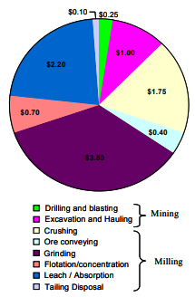

## Tipos de costos en minería: directos e indirectos

<!-- _class: fixedtitleA -->

| **Metodología** | **Definición** |
|:---:|:---:|
| Activity-Based Costing (ABC) | Asigna costos indirectos a actividades específicas. |
| Costeo por Procesos | Asigna costos a procesos continuos y homogéneos. |
| Full Cost Accounting (FCA) | Incluye todos los costos, incluyendo externalidades (ambientales, sociales). |
| Lean Accounting | Elimina desperdicios y costos que no agregan valor. |
| Theory of Constraints (TOC) | Identifica y optimiza el cuello de botella que limita la producción. |
| Total Cost of Ownership (TCO) | Evalúa todos los costos asociados a un activo durante su vida útil. |
| Life Cycle Costing (LCC) | Analiza costos desde exploración hasta cierre de la mina. |
| Benchmarking de Costos | Compara costos operativos con estándares de la industria. |
| Value Chain Analysis (VCA) | Examina cada actividad de la cadena para identificar fuentes de costo y valor. |

## Metodologias de costeo

<!-- _class: fixedtitleA -->

| **Necesidad** | **Metodología recomendada** | **Costos Variables** |
|:---:|:---:|:---:|
| Asignar costos indirectos | ABC, TDABC, Costeo por Procesos. | Aumentan/disminuyen con la producción. |
| Optimizar eficiencia | Lean Accounting, TOC, Benchmarking. | Combustible para camiones CAEX. |
| Gestión ambiental | Full Cost Accounting, EMA. | Ajustables según necesidad operativa. |
| Decisiones de inversión | TCO, Life Cycle Costing. | Bajo (solo se incurren si hay producción). |
| Control presupuestario | Costeo Estándar, Data-Driven Costing. | Dominante en operaciones a gran escala. |
| Impacto en liquidez | Gran desembolso inicial. | Desembolsos recurrentes y menores. |

 

> Consecuencias de una mala asignación
> - Toma de decisiones erróneas: Proyectos que parecen rentables, pero no lo son.
> - Pérdida de competitividad: Costos mal asignados generan precios no realistas.

## ¿Por qué es importante gestionar los costos?

<!-- _class: fixedtitleA -->

- **Rentabilidad y Viabilidad Financiera.** 
La minería requiere *grandes sumas de dinero* (exploración, equipos, mano de obra, permisos). Controlar costos asegura ganancias, incluso con fluctuaciones en los precios de los minerales.
- **Competitividad en el Mercado**
Costos bajos permiten competir mejor, especialmente cuando los precios globales caen.
- **Optimización de Recursos**
Reduce desperdicios (insumos, materiales, energía, tiempo) y maximiza la eficiencia operativa.
- **Reducción de Riesgos**
Evita sobrecostos durante la operación. Así también, retrasos o cierres anticipados de minas.
- **Confianza de Inversores**
Atrae financiamiento al demostrar eficiencia financiera.
- **Permite diseñar planes estratégicos robustos**
Ante los diversos escenarios que se enfrenta la minería, el control de costos es clave.

## Puntos clave en la gestión de costos

<!-- _class: fixedtitleA -->

- **Objetivo Único**: Maximizar el Valor para el Accionista (NPV)

> Muchas veces se apunta a diversos objetivos. Por eso es importante identificar los escenarios donde estos objetivos aplican y se llevan a cabo

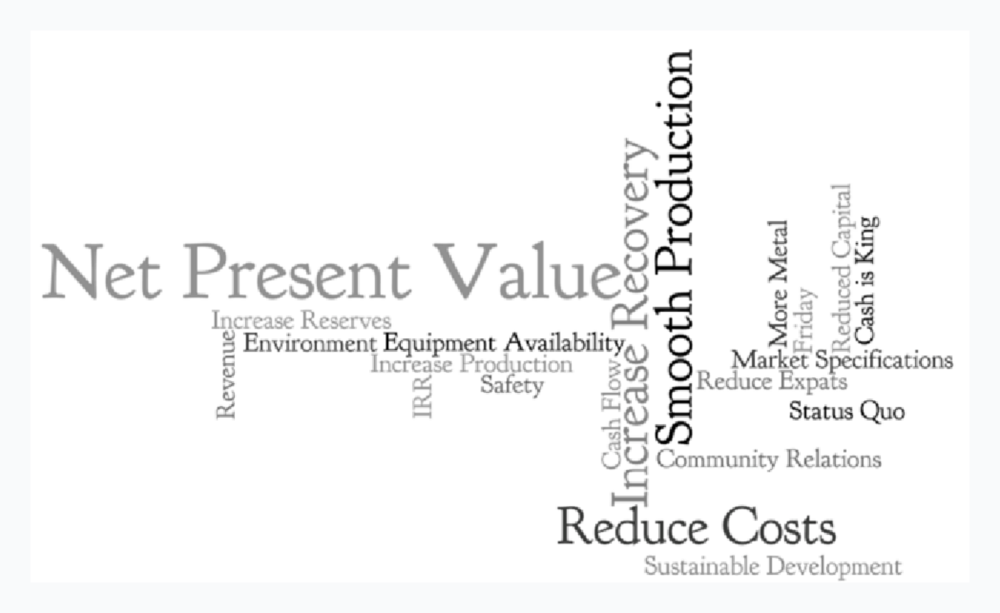

## Puntos clave en la gestión de costos

<!-- _class: cols-2 -->

#### Priorización de decisiones de capital
- En general, las decisiones de gasto de capital (CapEx) tienen mucho más impacto que los costos operativos (OpEx).
- Se deben priorizar aquellas que afectan directamente al valor del proyecto.
- Impacto de las cuentas por pagar y la rotación de inventarios. 

#### Equipos multidisciplinarios 
- Evaluar cambios considerables en el plan estratégico, por consiguiente, en la producción requiere del involucramiento de personal de operaciones, logísticas, marketing, finanzas. 
- Si bien no es posible proporcionar todos los casos a todos, los más importantes deberían revisarse con mayor profundidad para detectar errores, lograr una mayor implicación del equipo y descubrir nuevas ideas para optimizar el valor del proyecto.

## Puntos clave en la gestión de costos
<!-- _class: cols-2 -->

#### Optimización de políticas de minado y procesamiento
- Evitar decisiones aisladas como aumentar procesamiento sin ajustar secuencias de minado. **La revisión integral es vital**

#### Iteración en la revisión de planes
- La información más fidedigna es la del personal que se encuentra en campo. Este es un input valioso para la toma de decisiones.
Se recomienda revisión independiente para validar resultados y evitar sesgos.

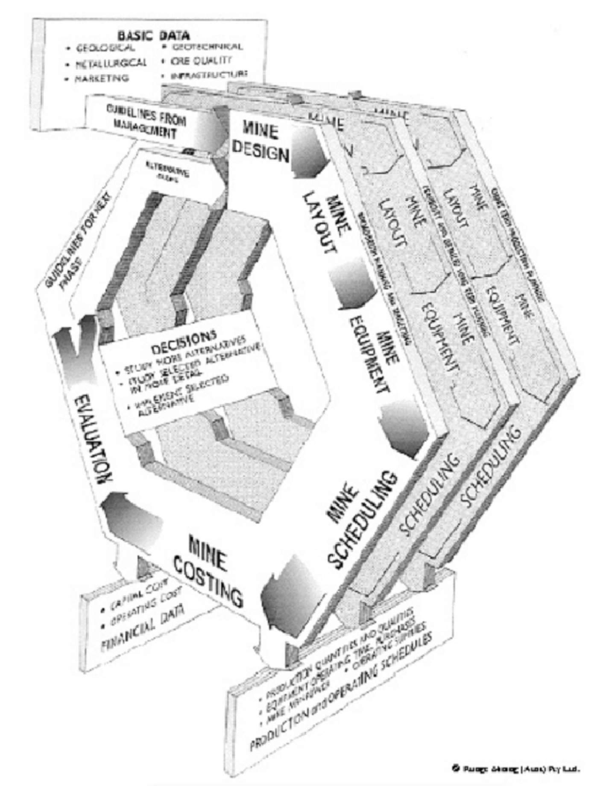

## Herramientas para la gestión de costos

<!-- _class: fixedtitleA -->

 
##### El uso de ERPs en minería

- Un ERP permite integrar los datos correspondientes a los procesos que componen una industria, en este caso: minera. Permite, entre otras cosas:
  - Controlar costos
  - Cumplimiento normativo → Muchas corporaciones adoptan este estándar.
  - Optimizar procesos
  - Integraciones con IA
  - Escalabilidad → Cuanto más crece la empresa, se adapta mejor.

> El grado de adaptabilidad es limitado. Entonces SAP ¿amigo o enemigo?

## ERPs en minería

<!-- _class: fixedtitleA -->

 
|  | **Ventajas** | **Desventajas** |
|:---:|:---:|:---:|
| **SAP S/4HANA** | - Integración profunda con módulos   mineros. - Escalable para operaciones globales. | - Complejidad en la   personalización. - Tiempo prolongado de despliegue. |
| **Oracle Cloud Mining** | - Solución en la nube con  actualizaciones automáticas. - Reportes regulatorios preconfigurados. | - Dependencia de Internet. - Menor flexibilidad para procesos  específicos. |
| **MineRP** | - Especializado en minería. - Integración con GIS y modelos 3D de yacimientos. | - Menor capacidad de   análisis financiero avanzado. |

 

> El SAP sigue siendo el mas usado en la industria. Si bien genera muchos problemas, muchos vacios y la curva de aprendizaje es larga y tediosa; es la herramienta mas utilizada para dicho problema. Ahí tenemos **una oportunidad para desarrollar alternativas**. 

<!-- _class: fixedtitleA -->

## Análisis de la cadena de valor en la minería

<!-- _class: pin-3 -->

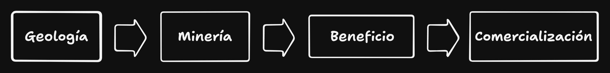

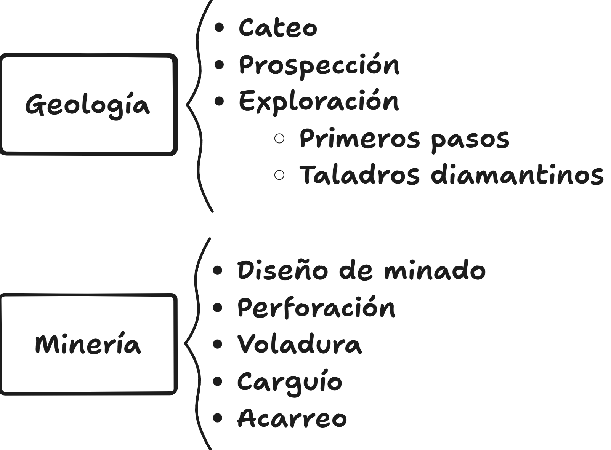

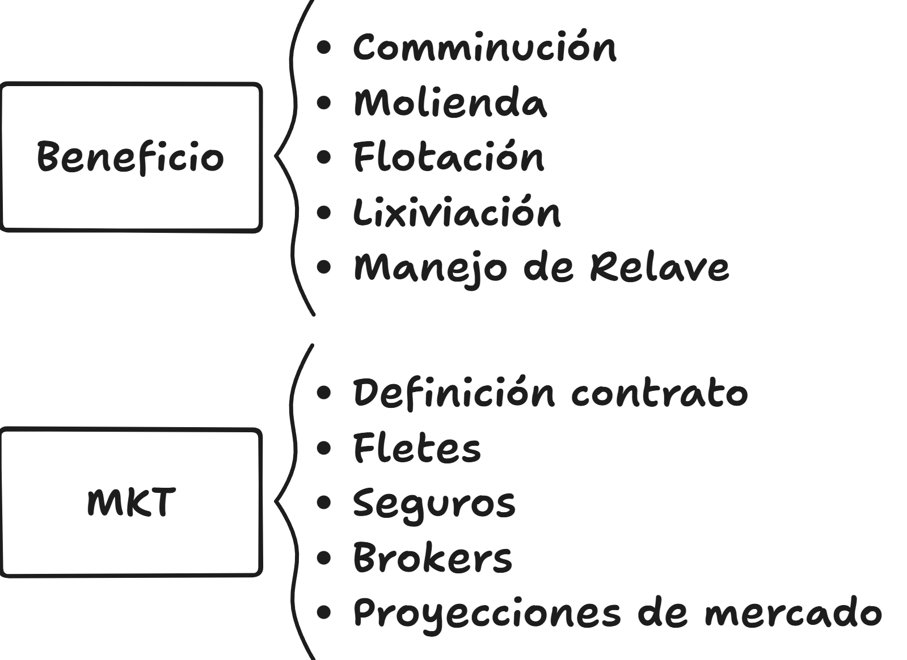

## Perspectiva OECD - [link](https://www.oecd.org/en/publications/the-mining-global-value-chain_2827283e-en.html)

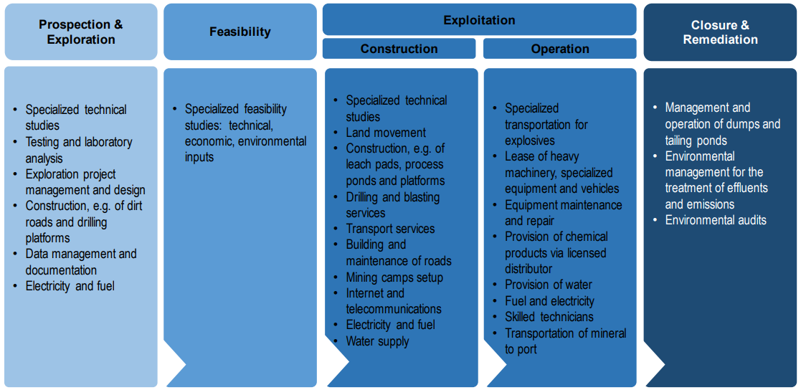

## Perspectiva McKinsey - [link](https://www.mckinsey.com/industries/metals-and-mining/our-insights/the-mine-to-market-value-chain-a-hidden-gem)

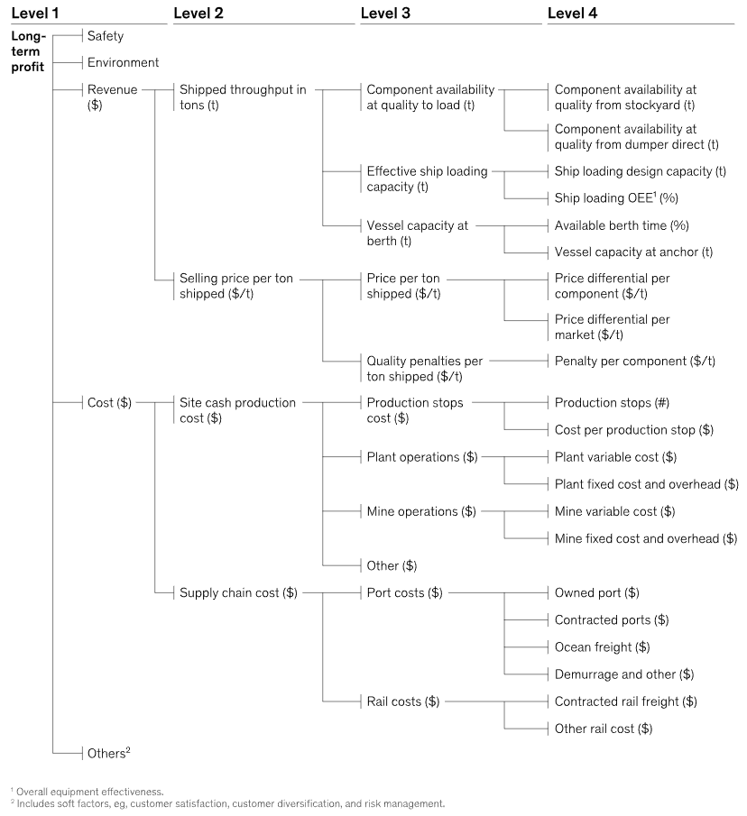

## Cuellos de botella en minería

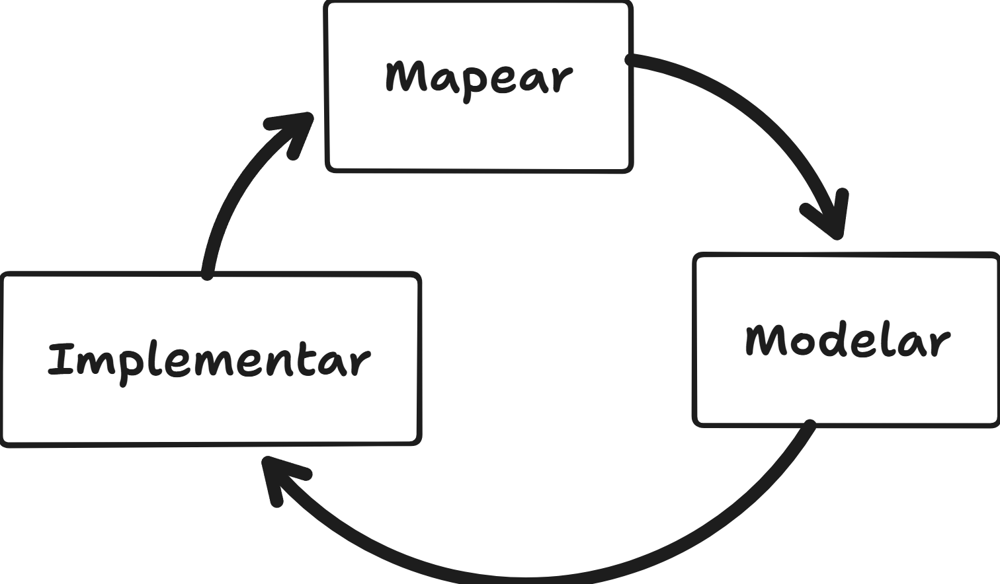

## Cuellos de botella en el proceso [link](https://www.bain.com/insights/how-to-eliminate-mining-bottlenecks-for-good/)

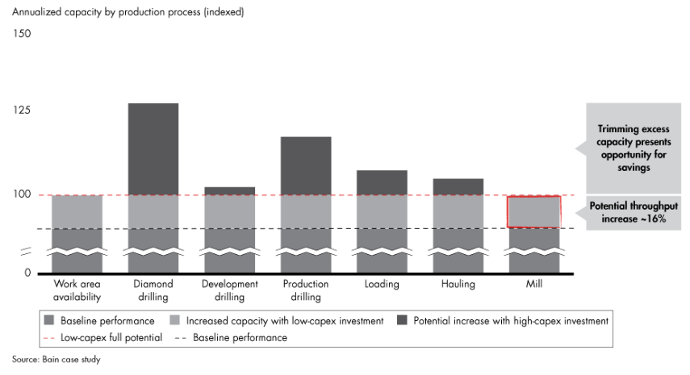

## Estimacion de cut-off en mineria

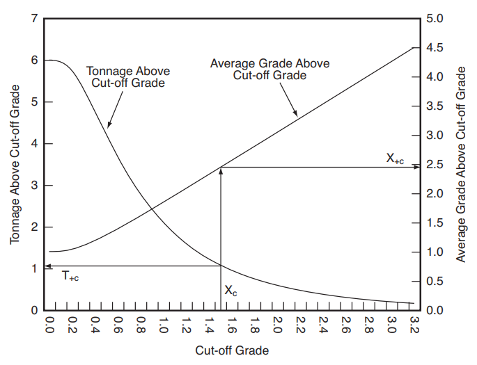

## Estimacion de cut-off en mineria

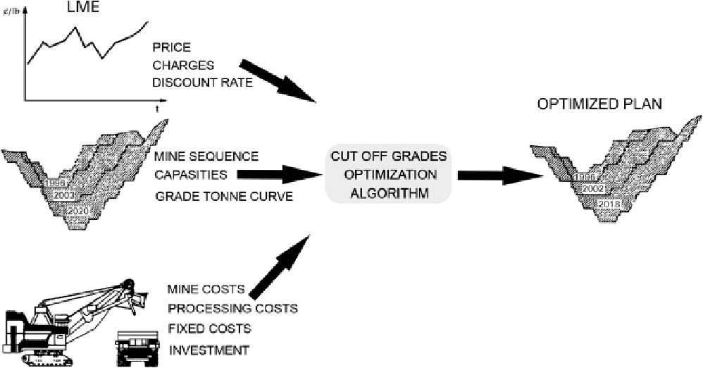

## Estimacion de cut-off en mineria

<!-- _class: pin-3 -->

> La obtención de un CoG robusto es, *sin lugar a dudas*, uno de los grandes objetivos del equipo de planificación. Para esto, **el enfoque multidisciplanario** ya descrito es clave en este punto. Los enfoques basados en una CoG en punto de equilibrio son muy propensos al riesgo propio del precio de metales.

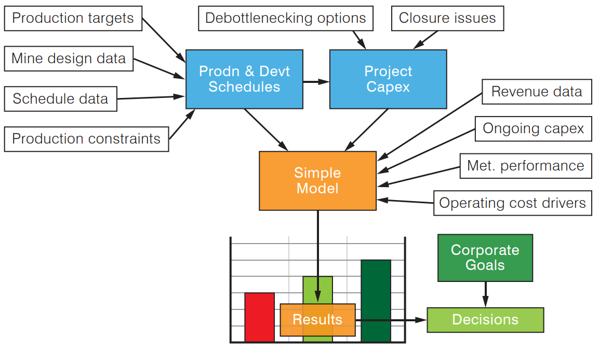

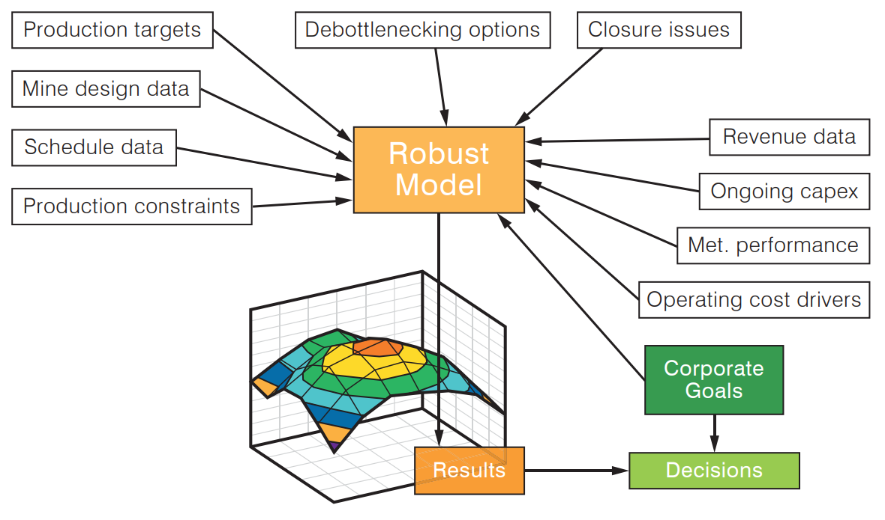

 

---
<!-- _class: lastpage -->
<!-- _footer: "" -->

###### Ejemplo de aplicación de cut-off en mineria

## Presupuestos de proyectos mineros 
<!-- _class: trans -->
<!-- _footer: "" -->
<!-- _paginate: "" -->

## ¿Qué veremos en este módulo?

<!-- _class: col_ol_ci fglass toc_a -->
<!-- _footer: "" -->
<!-- _header: "" -->
<!-- _paginate: "" -->

- Elaboración de presupuestos de inversión
- Estimación de costos de exploración y desarrollo de yacimientos
- Análisis de costos de infraestructuras mineras
- Consideraciones financieras en la elaboración de presupuestos

## Elaboración de presupuestos de inversión - Supuestos

<!-- _class: pin-3 -->

Es **crucial** tener en cuenta que tenemos variables que forman parte de nuestro entendimiento, algunas con cierto o ningún tipo de referencia **al momento de evaluar.**
Esto indica la relevancia de colocar los supuestos de **manera clara y conscisa** durante todas las etapas de la evaluación para los ajustes necesarios.

#####  

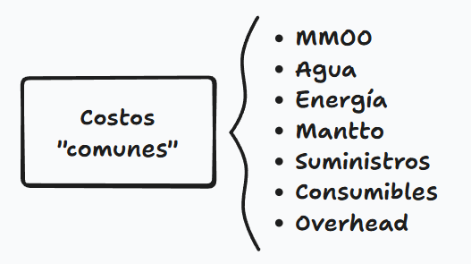

##### Matriz de entendimiento

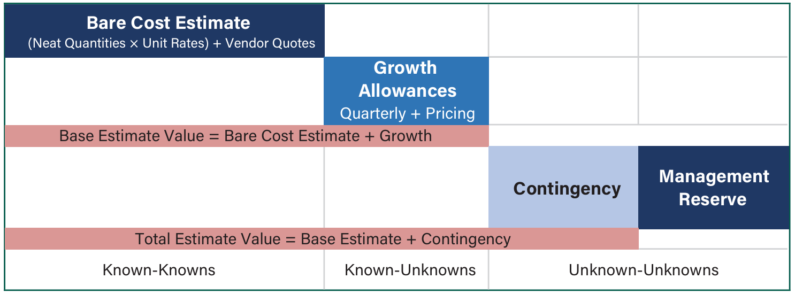

## Elaboración de presupuestos de inversión

<!-- _class: cols-3 -->

###### Experiencia + Factor incremental

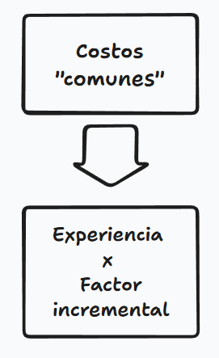

  
###### Ecuaciones o Bases de datos
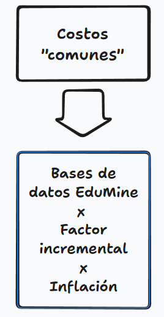
 

 
###### Ejemplos de Minas similares
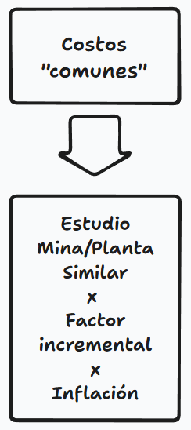

## Estimación de costos de exploración y desarrollo de yacimientos

<!-- _class: cols-2 -->

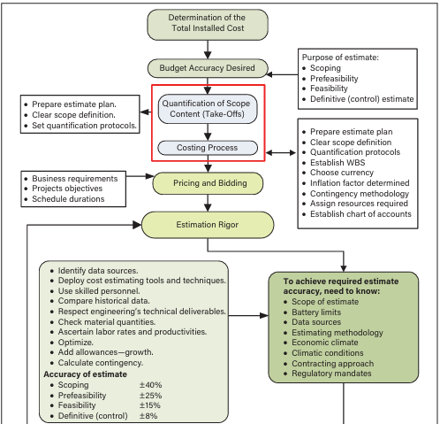

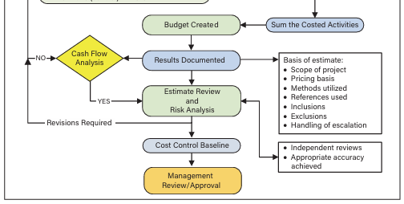

## Análisis de costos de infraestructuras mineras

<!-- _class: cols-2 -->

#### El reto de la infraestructura en Perú 

- El Perú posee costos competitivos a nivel mundial en temas de energía y acceso a agua para las operaciones mineras. 
- Estas ventajas son contrapuestas con las restricciones que obedece la pobre infraestructura para trasladar los minerales hacia zonas de embarque. 

> "It is expected that Peru will only realize its full economic potential after reducing its infrastructure bottlenecks. Estimates vary, but the investment required runs into billions of dollars. In the last decade, Peru has begun to take the necessary measures to improve its underprivileged infrastructure (transport facilities, electricity, water and communications) in order to promote new investments which will contribute to the development of the productive sectors of the country.

*Tomado de la Guía EY Mining Peru 2025-2026*

## Análisis de costos de infraestructuras mineras

<!-- _class: cols-2 -->

##### Posibles soluciones al problema

- Clusters Mineros del Sur
- Desarrollo portuario de emergencia
- Accesos a la nueva carretera central
- Implementación de Mineroductos
- Politicas de uso de agua desalinizada. 
- Mejoramiento de la red eléctrica nacional.
- ...
- ...
- ...

Sin embargo, el mejor enfoque durante la fase de evaluación para este tema será: 

## Consideraciones financieras en la elaboración de presupuestos

<!-- _class: fixedtitleA -->

 
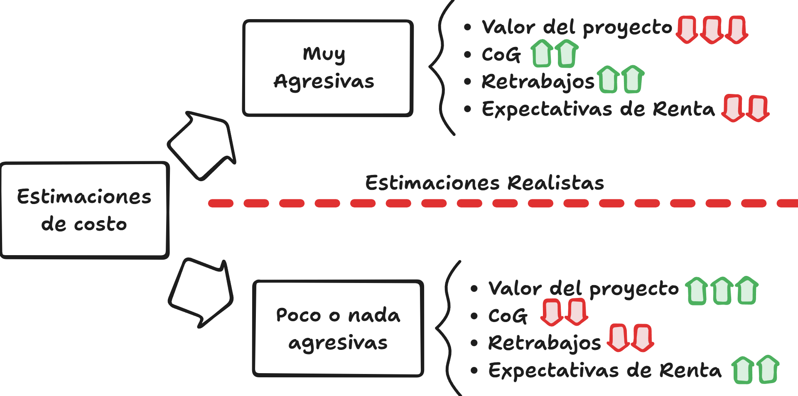

## Costos operativos en minería  
<!-- _class: trans -->
<!-- _footer: "" -->
<!-- _paginate: "" -->

## ¿Qué veremos en este módulo?

<!-- _class: col_ol_ci fglass toc_a -->
<!-- _footer: "" -->
<!-- _header: "" -->
<!-- _paginate: "" -->

- Costos de extracción de minerales: perforación, voladura, carga y acarreo
- Costos de procesamiento de minerales: trituración, molienda, concentración
- Costos de mantenimiento de equipos y maquinarias
- Gestión de costos de energía y suministros

## Tipos de Depósitos Minerales
<!-- _class: fixedtitleA -->

| **Tipo de Depósito** | **Geometría** | **Resistencia y Rigidez / Depósito** | **Ejemplos** |
|:---:|:---:|:---:|:---:|
| Aluvión (placeres) | Tabular–plano | Pobre/pobre | Arena y grava;  metales y piedras preciosas (estaño) |
| Superficie erosionada | Tabular–plano y delgado | Pobre/pobre a buena | Carbón |
| Diseminado | Masivo | Pobre/pobre | Menas hidrotermales   (porfídicas y sulfuros) |
| Veta (puede rehelarse) | Tabular–inclinado | Pobre a buena/buena | Menas hidrotermales   (porfídicas y sulfuros) |
| Evaporitas | Tabular–plano–grueso | Buena/buena | Sal, fosfatos |
| Sedimentario (estratificado) | Tabular–plano–grueso | Buena/buena | Caliza, arenisca |
| Metamórfico | Tabular–plano–grueso | Buena/buena | Mármol, pizarra |
| Ígneo (magnético) | Masivo | Buena/buena | Granito, basalto, diabase |

## Minería Subterránea - Métodos de explotación I

<!-- _class: fixedtitleA -->

| **Profundidad del Depósito** | **Resistencia  de la Roca** | **Características  del Depósito** | **Método  de Minado** | 
|:---:|:---:|:---:|:---:|
| Profundo–requiere  minería subterránea | Roca competente  fuerte a moderada–apta  para minado sin soporte | Tabular, plano,  delgado, gran tamaño | Cuartos y pilares  (Room and Pillar) | 
|  |  | Tabular, plano,  grueso, gran tamaño | Cámara y pilar  (Stope and Pillar) | 
|  |  | Tabular, empinado,  delgado, cualquier tamaño | Escombrado por hundimiento  (Shrinkage Stoping) | 
|  |  | Tabular, empinado,  grueso, gran tamaño | Corte por subniveles | 

## Minería Subterránea - Métodos de explotación I

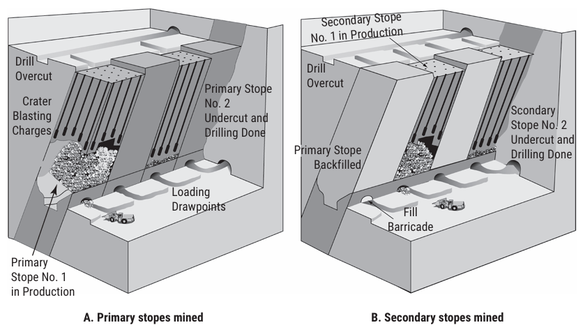

## Minería Subterránea - Métodos de explotación I
<!-- _class: cols-2 -->

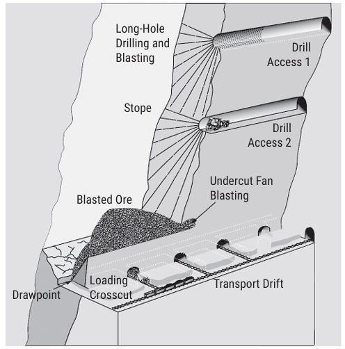

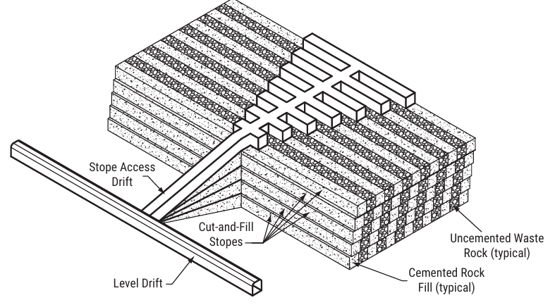

## Minería Subterránea - Métodos de explotación II
<!-- _class: fixedtitleA -->

| **Profundidad del Depósito** | **Resistencia  de la Roca** | **Características  del Depósito** | **Método  de Minería** |
|:---:|:---:|:---:|:---:|
| Profundo–requiere  minería subterránea | Roca incompetente  de resistencia moderada a débil  – requiere soporte | Forma variable, empinado,  delgado, cualquier tamaño,  roca más fuerte que relleno | Corte y relleno  desde arriba |
|  |  | Forma variable, empinado,  delgado, cualquier tamaño,  roca más débil que relleno | Corte y relleno  desde abajo |
|  |  | Tabular, empinado,  delgado, tamaño pequeño | Escombrado vertical  (Stull Stoping) |
|  |  | Cualquier forma,  cualquier buzamiento,  grueso, cualquier tamaño | Corte en cuadros  (Square-set stoping) |

## Minería Subterránea - Métodos de explotación II

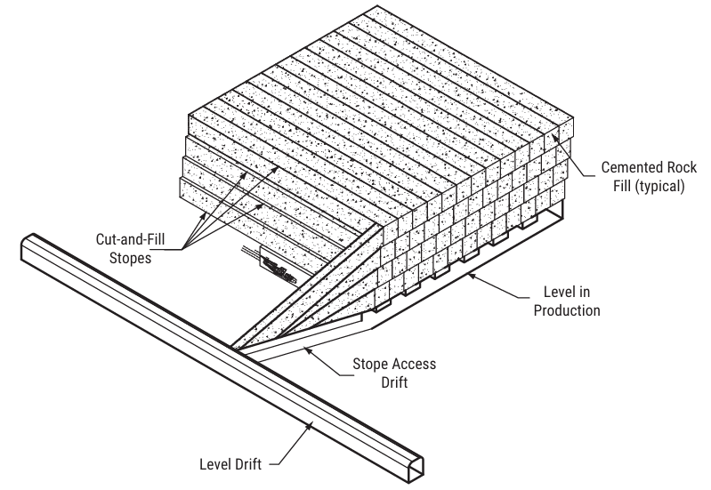

## Minería Subterránea - Métodos de explotación III

<!-- _class: fixedtitleA -->

 
| **Profundidad del Depósito** | **Resistencia  de la Roca** | **Características  del Depósito** | **Método  de Minería** |
|:---:|:---:|:---:|:---:|
| Profundo–requiere  minería subterránea | Roca débil–apta para hundimiento | Tabular, plano,  delgado, gran tamaño | Longwall |
|  |  | Tabular o masivo,  empinado, grueso, gran tamaño | Hundimiento  por subniveles |
|  |  | Masivo, empinado,  grueso, gran tamaño | Hundimiento  por bloques |

## Minería Subterránea - Métodos de explotación III
<!-- _class: cols-2 -->

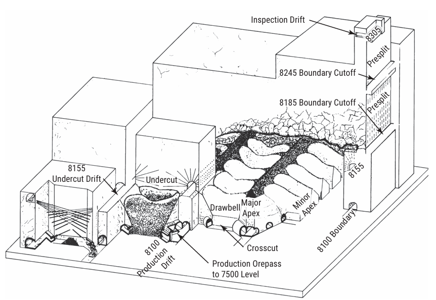

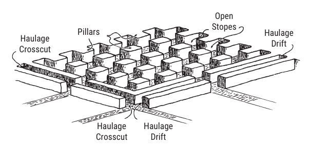

## Minería Subterránea - Resumen 
<!-- _class: fixedtitleA -->

 
| **Método** | **Flexibilidad/Selectividad** | **% Recuperación /  % Dilución** | **Productividad** |
|:---:|:---:|:---:|:---:|
| Cuartos y pilares | Alta/alta | 75/20 | Alta |
| Corte y relleno | Alta/alta | 95/5 | Moderada |
| Subnivel | Baja/baja | 80/10 | Moderada |
| Hundimiento por subniveles | Baja/baja | 90/20 | Alta |
| Hundimiento por bloques | Baja/baja | 90/20 | Alta |
| Corte por subniveles | Moderada/baja | 85/15 | Alta |
| Escombrado por hundimiento | Moderada/moderada | 80/10 | Baja |
| Longwall | Baja/baja | 80/10 | Muy alta |

## Mineria Superficial
<!-- _class: fixedtitleA -->

| **Método** | **Flexibilidad/Selectividad** | **% Recuperación / % Dilución** | **Productividad** |
|:---:|:---:|:---:|:---:|
| Explotación  en bancos | Moderada/alta | 90/5 | Muy alta |
| Canteras de  roca dura | Baja/media | 85/15 | Alta |
| Explotación  hidráulica | Baja/alta | 75/20 | Alta |
| Explotación  por dragado | Baja/alta | 80/20 | Alta |
| Explotación de  graveras y areneras | Alta/alta | 90/5 | Moderada |

## Mineria Superficial

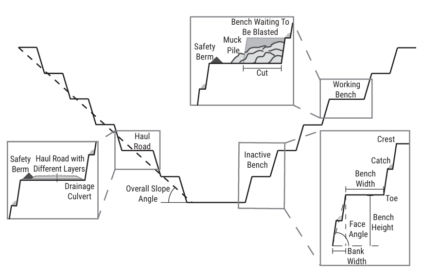  

## Mineria Superficial

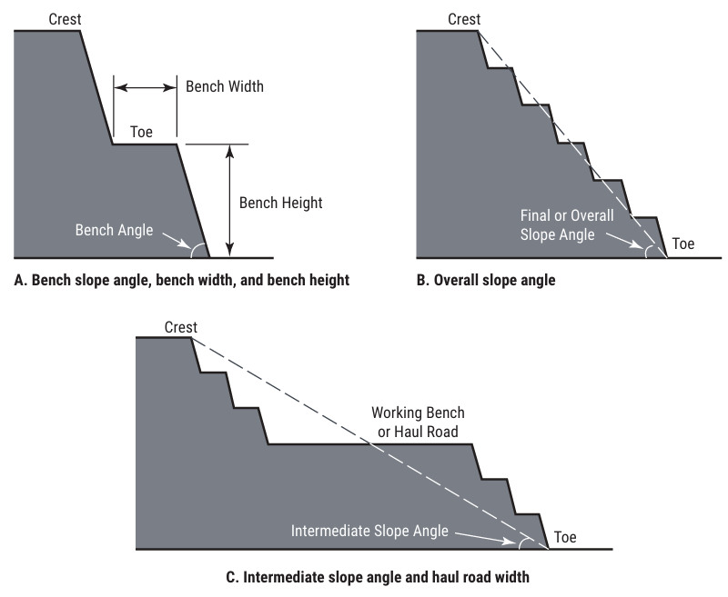  

## Métodos de Minado - Resumen General

<!-- _class: fixedtitleA -->

| **Método** | **Flexibilidad/Selectividad** | **% Rec / % Dil** | **Productividad** | **Otros Factores** |
|:---:|:---:|:---:|:---:|:---:|
| Placeres y dragado | Bajo/alto | Alto/bajo | Moderado | Requiere agua;  afecta el clima |
| Tajo abierto  (Open Pit) | Moderado/ moderado | Alto/bajo | Alta | Afecta el clima |
| Cámara y pilar | Alto/alto | 75/15 | Alta | Bancado común |
| Subnivel | Bajo/bajo | 75/15 | Moderado | Relleno común |
| Escombrado  por hundimiento | Moderado/ moderado | 80/10 | Bajo | ⅔ del mineral  queda retenido |
| Corte y relleno | Moderado/ alto | 100/0 | Bajo | Selección en el  frente de trabajo |
| Hundimiento  por bloques | Bajo/bajo | 90/20 | Alta | Mineral retenido |

## Ciclo de Trabajo minero
<!-- _class: cols-2 -->

#### Flujo de trabajo Típico minero
Este ciclo regular de actividades se compone en perforación, voladura, carguio y acarreo de materiales provenientes del tajo. Este mismo principio es el mismo sin importar si es **mineria cielo abierto** o **mineria subterránea**. 
Sin embargo, el costeo suele ser diferente a partir de las diferencias que existen en los tipos de minado. 

 
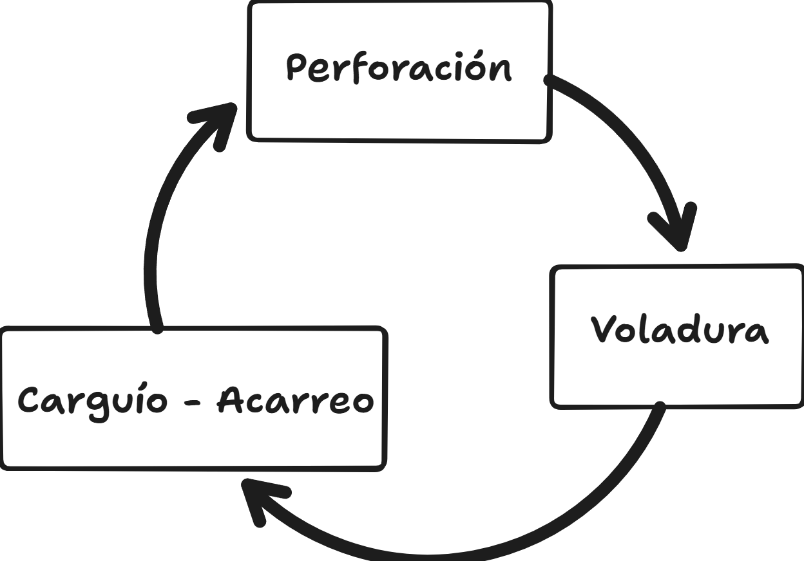

## Perforación de taladros 
<!-- _class: pin-3 -->

 
La perforación es el proceso mediante el cual se realizan taladros en la roca con el objetivo de colocar explosivos que permitan fragmentarla para su posterior carga y transporte. Este proceso es una etapa crítica dentro del ciclo de minado, ya que determina la eficiencia de la voladura, el tamaño del material fragmentado y, por lo tanto, la productividad general de la operación minera.

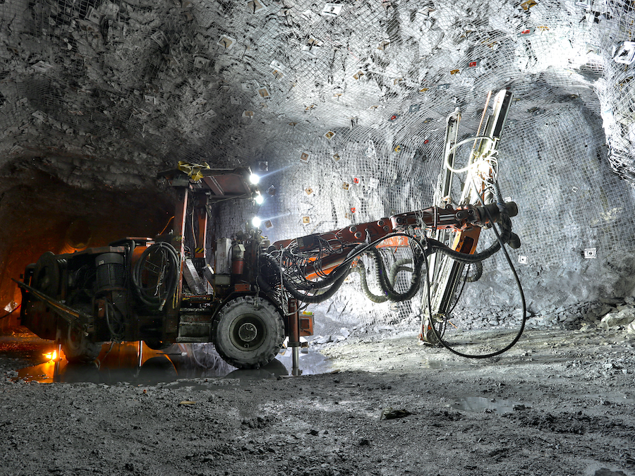

 

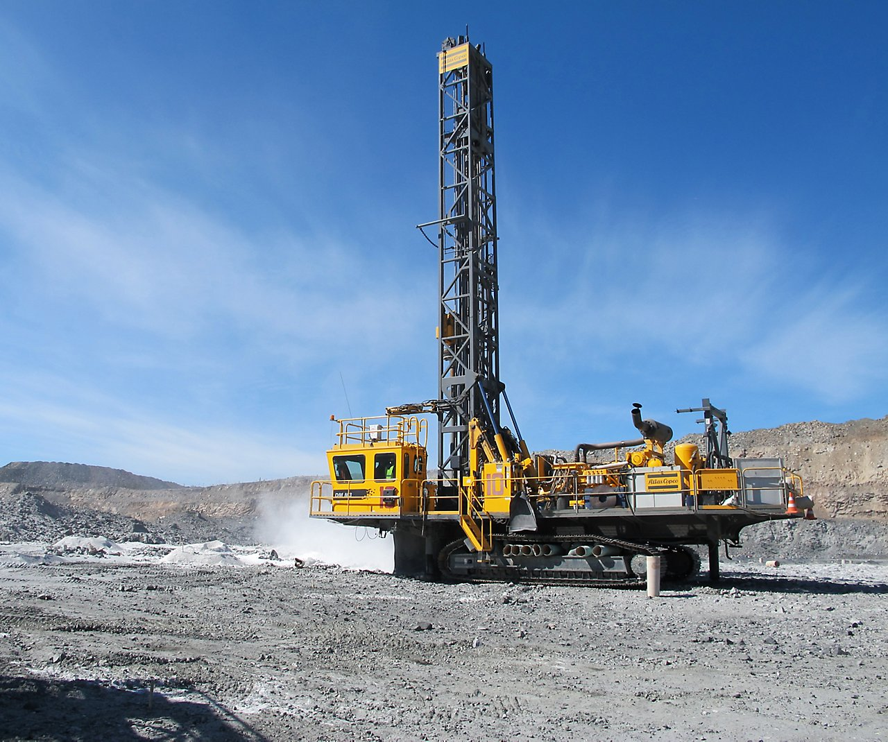

 

## Perforación de taladros
<!-- _class: fixedtitleA -->

 
| **Característica** | **Minería   Superficial** | **Minería   Subterránea** |
|:---:|:---:|:---:|
| **Objetivo Principal** | Fragmentar grandes volúmenes de roca | Fragmentar zonas selectivas o vetas |
| **Tipo de equipos** | Perforadoras rotativas o de martillo en fondo | Jumbos, martillos neumáticos o hidráulicos |
| **Acceso al frente de trabajo** | Fácil, al aire libre | Limitado, por túneles y galerías estrechas |
| **Diámetro de los barrenos** | Grandes (100–400 mm) | Pequeños a medianos (33–76 mm) |
| **Profundidad de perforación** | Alta (hasta 20–40 m o más por banco) | Moderada (1.5–5 m o más según método) |
| **Condiciones de trabajo** | Mejor ventilación e iluminación natural | Condiciones restringidas, necesidad de ventilación |
| **Riesgos operativos** | Desprendimientos, polvo | Colapsos, gases, falta de visibilidad |
| **Tasa de avance** | Alta (mayor volumen por ciclo) | Menor (operación más precisa y controlada) |
| **Costo por metro perforado** | Relativamente bajo | Más alto debido a complejidad y accesibilidad |
| **Flexibilidad de diseño** | Alta, permite rediseñar con más libertad | Limitada por la geometría subterránea |

## Voladura de Rocas

La voladura es el proceso mediante el cual se fractura y fragmenta la roca utilizando explosivos colocados previamente en taladros perforados. El objetivo principal de la voladura es liberar el material útil (mineral o estéril) para facilitar su carga, transporte y procesamiento, optimizando además los costos y la eficiencia operativa del minado.

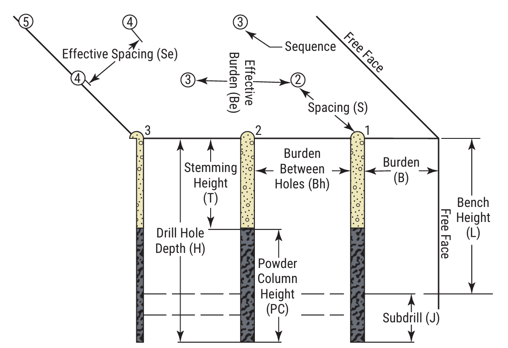

## Voladura de Rocas
<!-- _class: fixedtitleA -->

| **Característica** | **Minería  Superficial** | **Minería  Subterránea** |
|:---:|:---:|:---:|
| **Tipo de voladura** | Voladura masiva  por bancos (bench blasting) | Voladura controlada  por avance o producción |
| **Tamaño del área de voladura** | Amplio (decenas a  cientos de metros cuadrados) | Reducido (frentes  estrechos y confinados) |
| **Tipo de explosivos** | ANFO, emulsiones a granel | Emulsiones encartuchadas,  dinamitas, ANFO confinado |
| **Control de vibraciones** | Menor preocupación (zonas abiertas) | Alta prioridad (infraestructura cercana) |
| **Seguridad y riesgos** | Proyección de roca, polvo | Gases tóxicos, estallidos de roca, confinamiento |
| **Costo relativo** | Más bajo por  tonelada fragmentada | Más alto por restricciones   de diseño y ventilación |

## Carguío - en Mina Tajo Abierto

Proceso mediante el cual el material fragmentado (mineral o estéril) es **recogido del frente de trabajo y depositado en un equipo de transporte o almacenamiento intermedio**. Esta etapa clave en el ciclo de minado, ya que determina la **eficiencia del acarreo y la continuidad de la producción**. 

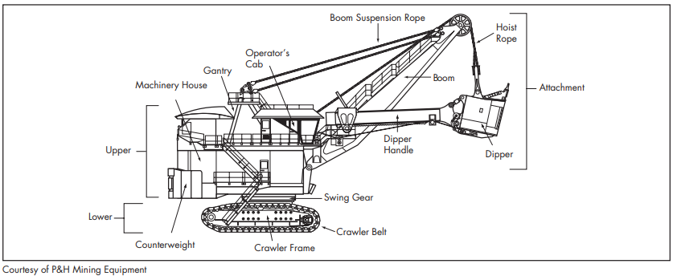

## Carguío - en Mina Tajo Abierto

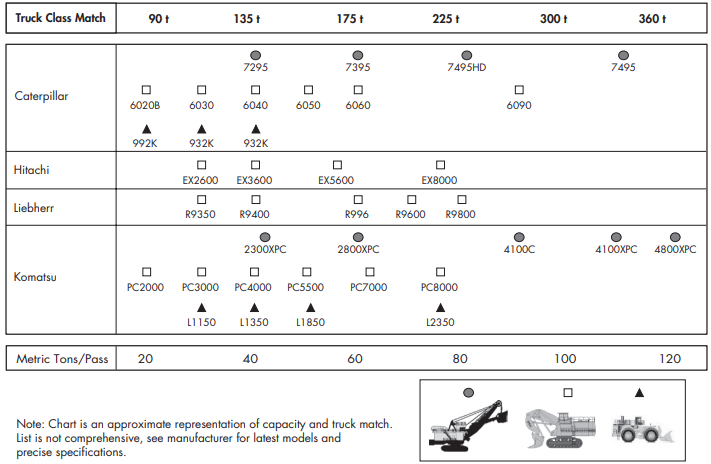

## Carguío - en Mina Tajo Abierto

<!-- _class: cols-2 -->

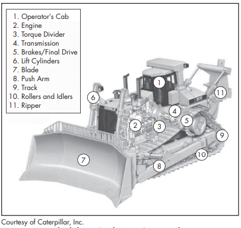

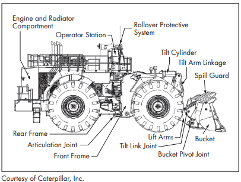

## Acarreo

El acarreo es el **proceso de transporte del material cargado desde el punto de extracción hasta su destino final, que puede ser una chancadora, un botadero, una planta de procesamiento o un sistema de almacenamiento**. Este proceso se puede realizar mediante camiones mineros, fajas transportadoras, vagones, o sistemas autónomos. 

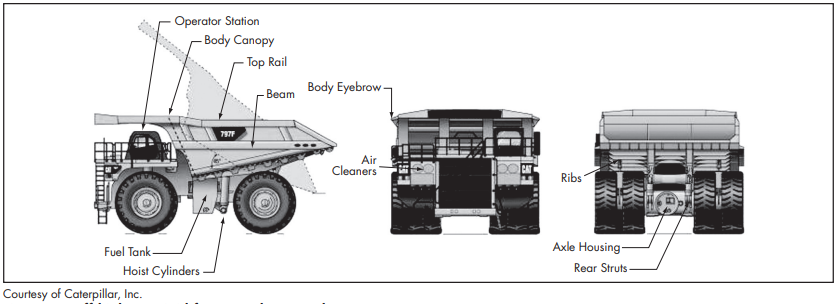

## Acarreo

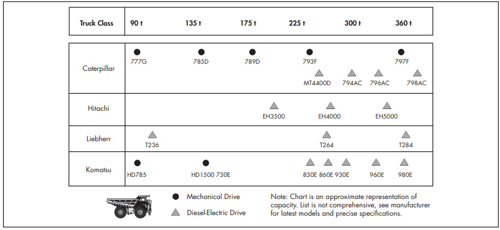

## Acarreo 

<!-- _class: cols-2 -->

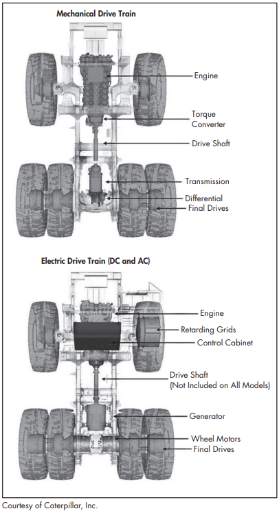

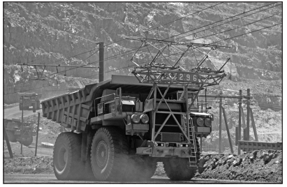

 

## Resumen de Actividades Mineras - OP

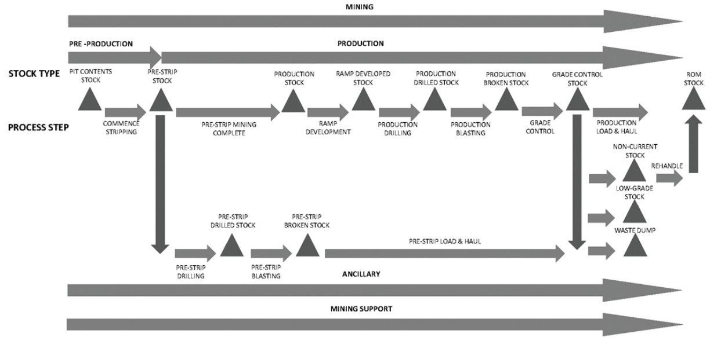

## Resumen de Actividades Mineras - UGM

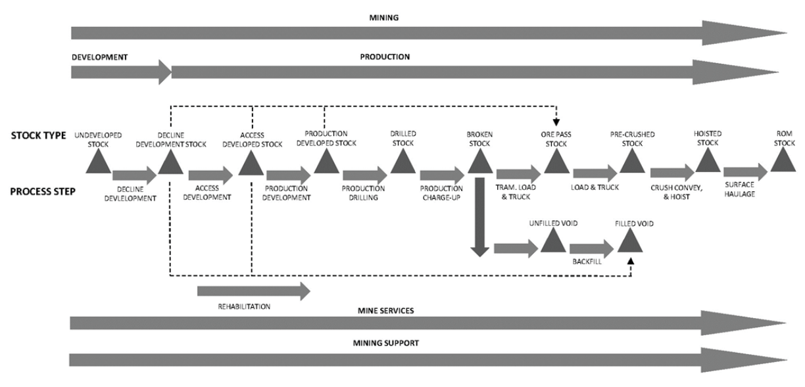

## Estructura de Costos Mina Subterránea

<!-- _class: cols-2 -->

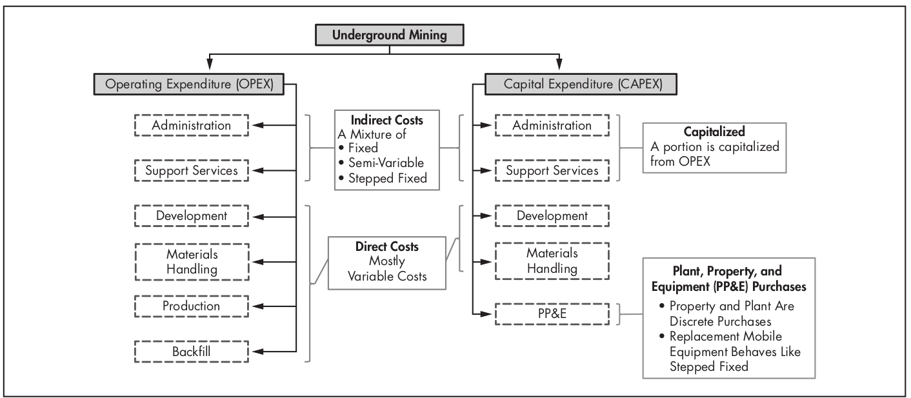

  

## Estructura de Costos Mina Subterránea

<!-- _class: cols-2 -->

## Estructura de Costos de Mina Superficial

<!-- _class: cols-2 -->

---
<!-- _class: lastpage -->
<!-- _footer: "" -->

###### Ejemplo: Cálculo de Costos mineros

## Procesamiento de Minerales - Esquema típico

## Procesamiento de Minerales - Procesamiento Oro

## Procesamiento de Minerales - Procesamiento Cobre

## Procesamiento de Minerales - Relavera

## Procesamiento de Minerales

## Resumen Costos en el Beneficio

| **Proceso**         | **CAPEX (Inversión Inicial)**                                                                 | **OPEX (Costos Operativos)**                                         |
|---------------------|-----------------------------------------------------------------------------------------------|-----------------------------------------------------------------------|
| **Chancado**        | - Trituradoras primarias/secundarias    - Correas transportadoras   - Infraestructura civil | - Energía eléctrica   - Mantenimiento mecánico   - Repuestos y consumibles |
| **Molienda**        | - Molinos SAG, bolas o barras   - Ciclones o hidrociclones   - Fundaciones y edificios   | - Energía (alto consumo)   - Bolas de acero   - Mantenimiento de equipos |
| **Clasificación**   | - Zarandas y cribas   - Ciclones o hidrociclones                                           | - Mantenimiento   - Repuestos   - Consumo de agua              |
| **Flotación**       | - Celdas de flotación   - Tanques de acondicionamiento   - Sistemas de dosificación     | - Reactivos (espumantes, colectores)   - Energía   - Mantenimiento |

## Resumen Costos en el Beneficio

| **Proceso**         | **CAPEX (Inversión Inicial)**                                                                 | **OPEX (Costos Operativos)**                                         |
|---------------------|-----------------------------------------------------------------------------------------------|-----------------------------------------------------------------------|
| **Lixiviación**     | - Pilas o tanques de lixiviación   - Sistema de riego o agitación   - Plantas SX-EW     | - Ácido sulfúrico o cianuro   - Energía   - Mantenimiento de bombas |
| **Espesamiento**    | - Espesadores   - Bombas de relave   - Tanques de control                               | - Floculantes   - Energía   - Mantenimiento y limpieza         |
| **Filtrado**        | - Filtros prensa o cerámicos   - Sistemas de vacío   - Secadores                        | - Repuestos de filtros   - Energía   - Personal técnico        |
| **Relaves**         | - Depósitos de relaves   - Tuberías y bombas   - Sistemas de monitoreo                  | - Manejo y transporte   - Monitoreo ambiental   - Mantenimiento |

---
<!-- _class: lastpage -->
<!-- _footer: "" -->

###### Ejemplo: Cálculo de Costos Procesamiento

## Mantenimiento de Equipos Mineros - Modelo de tiempos

| **Componente del Tiempo**           | **Símbolo** | **Descripción**                                  | **Ejemplo (min/día)** |
|------------------------------------|-------------|--------------------------------------------------|------------------------|
| Tiempo disponible                  | T_disp      | Total tiempo calendario disponible               | 1,440 min              |
| Tiempo de operación                | T_op        | Tiempo efectivo que el equipo trabaja            | 1,000 min              |
| Tiempo de detención programada     | T_prog      | Mantenimiento preventivo, repostaje, cambio turno| 300 min                |
| Tiempo de detención no programada  | T_np        | Fallas imprevistas, condiciones climáticas       | 100 min                |
| **Utilización**                    | U = T_op / T_disp | Porcentaje del tiempo usado efectivamente   | 69.4%                  |
| **Disponibilidad mecánica**        | D = (T_disp - T_np) / T_disp | Capacidad del equipo sin fallas     | 93.1%                  |
| **Eficiencia operativa**           | E = T_op / (T_disp - T_prog) | Eficiencia sin considerar detenciones programadas | 83.3%                  |

## Factores clave en la gestión del mantto

| **#** | **Factor Crítico**                  | **Descripción**                                                                                   |
|-------|-------------------------------------|---------------------------------------------------------------------------------------------------|
| 1     | Tipo y criticidad del equipo        | Equipos mayores como palas, camiones y molinos son claves y costosos en mantenimientos.          |
| 2     | Condiciones de operación            | Altitud, polvo, humedad y horarios continuos aceleran el desgaste.                               |
| 3     | Estrategia de mantenimiento         | Preventivo y predictivo son más eficientes pero requieren planificación e inversión.             |
| 4     | Disponibilidad de repuestos         | Demoras logísticas y repuestos críticos elevan costos si no hay stock adecuado.                  |
| 5     | Mano de obra especializada          | Técnicos calificados tienen altos costos, especialmente en lugares remotos o turnos extremos.    |

## Factores clave en la gestión del mantto

| **#** | **Factor Crítico**                  | **Descripción**                                                                                   |
|-------|-------------------------------------|---------------------------------------------------------------------------------------------------|
| 6     | Edad y tecnología del equipo        | Equipos antiguos requieren más mantenimientos; nuevos necesitan formación y software.            |
| 7     | Sistemas de gestión (CMMS)          | Ayudan a optimizar recursos y tiempos, pero requieren capacitación y buen diseño.                |
| 8     | Paradas programadas (shutdowns)     | Requieren logística compleja, muchas horas-hombre y piezas críticas.                             |
| 9     | Lubricantes y consumibles           | Cambio de aceites, filtros y grasas debe estar optimizado para evitar sobrecostos.               |
| 10    | Contratos de mantenimiento externo  | Mal estructurados, pueden elevar OPEX; deben incluir KPIs de disponibilidad y tiempo efectivo.   |

## Mantenimiento de Equipos - Costo

## Mantenimiento de Equipos

## Gestión del Mantenimiento

## Gestión del Mntto

| **#** | **Función Principal**                                        | **Descripción**                                                                 |
|-------|--------------------------------------------------------------|---------------------------------------------------------------------------------|
| 1     | Planificación del mantenimiento                              | Diseñar y ejecutar planes preventivos, correctivos y predictivos eficaces.     |
| 2     | Gestión del presupuesto de mantenimiento                     | Controlar el CAPEX y OPEX del área, optimizando costos sin comprometer equipos.|
| 3     | Disponibilidad y confiabilidad de equipos                    | Asegurar alta disponibilidad y bajos tiempos de inactividad no planificada.     |
| 4     | Liderazgo y desarrollo del equipo técnico                    | Coordinar, formar y motivar al personal técnico, supervisores y contratistas.   |
| 5     | Mejora continua y análisis de fallas                         | Implementar mejoras técnicas y procesos basados en análisis de datos históricos.|

## KPI Clave en Gestión del Mntto
 
| **Indicador**                 | **Fórmula / Descripción**                                                       | **Meta Referencial**     |
|------------------------------|----------------------------------------------------------------------------------|--------------------------|
| **Disponibilidad mecánica**  | `(Tiempo disponible - Paradas no programadas) / Tiempo total`                   | > 85–90%                 |
| **MTBF** (Mean Time Between Failures) | Tiempo promedio entre dos fallas consecutivas en un equipo                      | > 100 horas (referencial)|
| **Costo de mantenimiento por tonelada** | `Costo total de mantenimiento / Toneladas producidas o movidas`              | 0.2 – 0.6 USD/ton (mina) |

---
<!-- _class: lastpage -->
<!-- _footer: "" -->

###### Ejemplo: Cálculo de Costos Mantto

## Costo de Energía
<!-- _class: fixedtitleA -->

 
| **Driver Crítico** | **Aplicación en Energía** |
|:---:|:---:|
| Tipo de proceso minero | Molienda y bombeo son intensivos en energía eléctrica |
| Ubicación de la mina | Altitud y distancia a la red eléctrica encarecen suministro y conexión |
| Tarifas locales y contratos | Tarifas reguladas vs libres; contratos spot o a largo plazo |
| Eficiencia operativa de equipos | Equipos antiguos o mal mantenidos consumen más energía |
| Uso de tecnologías sostenibles | Energías renovables, variadores de frecuencia, automatización |
| Regulaciones y normativas ambientales | Obligación de reportar huella de carbono y uso hídrico |
| Tipo de mina | Subterráneas requieren más energía para ventilación e iluminación |

## Costo de asociados a la gestión de Agua
<!-- _class: fixedtitleA -->

| **Driver Crítico** | **Aplicación en Agua** |
|:---:|:---:|
| Tipo de proceso minero | Lixiviación, relaves y plantas de tratamiento consumen grandes volúmenes |
| Ubicación de la mina | Regiones áridas requieren desalación, transporte y reciclaje intensivo |
| Tarifas locales y contratos | Tarifas de concesión de agua, derechos, sanciones ambientales |
| Eficiencia operativa de equipos | Pérdidas en circuitos hidráulicos o evaporación incrementan el uso |
| Uso de tecnologías sostenibles | Recirculación, espesadores eficientes, reúso de aguas |
| Regulaciones y normativas ambientales | Límites de consumo, calidad del efluente y permisos de vertido |
| Tipo de mina | Superficiales consumen más agua en polvorientos y riego de caminos |

## Recomendaciones para la gestión de Costos Mineros
<!-- _class: fixedtitleA -->

| **Recomendación** | **Aplicación** |
|:---:|:---:|
| Desagrega los costos por área y unidad de producción | Ej.: USD/t-minada, USD/t-procesada, USD/kWh, USD/m³, etc. |
| Monitorea KPIs operativos en tiempo real | Ej.: disponibilidad de equipos, consumo específico de energía y agua |
| Implementa mantenimientos predictivos | Reduce fallas críticas y costos por detenciones no programadas |
| Compara benchmarks internos y externos | Identifica oportunidades de mejora con operaciones similares |
| Usa dashboards integrados y reportes periódicos | Control visual y seguimiento por área (minado, planta, servicios auxiliares) |

## Recomendaciones para presentar resultados 

<!-- _class: fixedtitleA -->

| **Estrategia** | **Aplicación / Ejemplo** |
|:---:|:---:|
| Cuantifica el ahorro potencial | "Reducción de 5% en energía = USD 500k/año" |
| Prioriza acciones por impacto vs. factibilidad | Diagrama de Pareto o matriz de impacto |
| Propón pilotos o pruebas controladas | Validar eficiencia antes de escalar la estrategia |
| Enlaza mejoras con productividad o seguridad | “Menos fallas = + producción y - riesgos” |
| Sustenta con datos y casos reales (internos o del sector) | Aumenta credibilidad ante gerencia |

## Recomendaciones para presentar resultados 
<!-- _class: fixedtitleA -->

 
| **Tip** | **Justificación** |
|:---:|:---:|
| Simplifica para la audiencia | No todos manejan lenguaje técnico: usa analogías o gráficos |
| Relaciona siempre el costo con el valor o producción | “Menor costo” solo es útil si no afecta producción ni calidad |
| Establece metas claras y alcanzables | Ayuda a comprometer equipos y facilita evaluación |
| Automatiza reportes y dashboards | Ahorra tiempo y reduce errores humanos |
| Documenta supuestos y fuentes de datos | Mejora la trazabilidad y evita disputas en revisiones |

## Evaluación económica de proyectos mineros
<!-- _class: trans -->
<!-- _footer: "" -->
<!-- _paginate: "" -->

## ¿Qué veremos en este módulo?

<!-- _class: col_ol_ci fglass toc_a -->
<!-- _footer: "" -->
<!-- _header: "" -->
<!-- _paginate: "" -->

- Evaluación de la viabilidad económica de un proyecto minero
- Cálculo de indicadores financieros: VAN, TIR, periodo de recuperación
- Análisis de sensibilidad y escenarios en la evaluación económica
- Consideraciones de riesgo y incertidumbre en la evaluación económica

---
<!-- _class: lastpage -->
<!-- _footer: "" -->

###### ¿Qué entendemos por viabilidad?

## Viabilidad económica de un proyecto minero

<!-- _class: fixedtitleA -->

> There is something very wrong with [the] conventional model of decision-making ... it conceives of decision-making as a process of selecting from existing options according to a fixed formula ... But in fact that is what happens only at the end of decision making – the phase that does not require creative thought ... At the heart of decision-making is the creation of new options and the abandonment or modification of existing ones (Deutsch, 2011, p 341).​

## Métodos tradicionales - Estimación  de Punto Único​

- Estima el valor esperado para entradas variables especifica.
- Aproximado y generalizado pero rápido y fácil​
  

## Métodos tradicionales - Análisis de Situaciones “Y si”​

- Rango de posibilidades incrementales y marginales​
- Laborioso, revela posibilidades y no probabilidades

## Métodos tradicionales - Análisis de Situaciones “Y si”​

## Métodos tradicionales - Análisis  de Escenarios​

- Ofrece escenario más probable, mejor escenario y peor  escenario. 

## El problema de los promedios

## Flujo de caja descontado (DCF)

<!-- _class: fixedtitleA -->

 

## Flujo de caja descontado (DCF)

## Flujo de caja descontado (DCF)

$$\text{VAN} = \sum^n_{i=0}{\frac{FC_i}{(1+r)^i}} - I_o$$

#### Tasa interna de Retorno (TIR)
Tasa de descuento que hace al valor presente neto (VAN) igual a cero. 

#### Payback Period
Tiempo de retorno de la inversión 

## Un dólar Real vs un dólar nominal

$1 + \text{Dolar Real} = \frac{1 + \text{Dolar Nominal}}{(1 + \text{Inflation Rate expresado en decimal})^\text{Tiempo}}$

## Conceptos Clave

## Limitantes del DCF

<!-- _class: fixedtitleA -->

| Alternativa    | Método de Cálculo                                                       | NPV Final |
|----------------|-------------------------------------------------------------------------|-----------|
| Alternativa K  | Un solo caso                                                            | 50        |
| Alternativa K  | Múltiples casos con opcionalidad - ponderado por probabilidad           | 53        |
| Alternativa K  | Matemáticas probabilísticas sofisticadas                                | 48        |
 

## Limitantes del DCF

## Limitantes del DCF

## Limitantes del DCF

## Limitantes del DCF

## Limitaciones del DCF

<!-- _class: fixedtitleA -->

 
- No permite considerar adecuadamente los riesgos específicos de los proyectos mineros.
   
  - No permite aplicar adecuadamente factores de descuento apropiados para ajustar por el riesgo.
  - Problemas con el uso del WACC corporativo
  - Problemas con la TIR, Payback y otras medidas
  - Volatilidad de los precios de los productos mineros
  - Riesgo geológico
  
- No permite valorizar correctamente proyectos mineros de larga duración (o sea casi todos)

## Limitantes del DCF

## Limitantes del TIR

Exhibe múltiples raíces, pues esta tarda resuelve un polinomio. Pueden haber varias TIRs si los flujos de caja son “intermitentes.”

## Adopción de nuevos mecanismos

## ¿Qué indicadores confiamos?

## Weighted Average Cost of Capital - WACC

<!-- _class: fixedtitleA -->

 
- El flujo de caja necesita ser descontado por una tasa de descuento apropiada. Para ello, se hará uso de la teoría de mercado de capitales.
- La tasa de descuento puede ser vista como el valor alcanzable necesario para lograr cumplir las expectativas mínimas del mercado para los activos listados. Si un VAN positivo es logrado a una determinada tasa de descuento, entonces el valor adicional será añadido a la compañía. 
- El costo de capital es la tasa de retorno aceptada que puede realizarse en una alternativa de inversión similar de riesgo equivalente.
- En la práctica común, los términos “costo de capital”, “tasa de retorno”, “tasa de descuento”, “costo de oportunidad de capital” son usados de forma intercambiable. Sin embargo, no deben confundirse con “costo financiero de capital” el cual esta relacionado al costo del dinero que ha sido dado por bonos, créditos, acciones comunes, entre otros. 

## WACC

<!-- _class: cols-2 -->

## Problemas con el WACC

<figcaption align="center">
<b> Figura: </b> Problemas con el WACC
</figcaption>

## Problemas con el WACC

<figcaption align="center">
<b> Figura: </b> Problemas con el WACC
</figcaption>

## Problemas con el WACC

<figcaption align="center">
<b> Figura: </b> Problemas con el WACC
</figcaption>

## Problemas con el WACC

<figcaption align="center">
<b> Figura: </b> Problemas con el WACC
</figcaption>

## Estructura Financiera de una Empresa Minera

<!-- _class: cols-2 -->

$$R_c = WACC = \frac{D}{D+E} \times R_d \times (1-t) \ + \frac{E}{D+E} \times R_e $$

Donde:
 - WACC = Weight Average Cost of Capital 
 - t = Tasa de impuesto

Considerando 

$$R_e = R_f \ + \beta \times (R_M - R_f) $$

Donde:
 - $R_f$ = Retorno de bonos soberanos
 - $R_M$ = Retorno de Mercado Diversificado
 - $\beta$ = Indice de sensibilidad del activo frente al retorno del mercado

## Estructura Financiera de una Empresa Minera

> *Nota*: Aquí es importante notar que la parte correspondiente a la deuda presenta un *descuento por impuesto* a partir que la deuda es deducible de impuesto. Así, mayor t, menor WACC y viceversa. 

Históricamente el *premium* proveniente por el $R_M$ sobre $R_f$ se encuentra entre $[4\% - 6\%]$ con tendencia a utilizar el valor más alto para los cálculos.

Ejemplo:
Si el post-tax $\beta$ de una acción es 1.26 y el retorno post-tax de un bono soberano a 10 años es de $5.4 \%$, entonces el costo de equity post-tax es de:

$R_e = 5.4\% + 1.26 \times 6\%$ 

$R_e = 13.0\%$ 

## El problema con Beta ($\beta$)

- El $\beta$ desacoplado se calcula mediante la siguente expresión:

$$\beta_a = \frac{\beta}{(1+\frac{D}{E}\times(1-t))}$$

Donde:
- $\beta$ = Parámetro $\beta$ 
- D = Deuda de Compañía
- E = Patrimonio de la Compañía (Capitalización de Mercado)
- t = tasa de impuesto

## El problema con Beta ($\beta$)

<!-- _class: fixedtitleA -->

- $\beta$ cambia con el tiempo. Lo cual lo hace difícil de cuantificar
- Valores de $\beta$ para proyectos debería ser diferente a valores de $\beta$ para el mercado de acciones
- Si bien la teoría establece que $\beta$ siempre deber ser positivo, ya que implica que una determinada empresa esta alienada al mercado. En minería eso no ocurre, las minas de Oro tienden a tener un $\beta$ negativo. (Recordar la definición de $\beta$)

  

## ¿De donde viene el dinero?

## Conceptos Clave

<!-- _class: cols-2 -->

<figcaption align="center">
<b> Figura: </b> Entendiendo el Cash Cost.
</figcaption>

<figcaption align="center">
<b> Figura: </b> Alcance del modelo financiero.
</figcaption>

## Gestión financiera en la minería 
<!-- _class: trans -->
<!-- _footer: "" -->
<!-- _paginate: "" -->

## ¿Qué veremos en este módulo?

<!-- _class: col_ol_ci fglass toc_a -->
<!-- _footer: "" -->
<!-- _header: "" -->
<!-- _paginate: "" -->

- Análisis de rentabilidad y margen en la industria minera
- Planificación financiera a corto y largo plazo
- Estrategias de financiamiento en proyectos mineros
- Gestión de costos y control presupuestario

## Análisis de rentabilidad y margen en la industria minera

<!-- _class: fixedtitleA -->

 
##### ¿Por qué es importante?

- **Indicador de sostenibilidad:** Las operaciones con bajo margen difícilmente pueden sostener inversiones en seguridad, medio ambiente o desarrollo comunitario.
- **Atracción de capital:** Inversionistas priorizan operaciones con rendimientos consistentes y predecibles.
- **Base para decisiones estratégicas:** Proyectos no rentables en términos ajustados al riesgo deberían ser descartados desde el inicio.

##### ¿Cómo se aplica en la práctica?

1. **Formulación de estrategia:** Un marco estratégico claro permite definir metas de retorno y márgenes deseados.

## Análisis de rentabilidad y margen en la industria minera

<!-- _class: fixedtitleA -->

 
##### ¿Cómo se aplica en la práctica?

2. **Optimización del portafolio:** Mineras líderes priorizan activos con retorno sobre el capital invertido (ROIC) superior al costo de capital.
3. **Alineación operativa:** Las métricas de rentabilidad se traducen en planes tácticos y KPIs por unidad operativa.

##### Principios y mejores prácticas

| Principio Gerencial | Aplicación en Minería |
|---------------------|------------------------|
| ROIC sobre WACC | Asegura que se crea valor económico real. |
| NPV positivo y robusto ante sensibilidad | Garantiza resiliencia ante volatilidad de precios. |
| Margen operativo > 30% | Suele indicar eficiencia operativa y resiliencia. |
| Costos All-in Sustaining Costs (AISC) | Comparación estándar entre pares. |

## Análisis de rentabilidad y margen en la industria minera

<!-- _class: fixedtitleA -->

 
##### Riesgos y errores comunes

| Riesgo | Descripción | Consecuencia |
|--------|-------------|--------------|
| Subestimar costos indirectos | Especialmente en entornos complejos o remotos | Erosión del margen |
| Ignorar impuestos o regalías locales | Impacto directo en rentabilidad neta | Decisiones erróneas de inversión |
| Evaluación con precios optimistas | Uso de escenarios no realistas | Sobrevaloración de proyectos |

##### Checklist Gerencial para Evaluar Rentabilidad

| Ítem | ¿Implementado? | Observaciones |
|------|----------------|---------------|
| ¿Se evalúa ROIC trimestralmente? | [ ] | |
| ¿Existen metas mínimas de margen por operación? | [ ] | |
| ¿Está alineada la estrategia con los activos más rentables? | [ ] | |

## Planificación financiera a corto y largo plazo

<!-- _class: fixedtitleA -->

La planificación financiera es la brújula que permite a las operaciones mineras navegar por un entorno de alta incertidumbre. Permite anticipar necesidades de capital, proyectar flujos de caja, gestionar riesgos estratégicos y garantizar que los recursos estén alineados con los objetivos del negocio.

##### ¿Por qué es importante?

- **Alineación estratégica:** Vincula los objetivos de largo plazo con decisiones tácticas inmediatas.
- **Reducción de incertidumbre:** Provee estructura frente a mercados volátiles.
- **Sustentabilidad operativa:** Permite proyectar necesidades de mantenimiento, renovación de flota, inversiones sociales, etc.
- **Acceso a capital:** Los planes financieros sólidos inspiran confianza en inversionistas y prestamistas.
 

## Planificación financiera a corto y largo plazo

<figcaption align="center">
<b> Figura: </b> Gestión Financiera en minería - Visión Antigua
</figcaption>

## Planificación financiera a corto y largo plazo

<!-- _class: cols-2 -->

    

## Estrategias de financiamiento en proyectos mineros

## Estrategias de financiamiento en proyectos mineros

## Gestión de costos y control presupuestario

<!-- _class: fixedtitleA -->

 
En minería, el control de costos no es simplemente un ejercicio de contabilidad, sino una necesidad de supervivencia. Con márgenes ajustados, precios volátiles y operaciones dispersas, los costos mal gestionados pueden erosionar rápidamente el valor de un activo.

##### ¿Por qué es importante?

- **Rentabilidad:** Costos bajos aseguran márgenes aceptables incluso en mercados adversos.
- **Valoración de activos:** El retorno de los activos es altamente relevante a nivel corporativo
- **Disciplina organizacional:** Promueve eficiencia, productividad y responsabilidad.

> La gestión de costos efectiva requiere más que herramientas financieras: requiere cultura y disciplina. Los líderes que dominan el control presupuestario construyen operaciones resilientes, incluso en condiciones de mercado adversas.

## Gestión de costos y control presupuestario

## Gestión de costos y control presupuestario

## Optimización de costos en minería  
<!-- _class: trans -->
<!-- _footer: "" -->
<!-- _paginate: "" -->

## ¿Qué veremos en este módulo?

<!-- _class: col_ol_ci fglass toc_a -->
<!-- _footer: "" -->
<!-- _header: "" -->
<!-- _paginate: "" -->

- Implementación de prácticas de eficiencia energética
- Identificación de áreas de mejora y reducción de costos
- Optimización de procesos y uso de tecnología en la minería
- Gestión de proveedores y contratos para la reducción de costos

## Implementación de prácticas de eficiencia energética

<!-- _class: fixedtitleA -->

##### Creciente Consumo e Intensidad Energética: 
El sector minero presenta el consumo de energía de más rápido crecimiento en Australia, y se proyecta que esta cifra continúe aumentando significativamente hacia 2030. Esto se debe, en gran parte, a la disminución de la ley promedio del mineral, lo que requiere **más energía para producir la misma cantidad de producto**.

##### Dominio Continuo de los Combustibles Fósiles:
La industria sigue dependiendo en gran medida de **los combustibles fósiles**. El gas (53%), los productos derivados del petróleo (23%) y la electricidad (19%) —generada principalmente a partir de carbón— son sus principales fuentes de energía. El sector "no está actualmente posicionado para convertirse en un consumidor importante de energía renovable" a gran escala.

## Implementación de prácticas de eficiencia energética

<!-- _class: fixedtitleA -->

##### Interés Creciente en Opciones Específicas de Energía Limpia
Aunque aún no está generalizado, hay un **enfoque en la energía solar, eólica y de biomasa como posibles soluciones de energía limpia para la industria**. La Energía Solar de Concentración (CSP, por sus siglas en inglés) se considera particularmente atractiva porque muchas minas están ubicadas en áreas con alta irradiación solar.

##### Preferencia por Medidas Menores
Actualmente, las empresas tienden a priorizar las compensaciones de carbono y las medidas de eficiencia energética por encima de los proyectos de energía limpia a gran escala, los cuales se perciben como de alto costo inicial. Muchas de las aplicaciones de energía limpia se describen como "simbólicas", como el uso de luces solares.

## Implementación de prácticas de eficiencia energética

<figcaption align="center">
<b> Figura: </b> Gestión de la eficiencia energética en minería
</figcaption>

## Implementación de prácticas de eficiencia energética

<figcaption align="center">
<b> Figura: </b> Versión ganar-ganar de la apuesta energética
</figcaption>

## Identificación de áreas de mejora y reducción de costos

<!-- _class: fixedtitleA -->

 

## Optimización de procesos y uso de tecnología en la minería

<figcaption align="center">
<b> Figura: </b> Retos en la apliación de gemelos digitales en minería
</figcaption>

## Optimización de procesos y uso de tecnología en la minería

<figcaption align="center">
<b> Figura: </b> Aplicación de gemelo digital en minería
</figcaption>

## Gestión de proveedores y contratos para la reducción de costos

<!-- _class: fixedtitleA -->

 

---
<!-- _class: lastpage -->
<!-- _footer: "" -->

###### Muchas gracias

- <i class="fa-brands fa-google"></i>
  - ameresv@gmail.com
- <i class="fa-brands fa-telegram"></i> 
  - +51-956384450  
- <i class="fa-brands fa-linkedin"></i> 
  - Ali Meres

