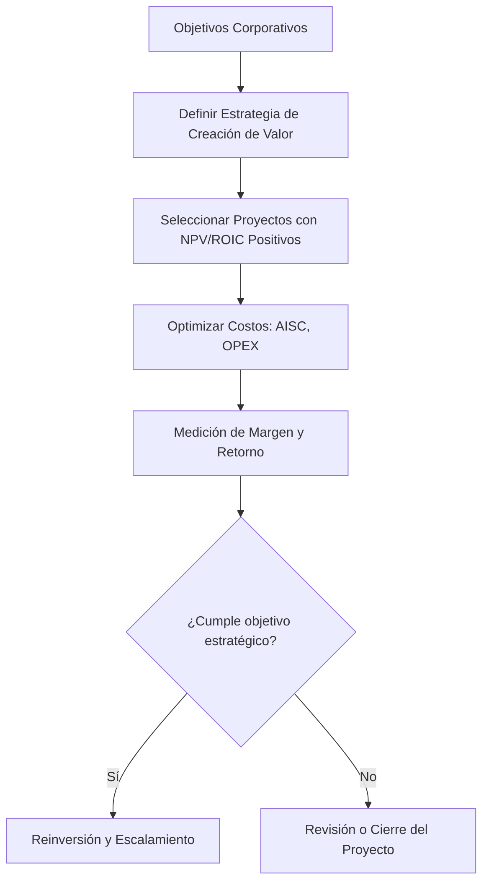

# Análisis de Rentabilidad y Margen en la Industria Minera

## Introducción Gerencial

La rentabilidad y el margen operativo en la minería no son solo indicadores financieros: son señales estratégicas del éxito de una operación minera. En un sector caracterizado por su alta intensidad de capital, ciclos de precios volátiles y relaciones complejas con comunidades, gobierno e inversores, entender cómo se genera (y mantiene) la rentabilidad es esencial para la sostenibilidad del negocio.

---

## ¿Por qué es importante?

- **Indicador de sostenibilidad:** Las operaciones con bajo margen difícilmente pueden sostener inversiones en seguridad, medio ambiente o desarrollo comunitario.
- **Atracción de capital:** Inversionistas priorizan operaciones con rendimientos consistentes y predecibles.
- **Base para decisiones estratégicas:** Proyectos no rentables en términos ajustados al riesgo deberían ser descartados desde el inicio.

---

## ¿Cómo se aplica en la práctica?

1. **Formulación de estrategia:** Un marco estratégico claro permite definir metas de retorno y márgenes deseados.
2. **Optimización del portafolio:** Mineras líderes priorizan activos con retorno sobre el capital invertido (ROIC) superior al costo de capital.
3. **Alineación operativa:** Las métricas de rentabilidad se traducen en planes tácticos y KPIs por unidad operativa.

---

## Principios y mejores prácticas

| Principio Gerencial | Aplicación en Minería |
|---------------------|------------------------|
| ROIC sobre WACC | Asegura que se crea valor económico real. |
| NPV positivo y robusto ante sensibilidad | Garantiza resiliencia ante volatilidad de precios. |
| Margen operativo > 30% | Suele indicar eficiencia operativa y resiliencia. |
| Costos All-in Sustaining Costs (AISC) | Comparación estándar entre pares. |

---

## Riesgos y errores comunes

| Riesgo | Descripción | Consecuencia |
|--------|-------------|--------------|
| Subestimar costos indirectos | Especialmente en entornos complejos o remotos | Erosión del margen |
| Ignorar impuestos o regalías locales | Impacto directo en rentabilidad neta | Decisiones erróneas de inversión |
| Evaluación con precios optimistas | Uso de escenarios no realistas | Sobrevaloración de proyectos |

---

## Diagrama: Flujo Estratégico de Rentabilidad Minera

---

## Diagrama: Cascada de Valor desde la Mina

---

## Checklist Gerencial para Evaluar Rentabilidad

| Ítem | ¿Implementado? | Observaciones |
|------|----------------|---------------|
| ¿Se evalúa ROIC trimestralmente? | [ ] | |
| ¿Existen metas mínimas de margen por operación? | [ ] | |
| ¿Se actualiza el NPV con nuevos supuestos de mercado? | [ ] | |
| ¿Se consideran costos totales (AISC) en decisiones? | [ ] | |
| ¿Está alineada la estrategia con los activos más rentables? | [ ] | |

---

## Conclusión

Para un gerente minero, entender la rentabilidad no es un ejercicio contable: es una disciplina estratégica. Requiere decisiones estructurales sobre qué minas operar, qué procesos optimizar y cómo enfrentar los ciclos del mercado. Apoyarse en métricas financieras sólidas, y revisar regularmente los supuestos estratégicos, es clave para navegar con éxito en esta industria desafiante.

