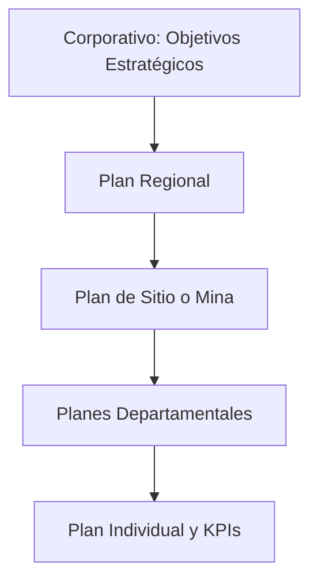

# Planificación Financiera a Corto y Largo Plazo en Minería

## Introducción Gerencial

La planificación financiera es la brújula que permite a las operaciones mineras navegar por un entorno de alta incertidumbre. Permite anticipar necesidades de capital, proyectar flujos de caja, gestionar riesgos estratégicos y garantizar que los recursos estén alineados con los objetivos del negocio.

---

## ¿Por qué es importante?

- **Alineación estratégica:** Vincula los objetivos de largo plazo con decisiones tácticas inmediatas.
- **Reducción de incertidumbre:** Provee estructura frente a mercados volátiles.
- **Sustentabilidad operativa:** Permite proyectar necesidades de mantenimiento, renovación de flota, inversiones sociales, etc.
- **Acceso a capital:** Los planes financieros sólidos inspiran confianza en inversionistas y prestamistas.

---

## ¿Cómo se aplica?

1. **Horizonte de corto plazo:** Presupuestos anuales, planes trimestrales, forecast mensual.
2. **Horizonte de largo plazo:** Plan de vida de mina (LOMP), plan estratégico de 5 a 20 años.
3. **Integración funcional:** Ingeniería, mantenimiento, RRHH y finanzas deben integrarse en la planificación.
4. **Ciclo de revisión:** Los planes se actualizan según la evolución real y cambios del entorno.

---

## Mejores prácticas y principios clave

| Principio | Corto Plazo | Largo Plazo |
|----------|-------------|-------------|
| Horizonte | 1-2 años | 5-20 años |
| Detalle | Alta granularidad | Alta incertidumbre, enfoque en escenarios |
| Herramientas | Presupuesto, forecast | LOMP, simulación, optimización multi-variable |
| Objetivo | Control y ejecución | Sostenibilidad y retorno estratégico |

---

## Riesgos comunes y cómo mitigarlos

| Riesgo | Consecuencia | Mitigación |
|--------|--------------|------------|
| Planificación en silos | Desalineación entre áreas | Integración de procesos y objetivos |
| Uso de supuestos rígidos | Planes poco realistas | Inclusión de escenarios y sensibilidad |
| Enfoque solo en producción | Desequilibrio financiero | Incluir requerimientos de capital, deuda, dividendos |

---

## Diagrama: Ciclo Integral de Planificación Financiera

```mermaid
graph TB
    A[Estrategia Corporativa] --> B[Plan de Vida de Mina (LOMP)]
    B --> C[Planes de Capital y Operación]
    C --> D[Presupuesto Anual]
    D --> E[Forecast Trimestral/Mensual]
    E --> F[Revisión de Desempeño]
    F --> G[Reajuste de Planes]
    G --> D
```

---

## Diagrama: Integración Multinivel de la Planificación



---

## Checklist Gerencial de Planificación

| Ítem | ¿Implementado? | Observaciones |
|------|----------------|---------------|
| ¿Se revisa el forecast mensualmente? | [ ] | |
| ¿El plan anual incluye sensibilidad de precios? | [ ] | |
| ¿Está alineado el presupuesto con el LOMP? | [ ] | |
| ¿Participan todas las áreas en la planificación? | [ ] | |
| ¿Se mide el cumplimiento de los planes? | [ ] | |

---

## Conclusión

La planificación financiera es más que una herramienta de control: es una capacidad estratégica. En minería, donde los horizontes son largos y los riesgos altos, los gerentes que dominan la planificación consiguen operaciones más estables, seguras y rentables.
