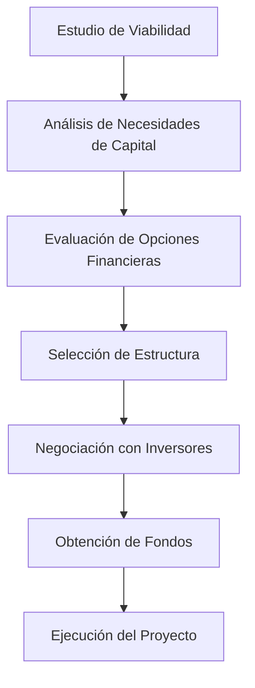

# Estrategias de Financiamiento en Proyectos Mineros

## Introducción Gerencial

Financiar proyectos mineros es una de las decisiones más críticas y complejas para la alta dirección. La estructura de financiamiento define la viabilidad del proyecto, su riesgo financiero, y su retorno a los accionistas.

---

## ¿Por qué es importante?

- **Alta intensidad de capital:** La minería requiere grandes desembolsos antes de generar ingresos.
- **Largo tiempo de maduración:** Es frecuente tener 5 a 10 años de inversión antes del primer retorno.
- **Riesgo elevado:** Geológico, ambiental, social, regulatorio y de mercado.
- **Interés del mercado financiero:** Fondos, bancos y socios buscan estructuras claras y riesgos bien distribuidos.

---

## ¿Cómo se aplica?

1. **Evaluación económica inicial (PEA, PFS, FS).**
2. **Definición de estrategia de financiamiento: deuda, equity, JV.**
3. **Negociación con stakeholders financieros.**
4. **Ejecución del financiamiento: capitalización, préstamos, emisión.**
5. **Monitoreo post-inversión.**

---

## Comparación de opciones de financiamiento

| Fuente | Ventajas | Desventajas |
|--------|----------|-------------|
| Capital (equity) | No requiere pago periódico | Dilución de participación |
| Deuda | Apalanca el capital propio | Riesgo de insolvencia |
| Joint Ventures | Comparte riesgos y capital | Menor control |
| Streaming / Royalty | Liquidez anticipada | Menor flujo neto futuro |

---

## Diagrama: Flujo Estratégico de Financiamiento

---

## Consideraciones clave para gerentes

- Costos ocultos de la deuda (comisiones, seguros, tasas flotantes).
- Riesgo de control compartido en JVs.
- Impacto fiscal y regulatorio.
- Cumplimiento de covenants financieros.
- Flexibilidad futura.

---

## Checklist de Financiamiento

| Ítem | ¿Implementado? | Observaciones |
|------|----------------|---------------|
| ¿Se evaluaron múltiples estructuras? | [ ] | |
| ¿Existe modelo financiero robusto y auditado? | [ ] | |
| ¿Están evaluados los riesgos legales y fiscales? | [ ] | |
| ¿Se alineó el modelo con la estrategia corporativa? | [ ] | |
| ¿Existe plan de monitoreo financiero post-financiamiento? | [ ] | |

---

## Conclusión

El financiamiento define el destino de un proyecto. Los gerentes deben combinar visión estratégica con comprensión técnica y financiera. Una estructura adecuada mitiga riesgos, asegura retornos y permite que los proyectos mineros prosperen.
