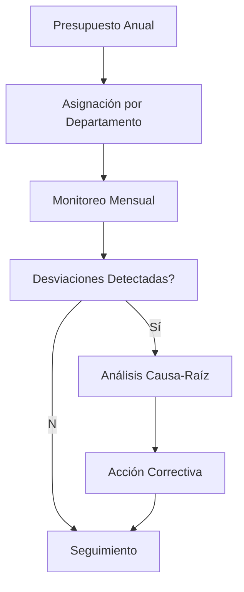

# Gestión de Costos y Control Presupuestario en Minería

## Introducción Gerencial

En minería, el control de costos no es simplemente un ejercicio de contabilidad, sino una necesidad de supervivencia. Con márgenes ajustados, precios volátiles y operaciones dispersas, los costos mal gestionados pueden erosionar rápidamente el valor de un activo.

---

## ¿Por qué es importante?

- **Rentabilidad:** Costos bajos aseguran márgenes aceptables incluso en mercados adversos.
- **Valoración de activos:** El valor presente neto (NPV) es altamente sensible al costo total.
- **Disciplina organizacional:** Promueve eficiencia, productividad y responsabilidad.

---

## ¿Cómo se aplica?

1. **Identificación y clasificación de costos (fijos, variables, directos, indirectos).**
2. **Definición de presupuestos y objetivos por centro de costo.**
3. **Monitoreo periódico de ejecución vs. presupuesto.**
4. **Análisis de desviaciones.**
5. **Acciones correctivas o preventivas.**

---

## Tipos de costos en minería

| Tipo | Ejemplos |
|------|----------|
| Fijo | Sueldos, arrendamientos |
| Variable | Combustible, reactivos |
| Directo | Acarreo, perforación |
| Indirecto | IT, administración, seguridad |

---

## Herramientas para el control presupuestario

- Sistema ERP y BI
- KPIs financieros por unidad
- Costos estándar vs. reales
- Auditorías internas
- Benchmarking de costos entre sitios

---

## Diagrama: Ciclo de Control Presupuestario

---

## Checklist Gerencial

| Ítem | ¿Implementado? | Observaciones |
|------|----------------|---------------|
| ¿Se analizan costos por unidad de producción? | [ ] | |
| ¿Existen acciones frente a desviaciones? | [ ] | |
| ¿Se revisa el presupuesto trimestralmente? | [ ] | |
| ¿Se realiza benchmarking entre operaciones? | [ ] | |
| ¿Están los supervisores alineados con metas de costos? | [ ] | |

---

## Conclusión

La gestión de costos efectiva requiere más que herramientas financieras: requiere cultura y disciplina. Los líderes que dominan el control presupuestario construyen operaciones resilientes, incluso en condiciones de mercado adversas.
